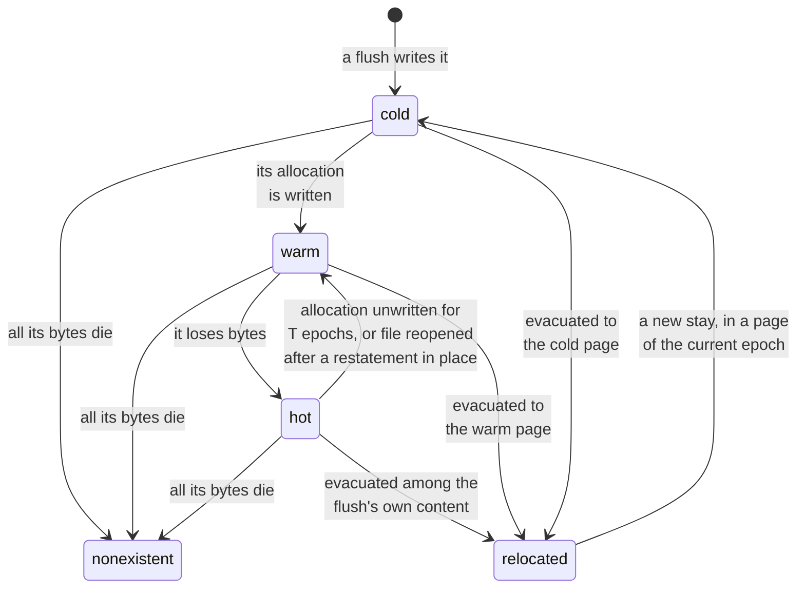

**Status: a proposal, not adopted.**
It would change where [consolidation](../impl/consolidation.md) puts the survivors of the pages it cleans, whichever policy chooses those pages: data-page scoring and the churn floor on main, or [ripeness](ripeness.md) and its [Bayesian variant](bayesian-ripeness.md).

**Sort each survivor into one of three classes by what has happened to it since its page was written, and pack each class onto pages of its own.**
A survivor is *hot* if its own chunk has lost bytes since it was placed, *warm* if not but its allocation has been written since, and *cold* if its allocation has not been written since.
The evidence is the allocation's [`last_written`](../impl/in-memory-state.md#3-the-allocation-map), which kladde already keeps and carries across sessions, and one bit per statement, set when a `Ref` loses part of its payload.
Hot survivors join the flush's own content, warm and cold ones fill pages of their own class, and within a class they keep key order.
Today, a victim's survivors move together, so a page that held cold content next to content that still dies hands both on to the same new page, and [the mixed workload](../evaluation/ripeness.md#hot-cool-and-cold-allocations-on-shared-pages) keeps nine tenths of its cold data on pages that mix classes under every policy measured.

## The problem

**Evacuation moves a victim's survivors as a unit, and nothing about them decides where they go but the victim they came from.**
A victim's survivors are taken in key order and placed one after another, into the room of a page the flush writes anyway or into a page [the budget loop](../impl/consolidation.md#the-budget-loop) opens, and a budgeted page holds the survivors of whole victims, side by side.
The ripeness draft's rule that [a budgeted page takes survivors of ripe pages, cold with cold](ripeness.md#budgeted-pages-take-survivors-of-ripe-pages), assumes that what survives a ripe page has stopped dying.

**On a page that mixed classes, what survives is cool content, which still dies, next to cold content, which never will.**
On kladde-bench's mixed workload, four allocations of 1 KiB share each page at random, a tenth of them hot, the rest cool or cold alike, and 91 % of the cold data starts on a page that mixes classes.
Once a page's hot allocation has died, its survivors are its cool and cold allocations, and cleaning moves them together.
So 88 to 90 % of the cold data still shares a page with data that changes at the end of every run, under ripeness, under [its Bayesian variant](../evaluation/bayesian-ripeness.md#what-the-posterior-calls-static), and without any cleaning at all; only main's frozen pages, as their cool content dies away, bring it down to 84 or 85 %.
Which page gets cleaned cannot change that; where each survivor goes can.

## The proposal

### Three classes

**A survivor of victim page $v$, written at epoch $E_v$, belongs to one class, by two pieces of evidence that are nested.**

| class | the survivor's chunk | its allocation | what it says |
| --- | --- | --- | --- |
| hot | has lost bytes since it was placed in $v$ | written since $E_v$ | writes are landing in this very chunk |
| warm | has not | written since $E_v$ | the allocation is in use, and its untouched part dies when the allocation is rewritten, shrunk, or freed |
| cold | has not | not written since $E_v$ | nothing has happened to it in the page's whole life |

**The more local evidence ranks hotter.**
A chunk that has lost bytes since it was placed in $v$ lost them to a write that reached its allocation after $E_v$, so every hot survivor's allocation has been written since, and the classes are nested.
The reverse does not hold: a write to the allocation may have gone to another part of it, a hot tail beside a cold head, and left this chunk alone.

**One refinement uses recency, which the chunk's evidence lacks.**
That a chunk has lost bytes says nothing about when; its allocation's age, $\text{now} - \text{last\_written}$, bounds how recently it can have.
A hot survivor whose allocation has not been written for more than $T$ epochs counts as warm, since the writes that touched it have stopped; $T$ is a constant to be chosen, and the posterior's memory $1/\beta$ of [ripeness](ripeness.md) is a natural first value.

**The classes are relative to the victim's age, not to a fixed threshold.**
"Written since $E_v$" asks whether anything happened to the allocation while it sat in this page, which is the question placement needs: content that changed less often than that is, at the scale of this page's life, cold.

### The evidence

**`last_written` exists and costs nothing new.**
The allocation map keeps it for every id, moves it whenever the application's writes reach the id, and the [consolidator state](../impl/consolidator-state.md#content-ages) carries it from one session to the next.
It measures content age, so moving a survivor does not reset it, as it does a page's epoch.
Comparing it with $E_v$ is one lookup per survivor, which evacuation does anyway to find the survivor's allocation.

**Whether a chunk has lost bytes needs one bit per statement, which the slab record can hold.**
The fragment map no longer says where a chunk ended, and the slab record holds only a statement's page and its pins; the `Ref`'s stated extent lives in the encoding in its table page, which only open decodes.
So the bit is kept as it goes, as [the Bayesian draft proposes](bayesian-ripeness.md#what-a-page-keeps-and-what-a-loss-costs), in the [statement slab's record](../impl/in-memory-state.md#2-the-statement-slab), whose 32 bits of pins leave room for it:

- **It is set** when a natural loss, the fold's or the consolidator state's own rewrite, releases bytes of a `Ref`'s fragments and leaves the statement live.
  A loss that takes the statement's last fragment kills the statement, and the bit with it.
- **Consolidation's moves do not set it**, since bytes moved out are not bytes lost.
- **A restatement in place carries it.**
  When a page rewrite, the rotating window, or the header restates a `Ref` whose bytes stay where they are, the new statement states only the live bytes, and the old extent is gone; so the bit rides on the pending entry, as [heat does](../impl/in-memory-state.md#during-a-flush), and a statement derived from several fragments takes it if any of them had it.
  A shift restates too: a statement whose bytes a splice shifted within their allocation dies whole, and its fragments are taken again at their new offsets, which carries the bit and does not set it; only the bytes the splice removes set it, on the statement that held them.
  Within one session, a chunk restated in place therefore stays hot for as long as it stays in its data page.
- **A relocation clears it.**
  A survivor that moves to a new page is a new chunk there, untouched until it loses bytes again; the class it was sorted by has already acted on it.
  So the bit describes one stay in one page, and evacuation, the only thing that reads it, ends that stay; runs that the fold merges on `defrag-shifts` are written again, and start clear as well.
- **Open rebuilds it**, since it is not persisted: open decodes every statement, so a `Ref` whose live fragments cover less than it states is set.
  Statements restated in an earlier session have lost their old extent and come back clear, which turns some hot survivors into warm ones until they lose bytes again.

**Within one stay in a page, the evidence only accumulates, and moving the chunk starts it afresh.**

A chunk starts cold, with no evidence, in every page it is written or moved into, since the flush that put it there gave the page its epoch; writes to its allocation make it warm, and losses of its own bytes hot, and a loss in a cold chunk takes both steps at once.
Only two things cool it within its page: [the refinement](#three-classes) once its allocation has gone quiet for $T$ epochs, and a reopened file, which forgets the bit of a chunk restated in place since its loss.
Restatements in place, shifts included, leave the class as it is.
Evacuation reads the class, moves the chunk to its class's page, and starts it cold there; description defragmentation's rewrites and the fold's merges relocate bytes the same way.

### Where each class goes

**Each class goes where content of its own temperature is.**

| class | where it goes | why |
| --- | --- | --- |
| hot | among the flush's own chunks, which `pack` places in key order | it is being written now, as the flush's fresh content is |
| warm | budgeted pages for warm survivors | content of allocations in use, which dies when they are rewritten, shrunk, or freed |
| cold | budgeted pages for cold survivors, together with the rotating window's description defragmentation rewrites | LFS's segregation: no hot content to wait for, and the page stays full |

**The cold page takes only where the window's rewrites go, not which descriptions are defragmented.**
The window's age filter already skips content written recently, so its rewrites are cold by selection.
The fold's half of description defragmentation, which [merges the runs a splice has just shifted](../impl/flush.md#shifted-bytes-restated-or-merged), writes hot content, and its runs stay among the flush's own chunks, where hot survivors go too; the proposal changes neither half.

**The budget loop takes its victims before `pack`, and hands their hot survivors to it.**
Today, `pack` runs first and [pulls victims into the room](../impl/consolidation.md#victims-are-pulled-one-at-a-time) of the flush's own pages, and the budget loop opens pages for more victims afterwards.
Under this proposal, the loop chooses its victims first and takes their survivors, sorting each into its class; the hot ones join the flush's own chunks, and the warm and cold ones fill pages of their own.
Victims whose survivors take at most $\theta$ of a page are left to free filling, as in [the ripeness draft](ripeness.md#the-flushs-own-pages-take-survivors-from-the-previous-flush), so that the loop does not open pages for what the room of the flush's own pages takes for nothing.
The [one survivor cut at a page boundary](../impl/consolidation.md#victims-are-pulled-one-at-a-time) that a budgeted page may take is cut within its class.

**The loop keeps one open page per class, and counts every page each class needs against the budget.**
A victim is taken only if all of its survivors fit: its hot ones in the flush's own pages, counted against the budget by their bytes, and its warm and cold ones in the open page of their class or in the next one, within the budget.
When the budget is spent or no ripe victim is left, each class's last page is checked:

- a page with at most $\theta$ of it empty closes as usual;
- a page with more than $\theta$ empty takes the other class's last page's survivors if they fit, since a small share of one class in the other's page costs little, as [the ripeness draft's mixed-page analysis](ripeness.md#what-a-mixed-page-costs) shows for shares below the content's own threshold;
- otherwise it closes short, which costs a page that is soon ripe; the loop prefers, among the ripe victims within reach, those whose survivors fill the open pages, as the current offer prefers victims that fill its page.

**Free filling sorts the survivors it takes too.**
A small victim that rides in the room of a flush's own page sends its hot and warm survivors there, and its cold ones to the cold page if the flush has opened one; if it has not, they ride along as well, as a share of at most $\theta$.
[The cursor](ripeness.md#the-flushs-own-pages-take-survivors-from-the-previous-flush), where ripeness has one, is left as it is: its page is a flush or two old, so the classes say little about its content, and it exists to match the flush's own temperature anyway.

**The rotating window's description defragmentation rewrites go to the cold page.**
They are cold by selection, and today share pages with the flush's fresh content, [an open question of the ripeness draft](ripeness.md#open-questions) that this answers.

### Within a class, key order

**Each class is packed in `(id, offset)` order, as [the flush's chunks are](../impl/consolidation.md#packing-in-id-order-with-look-ahead).**
Key order keeps the [reverse index](../impl/consolidation.md#finding-the-referrers-of-a-data-page) small and lets the cut merge fragments of one allocation that land side by side into one `Ref`.
Sorting survivors by age within a class would mix allocations further for a distinction the classes already draw.
In detail, hot survivors join `pack`'s chunks, so its look-ahead and its cuts treat them exactly as they treat the flush's own content.
Warm and cold survivors fill budgeted pages as survivors do today: in key order, a victim taken only if its survivors fit, and [one survivor cut at a page boundary](../impl/consolidation.md#victims-are-pulled-one-at-a-time) per page, made within the class, as [the budget loop above](#where-each-class-goes) says.
`pack`'s look-ahead could serve a class page as well, taking the survivor within reach that fills the page best before cutting one, and that matters more here than today, since class pages close short more often (see [below](#what-to-expect-on-kladde-svgs-drawings)).

### What it costs

- **Memory**: one bit per statement, which the slab record can spare, and one flag on the pending entry.
- **Work**: a lookup and a comparison per survivor, on top of taking it.
- **Pages that close short**: up to two per flush beyond the flush's own last page, one per budgeted class, when the budget runs out with their pages partly filled; the rules above keep them rare, but how rare is a question for measurement.
- **Statements**: an allocation whose chunks fall into different classes is split across pages, which costs a statement and a reverse-index entry per page it lands on.
  That split is the separation the proposal is after, a hot tail moved away from a cold head; allocations whose chunks share a class stay together.
- **Order of work in the flush**: the budget loop runs before `pack`, and leaves small victims to free filling, where today it takes what free filling left.

### What it gives the estimates

**A page written from one class starts with a prior that fits it.**
Under [ripeness](ripeness.md), a page's starting rate is the byte-weighted mix of its sources', and under [the Bayesian draft](bayesian-ripeness.md), its draining fraction's prior comes from its sources' draining shares.
A cold page could start at the floor rate and with its chunks static, and a warm page as draining, which is the [open question about moved content's classes](bayesian-ripeness.md#open-questions) answered from the placement side.
Neither estimate needs it, but both would learn less from the page's first losses.

### What to expect on kladde-svg's drawings

**On main's cleaning, the proposal could save at most 3 to 6 % of what kladde writes at the default churn floor, and 16 to 21 % at a floor of 0.25; its classes do tell content that dies from content that waits, but what they call cold still dies, a fifth of it at the lower floor, which is what that floor cleans a page at.**
The numbers come from a survey of [svg-bench](../evaluation/variable-size.md)'s runs on the `defrag-shifts` branch, at kladde-rs `795b3b9`, which classified every survivor that main's consolidation moved, without changing where it went, and then followed each chunk it had moved to see what became of it.
Each data page remembered the chunks `place` had put into it, so a survivor was hot if its chunk had lost bytes since, as the bit says within a session; the allocation's `last_written` against the victim's epoch told warm from cold.
The runs edit the tiger, the coat of arms of Spain, and the world map, at 60 to 100 KB, 120 to 200 KB, and 0.8 to 1 MB live, in the base, packed, and small layouts, with a journal of 4 pages, so a flush every 230 to 360 edits.
Their edits keep to one part of the drawing at a time, svg-bench's default since `795b3b9`: nine in ten pick from a window of a tenth of the drawing, which jumps every 3000 edits.
The uniform mix that earlier runs used touched nearly every shape within a flush or two, and made 38 to 52 % of the survivors hot.
The churn floor is the default, $\lambda = 1$, which takes victims at most half live, and $\lambda = 0.25$, which takes them up to four fifths live, and so gives the proposal as much moved content to work with as main's cleaning gets to.
The survey counts bytes that description defragmentation or the fold's merging took out of a chunk as lost, so it calls a few chunks hot that the bit would not.

**Most survivors are cold once the edits keep to one part of the drawing.**
At $\lambda = 1$, hot survivors are 20 to 36 % of the survivor bytes, warm ones 7 to 24 %, and cold ones 40 to 69 %; at $\lambda = 0.25$, 15 to 22, 9 to 28, and 50 to 74 %.
Young victims give the most cold survivors: at $\lambda = 1$, 57 to 90 % of what victims under 4 flushes old hold is cold, and 26 to 48 % of what victims 64 flushes and older hold, which only the world map and the coat of arms have.
Weighted by survivor bytes, victims are 4 to 6 flushes old on the tiger, 8 to 13 on the coat of arms, and 34 to 51 on the world map at $\lambda = 1$, and about half that at $\lambda = 0.25$.

**The classes sort content by how soon it dies, but cold content is not static.**
Followed from the move until its page was cleaned again or the run ended, the bytes moved in each class died at these shares, against what the flushes wrote fresh:

| churn floor | hot | warm | cold | fresh |
| --- | --- | --- | --- | --- |
| $\lambda = 1$ | 60 to 73 % | 38 to 69 % | 35 to 49 % | 46 to 61 % |
| $\lambda = 0.25$ | 38 to 52 % | 24 to 44 % | 16 to 23 % | 26 to 42 % |

In each run, hot bytes died 1.2 to 2.0 times as often as cold ones at $\lambda = 1$, and 1.7 to 3.2 times as often at $\lambda = 0.25$, so the classes predict what they should.
But a fifth of the cold bytes died even at $\lambda = 0.25$, where cleaning moved most bytes on within a few flushes, and a page that has lost a fifth of its content is what $\lambda = 0.25$ cleans.
A cold page would therefore drain more slowly than a mixed one and be cleaned less often, but it would not stay full.

**The direct gain is bounded by the cold survivors that had been moved before: 3 to 6 % of what kladde writes at $\lambda = 1$, and 16 to 21 % at $\lambda = 0.25$.**
Such a survivor sat untouched since its last move, in a page that mixed it with content that died, and is moved again for that; on a cold page that stayed full, it would have stayed put.
Of the bytes moved as cold, 44 to 61 % were moved again at $\lambda = 1$, and 74 to 81 % at $\lambda = 0.25$.
The bound assumes that their cold page never became a victim, which the deaths above make unlikely at $\lambda = 0.25$: there the proposal would save part of the 16 to 21 %, and only an implementation can tell how much.
At $\lambda = 1$, where a page is cleaned only once half of it has died, a cold page would mostly stay, but there are only 3 to 6 % of the writes to save.
Evacuation as a whole, which bounds anything placement can save, is 14 to 21 % of the writes at $\lambda = 1$ and 30 to 45 % at $\lambda = 0.25$.

**Survivors fill 1.3 to 9 pages per flush, so the classes stay apart, and the fallback makes that nearly free.**
Counting the pages a flush opens for survivors, a partial page as a whole one, but hot survivors by their bytes, since they fill the flush's own pages:

| churn floor | survivors per evacuating flush | the draft without its fallback | the draft with it | warm and cold bytes on pages of their own class |
| --- | --- | --- | --- | --- |
| $\lambda = 1$ | 1.3 to 2.7 pages | 0.54 to 0.81 pages more | 0.02 to 0.11 more | 63 to 82 % |
| $\lambda = 0.25$ | 3.4 to 9.0 pages | 0.38 to 0.64 more | 0.06 fewer to 0.05 more | 85 to 95 % |

Without the fallback, the short pages cost 2 to 9 % of what kladde writes; with it, at most 1.3 %.
The fallback is the rule of [the budget loop](#where-each-class-goes) that lets a class page with room take the other class's last page; the survey shares warm and cold remainders whenever they fit together, which is that rule with $\theta = 0$.
A class that splits an allocation costs a statement per extra piece, 1 to 5 pieces per evacuating flush at $\lambda = 1$ and 4 to 11 at $\lambda = 0.25$, under half a byte per edit.

**What the proposal could save in space is bounded by how full the data pages already are: at most 21 to 28 % of them at $\lambda = 1$, and 7 to 13 % at $\lambda = 0.25$.**
Placement cannot shrink what survives; it can only let cleaning keep data pages fuller for the same writes, so at best they end exactly full.
At $\lambda = 1$, data pages end 72 to 79 % full, and packing them exactly would save 11 to 23 % of the live pages; at $\lambda = 0.25$, they end 87 to 93 % full, and it would save 4 to 8 %.
The rest of the live pages are address-table pages, which the proposal does not touch: 7 to 54 % of them.
$\lambda = 0.25$ itself saves 15 to 21 % of the data pages over $\lambda = 1$, at 30 to 51 % more writes.

**Young victims make "cold" weak, and ripeness does not change that.**
"Not written since $E_v$" says little when $v$ is a flush or two old, and on the tiger and the coat of arms, 67 to 99 % of the survivor bytes come from victims under 16 flushes old.
That argues for a floor under the age that makes a survivor cold: cold only if its allocation has not been written since $\min(E_v, \text{now} - T')$, which keeps the relative test for old victims and borrows [the absolute threshold](#alternatives) for young ones.
The ripeness branches take victims no older than main's, as [the next section](#under-ripeness) shows, so the floor is the remedy left.

- **TODO:** consider introducing a floor under the age that makes a survivor cold; ripeness does not solve this.

#### Under ripeness

**No ripeness branch makes a better case for the proposal than main at $\lambda = 0.25$: their victims are no older, the classes predict no better, cold content dies as much, and at their most cleaning the bound is about the same, 10 to 28 % of the writes.**
The survey ran unchanged on the three ripeness branches, ported onto `defrag-shifts` and its focused edits as kladde-rs branches `ripeness-svg`, `ripeness2-svg`, and `bayesian-ripeness-svg`: one drain rate per page, a draining share fitted over a static one, and the Bayesian posterior per chunk under rule (a).
The Bayesian branch caps its empirical prior's weight at the loss events its pages have shown, as [its evaluation](../evaluation/bayesian-ripeness.md) recommends, and keeps a chunk known to drain across the restatements in place that splices cause, where it used to start a restated chunk untouched; kladde-rs' `implementation-notes.md` lists what the ports change.
Ripeness has no churn floor: a controller moves the price of space $\kappa$ until the data pages and leaves together are $\tau$ full.
The runs use the default, $\tau = 0.75$, and $\tau = 0.9$, which the leaves keep out of reach, so that the controller cleans as much as it can; that is the counterpart of $\lambda = 0.25$, at which main's data pages end about as full.

| policy | victims' age in flushes: tiger, coat of arms, world map | survivors hot / warm / cold | bytes moved as hot that died | as cold | cold survivors moved again, share of the writes |
| --- | --- | --- | --- | --- | --- |
| main, $\lambda = 1$ | 4–6, 8–13, 34–51 | 20–36 / 7–24 / 40–69 % | 60–73 % | 35–49 % | 3–6 % |
| main, $\lambda = 0.25$ | 2–3, 3–6, 15–24 | 15–22 / 9–28 / 50–74 % | 38–52 % | 16–23 % | 16–21 % |
| ripeness, $\tau = 0.75$ | 3–4, 5–8, 31–36 | 15–30 / 8–21 / 50–76 % | 38–60 % | 21–40 % | 6–16 % |
| ripeness, $\tau = 0.9$ | 3–4, 5–7, 16–21 | 13–26 / 8–25 / 54–76 % | 28–59 % | 18–25 % | 10–24 % |
| static share, $\tau = 0.75$ | 2–3, 4–7, 29–34 | 14–29 / 7–23 / 50–79 % | 37–53 % | 16–39 % | 6–18 % |
| static share, $\tau = 0.9$ | 2–3, 3–5, 15–19 | 12–20 / 8–26 / 55–78 % | 27–50 % | 15–18 % | 17–24 % |
| Bayesian, $\tau = 0.75$ | 3–4, 5–7, 32–36 | 15–30 / 8–20 / 51–74 % | 40–62 % | 19–40 % | 5–18 % |
| Bayesian, $\tau = 0.9$ | 3–4, 5–6, 14–18 | 11–25 / 8–25 / 54–77 % | 26–59 % | 15–24 % | 12–28 % |

**Ripeness takes victims no older than main's.**
At $\tau = 0.75$ they are as old as main's at $\lambda = 1$ on the world map and younger on the smaller drawings, and at $\tau = 0.9$ as young as main's at $\lambda = 0.25$.
Victims under 4 flushes old still hold the most cold survivors, 59 to 90 % of their bytes on the static-share branch at $\tau = 0.75$.
The draft's hope that ripe pages are old ones whose content has stopped dying does not hold on these drawings: ripeness judges a page by how fast it drains, not by its age, and the pages the focused edits work on drain fast and turn ripe young.

**The classes predict as well as under main, and no better.**
Hot bytes died 1.3 to 3.4 times as often as cold ones in each run, and cold bytes died 15 to 25 % at $\tau = 0.9$, as at $\lambda = 0.25$; at that much cleaning, a cold page would be cleaned again too.

**At their most cleaning, the four policies end with nearly the same data pages, so the space the proposal could save is the same small share; they differ in what they write.**
At $\tau = 0.9$, the ripeness branches end with 3 % fewer to 20 % more data pages than main at $\lambda = 0.25$, the 20 % being the packed tiger's 12 pages against 10, and write 16 % less to 34 % more.
Packing their data pages exactly would save 4 to 24 % of them, 2 to 16 % of the live pages.
At $\tau = 0.75$, they end with up to 20 % fewer data pages than main at $\lambda = 1$, and write 7 to 49 % more.

**Live pages and file sizes after the workload, in the base / packed / small layouts:**
Address-table pages pile up as nearly empty leaves for a dozen flushes and are then collected at once, under every policy, so the live pages at the end swing with where a run stops in that cycle, as on the small tiger at $\tau = 0.9$; the data pages and the mean over the run's second half are steadier.

The tiger, 60 to 100 KB live:

| policy | live pages at the end | of them data | mean live pages, second half | closed file, KB | bytes written per edit |
| --- | --- | --- | --- | --- | --- |
| main, $\lambda = 1$ | 34 / 26 / 20 | 25 / 12 / 15 | 41 / 25 / 26 | 244 / 176 / 144 | 155 / 98 / 96 |
| main, $\lambda = 0.25$ | 31 / 17 / 13 | 20 / 10 / 12 | 34 / 20 / 17 | 232 / 192 / 152 | 210 / 127 / 134 |
| ripeness, $\tau = 0.75$ | 32 / 22 / 15 | 22 / 12 / 13 | 38 / 20 / 16 | 228 / 192 / 164 | 176 / 111 / 110 |
| ripeness, $\tau = 0.9$ | 30 / 18 / 37 | 22 / 12 / 13 | 37 / 20 / 34 | 292 / 172 / 264 | 185 / 117 / 112 |
| static share, $\tau = 0.75$ | 36 / 16 / 14 | 20 / 10 / 13 | 34 / 19 / 15 | 296 / 200 / 160 | 195 / 133 / 124 |
| static share, $\tau = 0.9$ | 36 / 23 / 17 | 21 / 10 / 12 | 34 / 18 / 16 | 312 / 188 / 180 | 213 / 138 / 140 |
| Bayesian, $\tau = 0.75$ | 35 / 20 / 21 | 23 / 11 / 15 | 38 / 20 / 17 | 228 / 164 / 160 | 185 / 119 / 113 |
| Bayesian, $\tau = 0.9$ | 32 / 20 / 15 | 21 / 11 / 13 | 35 / 22 / 16 | 296 / 176 / 168 | 194 / 118 / 115 |

The coat of arms of Spain, 120 to 200 KB live:

| policy | live pages at the end | of them data | mean live pages, second half | closed file, KB | bytes written per edit |
| --- | --- | --- | --- | --- | --- |
| main, $\lambda = 1$ | 112 / 64 / 52 | 68 / 36 / 43 | 113 / 65 / 52 | 616 / 384 / 312 | 193 / 121 / 136 |
| main, $\lambda = 0.25$ | 95 / 49 / 41 | 56 / 30 / 34 | 98 / 54 / 40 | 612 / 324 / 304 | 278 / 173 / 204 |
| ripeness, $\tau = 0.75$ | 105 / 54 / 46 | 58 / 30 / 39 | 96 / 58 / 45 | 568 / 388 / 280 | 260 / 157 / 164 |
| ripeness, $\tau = 0.9$ | 94 / 51 / 40 | 59 / 31 / 37 | 96 / 54 / 44 | 600 / 336 / 328 | 268 / 162 / 172 |
| static share, $\tau = 0.75$ | 91 / 47 / 38 | 61 / 32 / 36 | 92 / 51 / 46 | 556 / 272 / 260 | 274 / 172 / 184 |
| static share, $\tau = 0.9$ | 90 / 51 / 38 | 56 / 29 / 35 | 92 / 56 / 40 | 588 / 380 / 320 | 313 / 187 / 207 |
| Bayesian, $\tau = 0.75$ | 84 / 49 / 68 | 58 / 30 / 36 | 95 / 55 / 50 | 544 / 376 / 392 | 274 / 161 / 166 |
| Bayesian, $\tau = 0.9$ | 94 / 55 / 43 | 57 / 29 / 36 | 95 / 55 / 44 | 596 / 376 / 280 | 286 / 170 / 177 |

The world map, 0.8 to 1 MB live:

| policy | live pages at the end | of them data | mean live pages, second half | closed file, KB | bytes written per edit |
| --- | --- | --- | --- | --- | --- |
| main, $\lambda = 1$ | 538 / 350 / 289 | 327 / 214 / 254 | 579 / 389 / 328 | 2512 / 1552 / 1316 | 227 / 176 / 225 |
| main, $\lambda = 0.25$ | 496 / 325 / 228 | 269 / 181 / 212 | 530 / 355 / 279 | 2220 / 1516 / 1228 | 317 / 238 / 330 |
| ripeness, $\tau = 0.75$ | 451 / 307 / 279 | 261 / 197 / 249 | 506 / 359 / 328 | 2116 / 1472 / 1332 | 308 / 213 / 241 |
| ripeness, $\tau = 0.9$ | 456 / 300 / 233 | 264 / 182 / 211 | 491 / 337 / 279 | 2136 / 1408 / 1192 | 372 / 284 / 333 |
| static share, $\tau = 0.75$ | 465 / 303 / 283 | 270 / 202 / 254 | 503 / 362 / 330 | 2120 / 1464 / 1292 | 337 / 222 / 252 |
| static share, $\tau = 0.9$ | 460 / 297 / 232 | 262 / 181 / 210 | 495 / 333 / 275 | 2084 / 1448 / 1160 | 409 / 307 / 349 |
| Bayesian, $\tau = 0.75$ | 455 / 305 / 282 | 263 / 197 / 253 | 503 / 360 / 329 | 2308 / 1460 / 1292 | 319 / 224 / 251 |
| Bayesian, $\tau = 0.9$ | 475 / 299 / 238 | 260 / 180 / 209 | 495 / 337 / 275 | 2140 / 1552 / 1212 | 413 / 319 / 340 |

**So the survey cannot rule the proposal out, and cannot promise much either.**
At the most cleaning any policy does, cold survivors moved again are 10 to 28 % of the writes, the most the proposal could save in writes, and the classes do sort content by how soon it dies.
But cold content dies 15 to 25 % before it is moved again, which is what such cleaning cleans a page at, so cold pages would be cleaned again too, and in space the proposal could gain at most 4 to 24 % of the data pages.
What an implementation would keep of the write bound is the question left, and the cheapest test is [allocation age alone](#alternatives), with the fallback, under main at $\lambda = 0.25$, which needs no ripeness branch and ends with as few data pages as any.

## Alternatives

- **Allocation age alone, two classes.**
  No new state at all: cold if the allocation has not been written since $E_v$, warm otherwise.
  It cannot tell a cold head from a hot tail in one allocation, which large allocations with skewed writes within them would show; the mixed workload's 1 KiB allocations would not.
  It is the first step to measure, since it needs nothing but the sorting.
- **Chunk evidence alone.**
  Hot if touched, cold otherwise: it misses that an allocation in use dies as a whole when it is freed or rewritten, as a log does when it rotates, and would pack a log's untouched records with cold content.
- **An absolute age threshold** in place of $E_v$: cold if the allocation has not been written for $T'$ epochs.
  It would treat survivors of young and old victims alike, but needs a constant that the victim's own age supplies for free.
- **A finer split**, by allocation age within a class or by a score that combines age and chunk evidence: more classes would separate content more finely, at the price of more open pages per flush, each of which may close short.
- **Inferring chunks from the page instead of keeping a bit.**
  Two live fragments of one allocation in the victim at the same displacement, the page offset less the allocation offset, were placed together, and the dead bytes between them were that allocation's: the chunk has lost its middle.
  This needs no state and survives restatements, but it misses a chunk that lost its head or tail, and the page itself does not help further, since data pages record no chunk boundaries.
  It could complement the bit after open, for statements restated in an earlier session.
- **Hot survivors on a page of their own, or with the warm ones**, which would keep the budget loop after `pack` as it is today.
  Hot survivors on ripe pages are likely few, since a ripe page's content has mostly stopped dying, so a page of their own would mostly close short; sharing the warm page costs a little mixing and saves reordering the flush.
  If measurement shows them rare, this is the simpler choice.
- **Sorting the flush's own content too.**
  The flush packs its fresh chunks in key order, which mixes allocations the application keeps rewriting with ones it has just created, [the largest source of mixed pages the ripeness draft leaves in place](ripeness.md#open-questions).
  An allocation's `last_written` before this flush's write would tell the two apart in the same way, at the price of key order among the flush's own pages; it is a separate decision from this one.

## What would change

- [Consolidation](../impl/consolidation.md): the budget loop would choose its victims before `pack`, keep an open page per class, and leave small victims to free filling; free filling would sort the survivors it takes; description defragmentation's rewrites would go to the cold page.
- [In-memory state](../impl/in-memory-state.md): the statement slab's record would gain the bit, and the pending entry a flag carried through restatements.
- [Opening a file](../impl/address-table-operations.md#opening-a-file) would set the bit for every `Ref` whose live fragments cover less than it states.
- The [ripeness draft](ripeness.md#where-survivors-go) would split "survivors of ripe pages" in its table by class, and its starting estimates could take the class into account.

## Open questions

- **$T$**, after which a hot survivor whose allocation has gone quiet counts as warm, and whether it is needed at all.
- **How often class pages close short**, and whether the loop's preference for victims that fill them is enough at small budgets.
- **Whether the gain survives the cost.**
  Cold pages that stay full are cleaned less often, but every allocation split across classes costs statements, and the order of work in the flush changes; the mixed workload, with allocation age alone and then with the bit, measures both.
