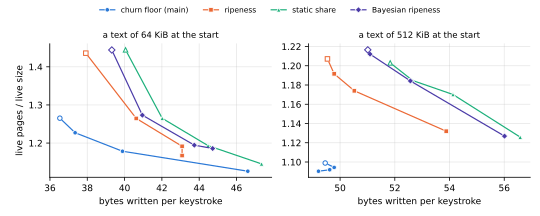
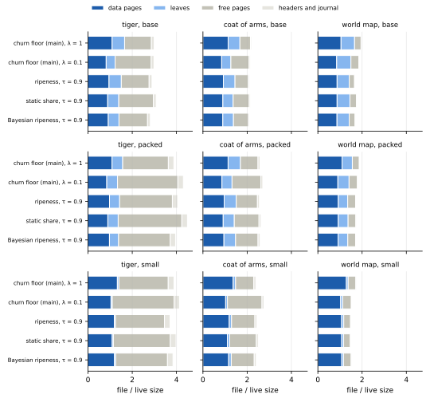

## Executive summary

**Cleaning until its live pages are about nine tenths full, kladde keeps the live pages of an edited drawing at 1.12 to 1.35 times its live size and of a typed text at 1.10 to 1.19 times; at main's default settings they take 1.34 to 1.56 times the live size on the drawings, and 1.09 and 1.25 times on the texts.**
Four cleaning policies ran on kladde-svg's three drawings, in three layouts, under a drawing editor's edits that keep to one part of the drawing at a time, and on texts of 64 and 512 KiB, typed into keystroke by keystroke.
In the regime this page dwells on, main's churn floor runs at λ = 0.25, which fills the drawings' live pages 89 to 92 % full.
Cleaning by ripeness, with a static share, and by Bayesian ripeness each aim at a target fill of 0.9, which they reach on the world map and fall short of on the tiger and the coat of arms, at 80 to 90 %.
The churn floor at λ = 0.1 fills the drawings' live pages fullest, 91 to 97 %, at 1.08 to 1.19 times the live size.

**Main's churn floor lies lowest on every workload, or within 0.7 % of the lowest.**
At equal writes, the ripeness branches keep 0.3 to 15 % more live pages than the churn floor in the drawings' base and packed layouts, between 0.7 % fewer and 8 % more in the small layout, and 2 to 22 % more on the texts.
The churn floor also reaches further: at λ = 0.1 it keeps 1.08 to 1.19 times the drawings' live size, where the best setting of any ripeness branch stops at 1.10 to 1.26.
In the regime, the ripeness branches keep 1 to 12 % more live pages than the churn floor at λ = 0.25, with between 19 % fewer and 10 % more writes.

**The ripeness branches give up the cleaning that costs nothing.**
Main's free filling takes any victim that fits into the room of the pages a flush writes anyway: at λ = 1, 54 to 919 per run, half to four times as many as the pages it opens to clean, 14 to 1,673.
The ripeness branches measured here take only small, ripe victims there, 0 to 116 per run at τ = 0.9, and open 117 to 4,809 pages instead.
With main's free filling instead, [the ripeness branches](ripeness-free-filling.md) close a third of their gap to the churn floor in the drawings' base and packed layouts, two thirds in the small layout, and none of it on the texts.

**The leaves fill about as much as the data pages under the churn floor, and a few points less under the ripeness branches.**
In the drawings' base and packed layouts, the address table's statements are 19 to 27 % of the live bytes, and the leaves that hold them 20 to 29 % of the live pages.
At λ = 0.25, the leaves come out 88 to 90 % full, against data pages 89 to 93 % full, since the churn floor prices a leaf as it prices a data page; under the ripeness branches at τ = 0.9, they come out 79 to 86 % full, against data pages 82 to 93 %.
Leaves as full as the data pages would save at most 3.5 % of the live pages.
In the drawings' small layout and on the texts, the leaves are 3 to 7 % of the live pages, and their fill matters little.

**Free pages make up much of the smaller files, and cleaning harder adds to them.**
During the edits, the tiger's files hold 23 to 47 free pages beside 13 to 34 live ones, and the coat of arms' 26 to 71 beside 35 to 95; the texts' free pages are 20 to 30 % of the file at 64 KiB and 11 to 12 % at 512 KiB.
Closed, the tiger's files take 2.4 to 5.1 times its edited SVG, the coat of arms' 1.5 to 3.0 times, the world map's 1.07 to 1.9 times, and the texts' 1.24 to 1.71 times the typed text.
From λ = 1 to λ = 0.1, the drawings' files gain 3 to 41 free pages while they lose 3 to 99 live ones, and the closed files come out between 16 % smaller and 24 % larger.

**Filling the pages costs 1.2 to 1.9 times the writes of main's default on the drawings, and up to 1.2 times on the texts, which is still a fraction of saving the file.**
In the regime, an edit writes 118 to 432 bytes, against 96 to 233 at main's default, and a keystroke 40.5 to 54.2, against 36.8 and 49.9.
Saving the canonical SVG every 100 edits would write 590 bytes per edit on the tiger, 1,845 on the coat of arms, and 10,699 on the world map, and saving the text every 1000 keystrokes 241 and 700 bytes per keystroke.
On the drawings, the journal and the headers take 48 to 83 bytes per edit under every policy, and cleaning decides the rest; on the texts, the journal, the headers, and the leaves that splices fill with restated statements take 31 to 47 bytes of each keystroke's writes, and the data pages 5 to 13.

**Edits and keystrokes stay fast, and flushes short: in the regime, kladde's calls take 22,000 to 108,000 edits per second on the drawings, against 37,000 to 119,000 at main's default, and 936,000 to 1,016,000 keystrokes per second on the texts; the median flush takes 3.2 to 10.6 ms on the drawings and 6.8 to 10.8 ms on the texts.**
On the drawings, the regime costs up to 42 % of the edit rate, the least under single-rate ripeness, up to 17 %; on the world map, the static share's and the Bayesian posterior's flushes take 1.2 to 1.7 times as long as single-rate ripeness's.
Reopening an edited file takes 0.7 to 18 ms.

## What was measured

**kladde-svg's `svg-bench` edits an SVG drawing stored in kladde as a drawing editor would, recording a row in [kladde-bench's](consolidation.md#what-was-measured) format every 1000 edits.**
Its mix: 30 % drags, which set a shape's translation; 20 % node moves, 8 % node insertions and 7 % node deletions in a path's data; 15 % recolours; 8 % duplications and 7 % deletions of a shape; and 5 % restacks, which move a shape among its siblings.
Nine edits in ten go to a window of a tenth of what they pick from, the shapes, the paths, or the elements without children, at the same place in each, and the window jumps elsewhere every 3000 edits, so that the edits keep to one part of the drawing at a time, as a person's do.
This is `svg-bench`'s default since kladde-rs `e88fd47`.

**The drawings are the Ghostscript tiger, the coat of arms of Spain, and a blank world map**, each edited as many times as it took an earlier, uniform mix to store eight times the drawing's live size in the base layout:

| drawing | edits | canonical SVG, before → after the edits | live size during the edits: base / packed / small |
| --- | --- | --- | --- |
| tiger | 31,613 | 66,850 → 59,005 bytes | 92 / 47 / 46 KiB |
| coat of arms | 41,130 | 163,768 → 184,541 bytes | 252 / 131 / 128 KiB |
| world map | 177,831 | 1,005,908 → 1,069,891 bytes | 1,353 / 954 / 943 KiB |

Every run makes the same edits, whatever the branch, layout, or setting.
The *live size* is the bytes of the drawing's allocations, and the *canonical SVG* what kladde-svg writes, without whitespace between tags and with path data in the grammar's shortcuts; the edits leave the coat of arms and the world map larger, and the tiger smaller.

**The layouts are cargo features of kladde-svg that choose the model's containers**: *base* stores every list as a vector of fixed slots, *packed* packs the lists of enums, children, transforms, attributes and path data, and *small* also keeps short lists and strings inline in their parent.
The small layout keeps most of a drawing's content in a few large allocations, so that its address table is small.

**kladde-bench's `text-bench` types into one text, stored in a single allocation of the store, keystroke by keystroke at a cursor, as a text editor would, recording a row every 1000 keystrokes**; [Benchmarks and tests](tools.md#text-bench-typing-into-one-text) describes it.
Of its 100,000 keystrokes, 85 % type a letter, 10 % delete the one before the cursor, 4.5 % move the cursor, nine moves in ten within a window of a tenth of the text that jumps every 5000 keystrokes, and 0.5 % paste 200 letters; every keystroke that changes the text is a splice, which the flush states by restating the statements behind it.
It ran on texts of 64 and 512 KiB of random words, which the typing grows to 241,322 and 700,340 bytes; their live size averaged 193 and 642 KiB over the second half.

**The store flushes whenever the journal outgrows four pages**, `Options::journal_budget_pages = 4`, and at every row: on the drawings every 230 to 372 edits on average, on the texts every 1000 keystrokes, the journal never filling between rows; otherwise it runs with its defaults.

**Four branches of kladde-rs ran, each with the [newest size rule](../superseded/allocations.md#what-it-was):**

| branch | commit | policy | knob, default | settings run |
| --- | --- | --- | --- | --- |
| `defrag-shifts` | `7eb2ec4` | main's [churn floor](../impl/consolidation.md#the-churn-floor-is-a-parameter-not-an-identity) | churn floor λ, 1 | 1, 0.5, 0.35, 0.25, 0.15, 0.1 |
| `ripeness-svg` | `d3b3a7e` | [cleaning by ripeness](../drafts/ripeness.md), one rate per page | target fill τ, 0.75 | 0.75, 0.85, 0.9, 0.95 |
| `ripeness2-svg` | `f659de7` | ripeness with a static share per page | target fill τ, 0.75 | as above |
| `bayesian-ripeness-svg` | `65d041a` | [Bayesian ripeness](../drafts/bayesian-ripeness.md), rule (a), with the empirical prior capped at the events it has seen | target fill τ, 0.75 | as above |

The three ripeness branches are ports, onto `defrag-shifts`, of the branches that [Cleaning by ripeness](ripeness.md), [Ripeness with a static share](ripeness2.md), and [Bayesian ripeness](bayesian-ripeness.md) measured on kladde-bench's workloads.
On every branch, a budgeted rewrite of leaves opens no page of its own and costs the budget the pages its restatements take, which [the page rewrite](../impl/consolidation.md#the-page-rewrite) estimates at the leaves' coverage; on main, the churn floor weighs a leaf by the same estimate, as [the budget loop](../impl/consolidation.md#the-budget-loop) has it.
`text-bench` came from kladde-rs `7c5cdd6`, on the branch `text-bench`, and was added to each of these commits with `git cherry-pick`, without its `--churn-floor` option on the ripeness branches, whose store lacks it.

Main's budget controller aims the file at a target fill of 0.8, measured over all of its pages, free ones included.
Over the second half of every run but those on the 512 KiB text, it held the budget at its maximum, 256 pages, but for a row or two in four runs on the world map, where it dipped to 196 pages at the lowest, so that the churn floor alone decided what was cleaned; on the world map, whose file starts out fuller than the target, it held the budget lower during parts of the first half.
On the 512 KiB text, the file passed the target after about 11,000 keystrokes, the controller had cut the budget to its minimum, one page, by 39,000 to 42,000, and every λ cleaned about alike.
The ripeness branches' controller moves the price of space until the data pages and leaves are as full as the target.

**The regime this page dwells on is live pages about nine tenths full**: λ = 0.25 for the churn floor, and τ = 0.9 for the ripeness branches, whose results at 0.85, 0.9, and 0.95 hardly differ on the tiger and the coat of arms.
Main's default, λ = 1, is the reference, and λ = 0.1, which fills the pages most, the churn floor's furthest reach; the [sweep](#the-sweep-in-numbers) has every setting.
The tables name the churn floor by its λ, and the three ripeness branches, each at τ = 0.9, by their estimate: *ripeness*, *static share*, and *Bayesian*.

**Space is averaged over the second half of each run, and writes are what kladde wrote during that half, per edit or keystroke**, as on the other evaluation pages.
*Live pages* are the data pages and the leaves, the latter with the interior pages of the address table, but without the header and the journal.
*Fill* is the live bytes in a page over the 4,081 bytes it can hold: for a data page the bytes that fragments resolve to, for a leaf its statements' framing and inline payloads.
*Free pages* are pages within the file that hold nothing live; the *closed file* is the file's size after the last edit and `close`, which truncates it after its last live page.
Writes count the journal's bytes and every page written, headers included, at 4,096 bytes each.

**The space and the writes come from 198 runs, eight at a time, 162 of `svg-bench` and 36 of `text-bench`; the times from two further passes, one run at a time on an otherwise idle host, of the six configurations in the tables on the drawings and of every setting on the texts.**
All were built with `--release` by Rust 1.99.0 and ran on an Intel Core i7-1165G7, four cores and eight threads, with 16 GB of memory under Linux 7.0, in a development container, on mains power.
The benchmarks are deterministic but for their times, and both timing passes reproduced the first runs' tables to the byte; the [times](#times) give their mean, and how far the two passes differed.
`data/cleaning-edits/` keeps every run's table, `logs/` beside them the end of each run's output, with the closed file's size, and `timing/` and `timing2/` that of the two timing passes, with the texts' tables, from which their keystroke rates come.

To reproduce a run, build `svg-bench` on the branch's commit, with `--features packed` or `--features small` for those layouts, and run it on the drawing with its number of edits, or add `text-bench` and run it on a text of the size:

```sh
git cherry-pick --no-commit 7c5cdd6   # text-bench; drop --churn-floor on the ripeness branches
cargo build --release -p kladde-svg --bin svg-bench --features packed
# --target-fill 0.9 instead of --churn-floor 0.25 on the ripeness branches
target/release/svg-bench crates/kladde-svg/corpus/drawings/world-map.svg \
    out/ --edits 177831 --journal-budget 4 --churn-floor 0.25
cargo build --release -p kladde-bench --bin text-bench
target/release/text-bench out/ --size 524288 --journal-budget 4 --churn-floor 0.25
```

The figures come from the tables in `data/`; each run's directory is named `<policy>-<knob><value>-<layout>`, with `text` for the layout of the texts' runs, and `tools/plot-evaluation.py` takes it labelled `<policy>/<knob>/<value>/<layout>`:

```sh
D=content/evaluation/data/cleaning-edits; F=content/evaluation/figures/cleaning-edits
runs=()
for dir in $D/*-*-*/; do
    IFS=- read -r p k l <<< "$(basename $dir)"; knob=${k%%[0-9]*}
    runs+=("$p/$knob/${k#$knob}/$l=$dir")
done
tools/plot-evaluation.py --only svg-tradeoff,text-tradeoff --out $F "${runs[@]}"
tools/plot-evaluation.py --only svg-pages --out $F $(printf '%s\n' "${runs[@]}" |
    grep -E '^(main/lambda/(1|0.25|0.1)|[a-z0-9]+/tau/0.9)/')
```

## Live pages

**On the drawings, the regime takes 9 to 21 % of main's live pages at its default away, most of them data pages; on the 64 KiB text, 5 to 6 %, while on the 512 KiB text, which main's default already keeps 95 % full, the churn floor at λ = 0.25 keeps as many and the ripeness branches 7 to 8 % more.**
Each cell gives the live pages, and in parentheses the leaves among them; the first column gives the live bytes they hold, in data pages and in leaves, which differ by at most 1.4 % between the policies:

| workload | layout or size | live bytes, KiB | λ = 1 | λ = 0.25 | λ = 0.1 | ripeness | static share | Bayesian |
| --- | --- | --- | --- | --- | --- | --- | --- | --- |
| tiger | base | 72 + 26 | 34.2 (8.8) | 26.9 (7.1) | 25.8 (6.9) | 30.1 (8.2) | 28.4 (8.2) | 29.3 (8.0) |
| tiger | packed | 37 + 14 | 18.0 (4.6) | 14.4 (4.0) | 14.1 (4.0) | 15.8 (4.4) | 14.9 (4.4) | 15.9 (4.4) |
| tiger | small | 45 + 1 | 16.1 (0.5) | 13.1 (0.5) | 12.7 (0.5) | 14.3 (0.5) | 13.2 (0.5) | 14.6 (0.6) |
| coat of arms | base | 203 + 67 | 94.8 (23.7) | 75.2 (18.8) | 71.0 (17.7) | 78.2 (20.3) | 76.6 (20.5) | 77.1 (20.0) |
| coat of arms | packed | 107 + 38 | 51.0 (13.6) | 40.6 (10.8) | 38.3 (10.1) | 43.2 (11.9) | 40.9 (11.5) | 42.0 (11.0) |
| coat of arms | small | 127 + 7 | 45.8 (2.1) | 37.1 (2.0) | 35.0 (2.0) | 40.3 (2.6) | 37.5 (2.8) | 40.8 (2.8) |
| world map | base | 1,110 + 345 | 478.8 (123.6) | 398.6 (96.6) | 379.4 (91.6) | 408.0 (106.3) | 409.8 (106.1) | 409.2 (107.1) |
| world map | packed | 834 + 202 | 333.2 (72.6) | 282.2 (57.0) | 269.3 (53.8) | 290.0 (63.3) | 291.3 (63.5) | 290.8 (62.6) |
| world map | small | 937 + 36 | 314.1 (12.0) | 264.6 (10.6) | 253.8 (11.1) | 273.1 (15.1) | 274.1 (17.1) | 273.7 (14.3) |
| text | 64 KiB | 192 + 13 | 60.4 (3.8) | 56.9 (3.8) | 54.3 (3.7) | 57.4 (3.9) | 57.5 (4.1) | 57.3 (3.8) |
| text | 512 KiB | 640 + 28 | 175.7 (7.6) | 176.5 (7.6) | 175.2 (7.6) | 188.5 (10.7) | 187.9 (11.3) | 189.9 (10.6) |

Over the live size, which the first column gives here, the same live pages:

| workload | layout or size | live size, KiB | λ = 1 | λ = 0.25 | λ = 0.1 | ripeness | static share | Bayesian |
| --- | --- | --- | --- | --- | --- | --- | --- | --- |
| tiger | base | 92 | 1.49 | 1.17 | 1.12 | 1.31 | 1.24 | 1.28 |
| tiger | packed | 47 | 1.52 | 1.22 | 1.19 | 1.33 | 1.26 | 1.35 |
| tiger | small | 46 | 1.39 | 1.12 | 1.09 | 1.23 | 1.14 | 1.26 |
| coat of arms | base | 252 | 1.50 | 1.19 | 1.13 | 1.24 | 1.22 | 1.22 |
| coat of arms | packed | 131 | 1.56 | 1.24 | 1.17 | 1.32 | 1.25 | 1.29 |
| coat of arms | small | 128 | 1.43 | 1.16 | 1.09 | 1.26 | 1.17 | 1.27 |
| world map | base | 1,353 | 1.42 | 1.18 | 1.12 | 1.21 | 1.21 | 1.21 |
| world map | packed | 954 | 1.40 | 1.18 | 1.13 | 1.22 | 1.22 | 1.22 |
| world map | small | 943 | 1.34 | 1.12 | 1.08 | 1.16 | 1.16 | 1.16 |
| text | 64 KiB | 193 | 1.25 | 1.18 | 1.13 | 1.19 | 1.19 | 1.19 |
| text | 512 KiB | 642 | 1.09 | 1.10 | 1.09 | 1.17 | 1.17 | 1.18 |

The live bytes exceed the live size in the drawings' base and packed layouts, since the statements that describe the allocations are live too.

**The churn floor fills the drawings' data pages 89 to 93 % full at λ = 0.25 and 93 to 97 % at λ = 0.1; the ripeness branches at τ = 0.9 fill them 82 to 93 % full.**
Each cell gives the fill of the data pages, of the leaves, and of all live pages, in percent:

| workload | layout or size | λ = 1 | λ = 0.25 | λ = 0.1 | ripeness | static share | Bayesian |
| --- | --- | --- | --- | --- | --- | --- | --- |
| tiger | base | 71 / 74 / 71 | 91 / 90 / 91 | 96 / 93 / 95 | 83 / 79 / 82 | 90 / 79 / 87 | 85 / 81 / 84 |
| tiger | packed | 70 / 75 / 71 | 89 / 88 / 89 | 93 / 86 / 91 | 82 / 80 / 81 | 90 / 79 / 87 | 82 / 80 / 81 |
| tiger | small | 73 / 28 / 72 | 91 / 33 / 89 | 94 / 35 / 91 | 83 / 28 / 81 | 90 / 29 / 88 | 82 / 32 / 80 |
| coat of arms | base | 72 / 71 / 72 | 90 / 89 / 90 | 96 / 94 / 95 | 89 / 83 / 87 | 92 / 82 / 89 | 90 / 84 / 88 |
| coat of arms | packed | 72 / 71 / 72 | 90 / 89 / 90 | 96 / 93 / 95 | 86 / 81 / 85 | 92 / 83 / 90 | 88 / 86 / 87 |
| coat of arms | small | 73 / 80 / 73 | 91 / 81 / 90 | 97 / 85 / 96 | 85 / 64 / 84 | 92 / 65 / 90 | 84 / 63 / 83 |
| world map | base | 78 / 70 / 76 | 92 / 89 / 92 | 97 / 95 / 96 | 93 / 83 / 90 | 92 / 83 / 90 | 93 / 82 / 90 |
| world map | packed | 80 / 70 / 78 | 93 / 89 / 92 | 97 / 95 / 97 | 93 / 81 / 90 | 93 / 80 / 90 | 92 / 81 / 90 |
| world map | small | 78 / 76 / 78 | 93 / 91 / 92 | 97 / 94 / 97 | 91 / 66 / 90 | 92 / 59 / 90 | 91 / 70 / 90 |
| text | 64 KiB | 85 / 87 / 85 | 91 / 87 / 90 | 95 / 88 / 95 | 90 / 81 / 90 | 91 / 74 / 89 | 90 / 84 / 90 |
| text | 512 KiB | 96 / 93 / 95 | 95 / 93 / 95 | 96 / 94 / 96 | 90 / 65 / 89 | 91 / 61 / 89 | 90 / 65 / 88 |

**On the world map, the ripeness branches reach their target, their live pages 90 % full at τ = 0.9 in every layout; on the tiger and the coat of arms, single-rate ripeness and the Bayesian posterior stop at 80 to 88 %, and the static share at 87 to 90 %.**
Their controller raises the price of space as long as the pages are emptier than the target, but on the smaller files no price makes it clean the pages that the churn floor cleans, and the targets 0.85, 0.9, and 0.95 end within a few points of each other.
Of the three, single-rate ripeness writes least, and on the world map it fills the pages as full as the other two.

**What the ripeness branches do not take is free cleaning.**
[Free filling](../impl/consolidation.md#victims-are-pulled-one-at-a-time) puts victims into the room left in the pages a flush writes anyway, which costs no page of its own.
Main takes any whole victim that fits there, sparsest first; the ripeness branches measured here take only ripe victims whose survivors fill at most θ, 5 %, of a page, and then the survivors of a cursor through the previous flush's least-filled page, so that survivors, cold by selection, do not settle next to fresh content, as [the ripeness draft](../drafts/ripeness.md#the-flushs-own-pages-take-what-costs-nothing) proposed before it took main's free filling.
So the ripeness branches clean nearly everything on pages they open for it.
Each cell gives, over a whole run, the data victims that free filling took, the data pages opened only to take victims, and the leaves rewritten, by the budget or by the cut's fillers:

| workload | layout or size | λ = 1 | λ = 0.25 | λ = 0.1 | ripeness | static share | Bayesian |
| --- | --- | --- | --- | --- | --- | --- | --- |
| tiger | base | 112 / 145 / 219 | 66 / 545 / 411 | 78 / 923 / 601 | 7 / 340 / 292 | 5 / 524 / 310 | 6 / 395 / 324 |
| tiger | packed | 90 / 64 / 118 | 56 / 301 / 200 | 51 / 482 / 275 | 8 / 196 / 168 | 1 / 336 / 168 | 0 / 213 / 175 |
| tiger | small | 97 / 120 / 61 | 66 / 413 / 65 | 59 / 664 / 63 | 8 / 241 / 61 | 5 / 415 / 61 | 7 / 245 / 64 |
| coat of arms | base | 215 / 226 / 388 | 131 / 1,045 / 858 | 100 / 2,282 / 1,569 | 9 / 847 / 645 | 11 / 1,155 / 660 | 15 / 1,004 / 737 |
| coat of arms | packed | 123 / 145 / 223 | 90 / 604 / 460 | 84 / 1,186 / 748 | 13 / 433 / 348 | 13 / 701 / 390 | 20 / 495 / 443 |
| coat of arms | small | 147 / 225 / 202 | 98 / 883 / 249 | 77 / 1,589 / 255 | 11 / 536 / 219 | 10 / 931 / 229 | 6 / 552 / 208 |
| world map | base | 919 / 1,194 / 3,002 | 673 / 4,729 / 6,522 | 646 / 10,636 / 12,451 | 72 / 4,405 / 5,112 | 88 / 4,630 / 5,657 | 96 / 4,720 / 5,256 |
| world map | packed | 795 / 817 / 1,792 | 573 / 3,130 / 3,867 | 523 / 7,691 / 7,993 | 50 / 3,102 / 2,865 | 97 / 3,269 / 3,050 | 60 / 3,173 / 3,018 |
| world map | small | 774 / 1,673 / 2,400 | 571 / 5,996 / 4,157 | 515 / 12,072 / 5,903 | 76 / 4,406 / 2,435 | 116 / 4,809 / 2,380 | 87 / 4,357 / 2,870 |
| text | 64 KiB | 54 / 14 / 157 | 50 / 69 / 161 | 45 / 210 / 162 | 8 / 117 / 127 | 8 / 148 / 119 | 4 / 133 / 134 |
| text | 512 KiB | 63 / 90 / 174 | 57 / 101 / 190 | 61 / 110 / 186 | 6 / 137 / 22 | 9 / 178 / 8 | 6 / 146 / 29 |

At λ = 1, main takes half to four times as many victims free as it opens pages for; the ripeness branches at τ = 0.9 take 0 to 16 % as many free as main does at λ = 1.
That count leaves out the pages the cursor empties, a whole statement at a time, in the room that small ripe victims leave.
[Ripeness with main's free filling](ripeness-free-filling.md) gives the ripeness branches main's free filling, which takes about one victim per flush on the drawings, as main's does: they write 2 to 3 % less at the same target, and close a third to two thirds of their gap to the churn floor on the drawings, and none of it on the texts.

## Leaves

**Under the churn floor, the leaves of the drawings' base and packed layouts fill about as much as the data pages: 70 to 75 % at λ = 1, 88 to 90 % at λ = 0.25 and 86 to 95 % at λ = 0.1, where the data pages are 70 to 80 %, 89 to 93 % and 93 to 97 % full.**
The churn floor prices a leaf as it prices a data page: rewriting it reclaims the page less what the leaf's statements take restated, and writes those, which the page rewrite estimates at the leaf's coverage, so that a leaf is a victim up to the same fill as a data page.
In those layouts, the statements are 19 to 27 % of the live bytes and the leaves 20 to 29 % of the live pages, so their fill matters; leaves as full as the data pages would save at most 2.8 % of the live pages under the churn floor.

**Under the ripeness branches, the leaves stay a few points emptier than the data pages: at τ = 0.9, 79 to 86 % full, against 82 to 93 %, and leaves as full as the data pages would save at most 3.5 % of the live pages.**
They charge a rewrite of leaves to the budget by the same estimate as main, but rank leaves by their ripeness; this page has not traced what keeps them emptier.

**Where the leaves hold little, their fill matters little.**
In the drawings' small layout, the statements are 1 to 5 % of the live bytes and the leaves 3 to 7 % of the live pages, and on the texts 4 to 6 % and 4 to 7 %.
On the 512 KiB text, the ripeness branches' leaves stay 61 to 65 % full; they rewrite 8 to 29 leaves over a whole run, and this page has not traced why so few.

## The trade-off between space and writes

**Each policy trades writes for space along its own curve, and the churn floor's lies lowest on every workload, or within 0.7 % of the lowest.**
The curves run through each policy's settings, from the one that cleans least, hollow, to the one that cleans most:



- **On the texts, the churn floor lies lowest at every setting.**
  On the 64 KiB text, the ripeness branches keep 2 to 22 % more live pages at equal writes.
  On the 512 KiB text, every λ keeps 1.09 to 1.10 times the live size at 50 to 52 bytes per keystroke, since the controller holds the budget at one page; the ripeness branches keep 7 to 12 % more live pages at those writes, and come within 4 % of it only at τ = 0.95, with 53.5 to 56.3 bytes per keystroke.
- **The ripeness branches' default target, 0.75, cleans less than main's default on the texts and the world map, and more on the smaller drawings.**
  It keeps 1.44 and 1.45 times the 64 KiB text's live size, where main's default keeps 1.25, and 2 to 5 % more live pages than main's default on the world map; on the tiger and the coat of arms, it keeps 2 to 6 % fewer, for 8 to 24 % more writes.

Each drawing takes a row, whose panels share their range of live pages:


- **In the drawings' base and packed layouts, the ripeness branches keep 0.3 to 15 % more live pages than the churn floor at equal writes**, the most at τ = 0.75, and the least at their fuller targets on the world map, where single-rate ripeness at τ = 0.95 comes within 0.3 %.
- **In the small layout, the curves come closest**: the ripeness branches keep 1 to 8 % more live pages than the churn floor at equal writes on the tiger and the coat of arms, and on the world map between 0.7 % fewer, single-rate ripeness at τ = 0.95, and 8 % more.
- **On the tiger and the coat of arms, the ripeness branches' curves bunch once their target passes 0.85**: each branch's settings from 0.85 up lie within 0.07 of each other in live pages over live size, at 1.14 to 1.35 times the live size.
  On the world map, each step of the target still takes live pages off, down to 1.10 to 1.17 times the live size at τ = 0.95.
- **The churn floor reaches further**: at λ = 0.1 it keeps 1.08 to 1.19 times the drawings' live size, for 168 to 731 bytes per edit, where the best setting of any ripeness branch stops at 1.10 to 1.26.

The equal-write comparisons interpolate the churn floor's curve between its settings, at every setting of the ripeness branches whose writes lie within it.

## Files

**Free pages take 14 to 69 % of the drawings' files during the edits, and on the tiger more pages than the live ones under every policy but main's default in the base layout; of the texts' files, they take 11 to 30 %.**
Each bar is a drawing's file averaged over the second half of the edits, in multiples of the live size:



Each cell gives the file's pages during the edits, and in parentheses the free ones among them:

| workload | layout or size | λ = 1 | λ = 0.25 | λ = 0.1 | ripeness | static share | Bayesian |
| --- | --- | --- | --- | --- | --- | --- | --- |
| tiger | base | 64 (27) | 69 (39) | 76 (47) | 67 (34) | 70 (38) | 69 (36) |
| tiger | packed | 44 (23) | 46 (29) | 52 (35) | 46 (28) | 51 (33) | 50 (31) |
| tiger | small | 45 (26) | 44 (28) | 49 (34) | 45 (27) | 47 (31) | 43 (26) |
| coat of arms | base | 127 (29) | 125 (47) | 144 (71) | 125 (44) | 128 (48) | 124 (44) |
| coat of arms | packed | 80 (26) | 83 (39) | 94 (53) | 80 (33) | 86 (43) | 84 (39) |
| coat of arms | small | 78 (29) | 79 (39) | 89 (51) | 78 (34) | 83 (43) | 79 (35) |
| world map | base | 579 (97) | 510 (109) | 504 (121) | 477 (66) | 487 (74) | 482 (69) |
| world map | packed | 428 (92) | 369 (83) | 367 (94) | 357 (64) | 371 (76) | 365 (71) |
| world map | small | 408 (91) | 346 (78) | 355 (98) | 367 (91) | 345 (68) | 354 (77) |
| text | 64 KiB | 79 (16) | 79 (20) | 81 (24) | 81 (21) | 83 (23) | 82 (22) |
| text | 512 KiB | 201 (23) | 203 (24) | 201 (24) | 214 (23) | 216 (26) | 217 (25) |

The rest of a file, about three pages, is the two header pages and the journal.

**Free pages are returned only in bulk.**
[Truncation](../impl/consolidation.md#truncation) waits until 16 pages at the file's end are free, `Options::truncate_tail`, 64 KiB, more than the tiger's live size in its packed and small layouts, and [compaction mode](../impl/consolidation.md#compaction-mode) starts only once free pages below the tail exceed a quarter of the file, `Options::hole_share`.
Cleaning harder frees more pages per flush: at λ = 0.1, the drawings' files hold 3 to 41 free pages more than at λ = 1, and compaction mode ran in 2 to 38 flushes where it ran in 1 to 10; the 64 KiB text's file holds 8 more, and the 512 KiB text's, whose budget the controller holds at one page, 1 more.
This page has not measured how much of the free space either threshold accounts for.

**Closed, the drawings' files take 1.07 to 5.1 times their edited SVG and the texts' 1.24 to 1.71 times the typed text, and which policy closes smallest changes from workload to workload.**
`close` truncates the file after its last live page, so what it keeps is the free pages below it:

| workload | layout or size | edited SVG or text, KiB | λ = 1 | λ = 0.25 | λ = 0.1 | ripeness | static share | Bayesian |
| --- | --- | --- | --- | --- | --- | --- | --- | --- |
| tiger | base | 58 | 244 | 228 | 296 | 248 | 248 | 228 |
| tiger | packed | 58 | 164 | 164 | 172 | 164 | 148 | 148 |
| tiger | small | 58 | 136 | 164 | 168 | 144 | 156 | 144 |
| coat of arms | base | 180 | 544 | 472 | 524 | 484 | 488 | 480 |
| coat of arms | packed | 180 | 312 | 312 | 332 | 292 | 272 | 304 |
| coat of arms | small | 180 | 292 | 276 | 324 | 280 | 300 | 296 |
| world map | base | 1,045 | 1,980 | 1,912 | 1,796 | 1,764 | 1,760 | 1,756 |
| world map | packed | 1,045 | 1,508 | 1,356 | 1,272 | 1,240 | 1,188 | 1,324 |
| world map | small | 1,045 | 1,280 | 1,120 | 1,196 | 1,160 | 1,156 | 1,140 |
| text | 64 KiB | 236 | 384 | 360 | 400 | 380 | 404 | 380 |
| text | 512 KiB | 684 | 848 | 868 | 876 | 944 | 924 | 932 |

The closed sizes vary by up to a third between policies that keep nearly as many live pages, since they depend on where the last live page happens to lie when the edits end.

## Writes

**Filling the pages costs writes: on the drawings, the churn floor at λ = 0.25 writes 1.4 to 1.8 times as much per edit as at λ = 1, and the ripeness branches at τ = 0.9 1.2 to 1.9 times; on the texts, up to 1.2 times.**
The journal and the headers write the same under every policy; the rest is data pages and leaves, the flush's own and those cleaning rewrites:

| workload | layout or size | journal + headers | λ = 1 | λ = 0.25 | λ = 0.1 | ripeness | static share | Bayesian |
| --- | --- | --- | --- | --- | --- | --- | --- | --- |
| tiger | base | 52 + 15 | 152 | 230 | 311 | 185 | 227 | 210 |
| tiger | packed | 37 + 11 | 96 | 136 | 168 | 119 | 141 | 120 |
| tiger | small | 37 + 11 | 96 | 135 | 169 | 118 | 146 | 118 |
| coat of arms | base | 65 + 18 | 204 | 349 | 569 | 312 | 365 | 348 |
| coat of arms | packed | 44 + 12 | 121 | 195 | 289 | 170 | 214 | 187 |
| coat of arms | small | 45 + 13 | 142 | 213 | 291 | 180 | 228 | 182 |
| world map | base | 63 + 17 | 233 | 426 | 731 | 395 | 432 | 421 |
| world map | packed | 49 + 14 | 164 | 280 | 489 | 261 | 280 | 273 |
| world map | small | 51 + 14 | 215 | 356 | 541 | 300 | 315 | 314 |
| text | 64 KiB | 13.2 + 4.1 | 36.8 | 40.5 | 47.9 | 42.8 | 44.0 | 44.3 |
| text | 512 KiB | 13.2 + 4.1 | 49.9 | 51.5 | 51.7 | 50.4 | 54.2 | 51.8 |

All values are bytes per edit on the drawings, and per keystroke on the texts, over the second half of the run.
Each cell splits the rest into data pages and leaves:

| workload | layout or size | λ = 1 | λ = 0.25 | λ = 0.1 | ripeness | static share | Bayesian |
| --- | --- | --- | --- | --- | --- | --- | --- |
| tiger | base | 56 + 30 | 111 + 51 | 165 + 79 | 81 + 37 | 118 + 42 | 99 + 44 |
| tiger | packed | 31 + 16 | 60 + 27 | 84 + 35 | 47 + 23 | 69 + 23 | 48 + 23 |
| tiger | small | 41 + 7 | 79 + 8 | 114 + 8 | 62 + 7 | 91 + 7 | 62 + 8 |
| coat of arms | base | 78 + 43 | 171 + 95 | 311 + 176 | 156 + 74 | 205 + 77 | 181 + 85 |
| coat of arms | packed | 43 + 23 | 91 + 48 | 153 + 80 | 77 + 37 | 114 + 44 | 85 + 45 |
| coat of arms | small | 63 + 21 | 129 + 27 | 208 + 26 | 97 + 25 | 146 + 25 | 101 + 23 |
| world map | base | 80 + 73 | 176 + 169 | 329 + 322 | 185 + 130 | 209 + 143 | 207 + 134 |
| world map | packed | 58 + 42 | 120 + 97 | 230 + 196 | 127 + 70 | 143 + 73 | 135 + 75 |
| world map | small | 95 + 54 | 196 + 95 | 336 + 139 | 176 + 58 | 193 + 57 | 180 + 68 |
| text | 64 KiB | 4.6 + 14.9 | 8.0 + 15.2 | 15.3 + 15.3 | 11.0 + 14.6 | 12.6 + 14.1 | 12.3 + 14.7 |
| text | 512 KiB | 4.8 + 27.8 | 4.7 + 29.5 | 4.8 + 29.5 | 5.7 + 27.4 | 9.7 + 27.1 | 7.4 + 27.1 |

- **In the drawings' base and packed layouts, the leaves take 25 to 49 % of what goes to data pages and leaves**, more than their 20 to 29 % of the live pages.
- **On the texts, describing the splices writes more than cleaning does.**
  A keystroke's splice shifts the text behind the cursor, 133 bytes per keystroke on the 64 KiB text and 529 on the 512 KiB one, which the flush states where it lies, restating the statements that describe it.
  So the leaves take 14 to 15 and 27 to 30 bytes of each keystroke's writes, the journal 13, and the headers 4, about the same under every policy, and the data pages, which cleaning writes, 5 to 15.
  [Splices without restating the tail](../drafts/splices.md) proposes how to state a splice without that.

**Every policy writes far less than saving the file would.**
Saving the canonical SVG every 100 edits would write 590 bytes per edit on the tiger, 1,845 on the coat of arms, and 10,699 on the world map, and every 1000 edits 59, 185, and 1,070; saving the text every 1000 keystrokes would write 241 and 700 bytes per keystroke.
In the regime, kladde writes 118 to 230 bytes per edit on the tiger, 170 to 365 on the coat of arms, and 261 to 432 on the world map, and 40.5 to 54.2 bytes per keystroke on the texts.

## Times

**Edits stay fast and flushes short under every policy; on the drawings, the regime costs up to 42 % of the edit rate, and on the world map the static share and the Bayesian posterior take up to 1.7 times single-rate ripeness's flush time; on the texts, the policies differ by little.**
Each cell gives the edits per second in kladde's calls, in thousands, or on the texts the keystrokes per second, counting the flushes that a full journal starts within an edit; the median time of the flushes at the rows, in milliseconds; and the median time to reopen the closed file, in milliseconds; each the mean of the two timing passes:

| workload | layout or size | λ = 1 | λ = 0.25 | λ = 0.1 | ripeness | static share | Bayesian |
| --- | --- | --- | --- | --- | --- | --- | --- |
| tiger | base | 86 / 3.0 / 1.3 | 74 / 4.2 / 1.2 | 68 / 4.8 / 1.1 | 84 / 3.4 / 1.2 | 79 / 4.1 / 1.2 | 73 / 3.6 / 1.2 |
| tiger | packed | 119 / 2.8 / 1.2 | 105 / 3.8 / 1.2 | 90 / 4.2 / 1.4 | 107 / 3.4 / 1.3 | 101 / 4.1 / 1.4 | 95 / 3.9 / 1.4 |
| tiger | small | 111 / 2.6 / 0.8 | 101 / 3.6 / 0.8 | 99 / 3.9 / 0.8 | 108 / 3.2 / 0.8 | 100 / 3.3 / 0.9 | 102 / 3.3 / 1.1 |
| coat of arms | base | 62 / 3.2 / 3.4 | 49 / 4.3 / 3.0 | 34 / 6.9 / 2.9 | 55 / 3.8 / 3.1 | 45 / 5.3 / 3.5 | 42 / 5.3 / 3.3 |
| coat of arms | packed | 85 / 3.5 / 3.4 | 70 / 5.2 / 3.0 | 58 / 7.5 / 2.9 | 77 / 4.4 / 3.1 | 67 / 5.3 / 3.3 | 60 / 6.5 / 3.0 |
| coat of arms | small | 74 / 4.2 / 1.8 | 67 / 5.0 / 1.7 | 64 / 5.1 / 1.7 | 75 / 4.5 / 1.8 | 64 / 5.3 / 2.0 | 68 / 4.8 / 1.8 |
| world map | base | 37 / 4.5 / 17.6 | 29 / 6.3 / 15.2 | 21 / 9.4 / 14.5 | 31 / 6.6 / 16.0 | 23 / 8.6 / 17.0 | 22 / 10.6 / 16.8 |
| world map | packed | 45 / 4.3 / 16.3 | 35 / 5.8 / 14.8 | 26 / 8.6 / 14.0 | 39 / 6.0 / 15.4 | 32 / 7.3 / 16.7 | 27 / 9.4 / 16.0 |
| world map | small | 37 / 6.1 / 8.0 | 29 / 7.8 / 7.9 | 24 / 10.8 / 7.6 | 35 / 6.3 / 8.2 | 29 / 8.1 / 8.2 | 26 / 10.5 / 8.2 |
| text | 64 KiB | 982 / 6.9 / 0.7 | 1,016 / 6.8 / 0.7 | 968 / 7.2 / 0.7 | 990 / 6.8 / 0.7 | 994 / 7.3 / 0.9 | 968 / 7.3 / 0.9 |
| text | 512 KiB | 958 / 9.2 / 1.4 | 993 / 8.9 / 1.4 | 966 / 9.0 / 1.5 | 936 / 9.1 / 1.7 | 975 / 10.8 / 1.9 | 970 / 9.4 / 2.2 |

- **Against main's default, the churn floor at λ = 0.25 edits the drawings 9 to 23 % slower, and at λ = 0.1 11 to 46 %; single-rate ripeness up to 17 %, the static share 8 to 39 %, and the Bayesian posterior 8 to 42 %.**
  The edit rate falls with the writes, since cleaning works inside the flushes that edits start.
- **The flushes at the rows take 2.6 to 6.1 ms at the median on the drawings under main's default, 3.2 to 10.6 ms in the regime, and 6.8 to 10.8 ms on the texts**, where each row's flush states a thousand keystrokes' splices, the journal never having filled before it.
  On the world map, single-rate ripeness flushes as fast as the churn floor at λ = 0.25 in the base and packed layouts, and faster in the small one; the static share and the Bayesian posterior take 1.2 to 1.7 times as long as single-rate ripeness, more than their 5 to 9 % more writes explain, and on kladde-bench too, [their ranking cost more](bayesian-ripeness.md).
- **Reopening the edited file takes 0.8 to 1.4 ms on the tiger, 1.7 to 3.5 ms on the coat of arms, 7.6 to 18 ms on the world map, and 0.7 to 2.2 ms on the texts**; the layout matters more than the policy, since the small layout's address table is small.
- **On the texts, every setting takes 936,000 to 1,016,000 keystrokes per second**, with median flushes of 6.8 to 7.7 ms at 64 KiB and 8.8 to 10.8 ms at 512 KiB; the settings' keystroke rates lie within 9 % of each other, little more than identical runs differ.

**Identical runs differed by little.**
The two timing passes differed in the drawings' edit rate by 1 % at the median and 23 % at most, in their median flush by 3 % and 19 %, and in their reopen times by 2.5 % and 29 %, the largest on the tiger, whose reopens take about a millisecond; on the texts, by 1 to 2 % at the median and at most 8, 10 and 9 %.
The reopen times are medians of 21 opens each.

## The sweep in numbers

**Every setting's steady state: the live pages over the live size, and the bytes written per edit or keystroke.**
These are the points of [the trade-off figures](#the-trade-off-between-space-and-writes).

| base | tiger | coat of arms | world map |
| --- | --- | --- | --- |
| churn floor, λ = 1 | 1.49, 152 | 1.50, 204 | 1.42, 233 |
| churn floor, λ = 0.5 | 1.29, 179 | 1.29, 259 | 1.26, 304 |
| churn floor, λ = 0.35 | 1.22, 203 | 1.23, 296 | 1.21, 354 |
| churn floor, λ = 0.25 | 1.17, 230 | 1.19, 349 | 1.18, 426 |
| churn floor, λ = 0.15 | 1.15, 279 | 1.14, 447 | 1.14, 570 |
| churn floor, λ = 0.1 | 1.12, 311 | 1.13, 569 | 1.12, 731 |
| ripeness, τ = 0.75 | 1.43, 166 | 1.44, 236 | 1.45, 273 |
| ripeness, τ = 0.85 | 1.30, 189 | 1.27, 291 | 1.28, 337 |
| ripeness, τ = 0.9 | 1.31, 185 | 1.24, 312 | 1.21, 395 |
| ripeness, τ = 0.95 | 1.28, 200 | 1.24, 307 | 1.17, 476 |
| static share, τ = 0.75 | 1.44, 172 | 1.45, 252 | 1.46, 303 |
| static share, τ = 0.85 | 1.26, 204 | 1.27, 311 | 1.28, 369 |
| static share, τ = 0.9 | 1.24, 227 | 1.22, 365 | 1.21, 432 |
| static share, τ = 0.95 | 1.23, 226 | 1.20, 378 | 1.16, 548 |
| Bayesian, τ = 0.75 | 1.43, 171 | 1.44, 243 | 1.45, 285 |
| Bayesian, τ = 0.85 | 1.28, 199 | 1.27, 306 | 1.28, 351 |
| Bayesian, τ = 0.9 | 1.28, 210 | 1.22, 348 | 1.21, 421 |
| Bayesian, τ = 0.95 | 1.28, 197 | 1.22, 345 | 1.16, 549 |

| packed | tiger | coat of arms | world map |
| --- | --- | --- | --- |
| churn floor, λ = 1 | 1.52, 96 | 1.56, 121 | 1.40, 164 |
| churn floor, λ = 0.5 | 1.33, 109 | 1.34, 150 | 1.26, 208 |
| churn floor, λ = 0.35 | 1.27, 126 | 1.29, 164 | 1.22, 240 |
| churn floor, λ = 0.25 | 1.22, 136 | 1.24, 195 | 1.18, 280 |
| churn floor, λ = 0.15 | 1.21, 155 | 1.20, 247 | 1.15, 365 |
| churn floor, λ = 0.1 | 1.19, 168 | 1.17, 289 | 1.13, 489 |
| ripeness, τ = 0.75 | 1.48, 108 | 1.50, 138 | 1.46, 188 |
| ripeness, τ = 0.85 | 1.34, 121 | 1.32, 171 | 1.29, 224 |
| ripeness, τ = 0.9 | 1.33, 119 | 1.32, 170 | 1.22, 261 |
| ripeness, τ = 0.95 | 1.35, 117 | 1.32, 176 | 1.17, 328 |
| static share, τ = 0.75 | 1.46, 113 | 1.50, 149 | 1.47, 202 |
| static share, τ = 0.85 | 1.30, 135 | 1.32, 179 | 1.30, 242 |
| static share, τ = 0.9 | 1.26, 141 | 1.25, 214 | 1.22, 280 |
| static share, τ = 0.95 | 1.26, 140 | 1.26, 210 | 1.16, 365 |
| Bayesian, τ = 0.75 | 1.46, 107 | 1.50, 145 | 1.47, 197 |
| Bayesian, τ = 0.85 | 1.34, 120 | 1.32, 174 | 1.29, 234 |
| Bayesian, τ = 0.9 | 1.35, 120 | 1.29, 187 | 1.22, 273 |
| Bayesian, τ = 0.95 | 1.32, 121 | 1.28, 192 | 1.16, 364 |

| small | tiger | coat of arms | world map |
| --- | --- | --- | --- |
| churn floor, λ = 1 | 1.39, 96 | 1.43, 142 | 1.34, 215 |
| churn floor, λ = 0.5 | 1.20, 117 | 1.26, 170 | 1.20, 269 |
| churn floor, λ = 0.35 | 1.17, 122 | 1.20, 189 | 1.16, 307 |
| churn floor, λ = 0.25 | 1.12, 135 | 1.16, 213 | 1.12, 356 |
| churn floor, λ = 0.15 | 1.11, 155 | 1.11, 255 | 1.09, 451 |
| churn floor, λ = 0.1 | 1.09, 169 | 1.09, 291 | 1.08, 541 |
| ripeness, τ = 0.75 | 1.31, 106 | 1.40, 154 | 1.39, 217 |
| ripeness, τ = 0.85 | 1.22, 116 | 1.27, 179 | 1.23, 256 |
| ripeness, τ = 0.9 | 1.23, 118 | 1.26, 180 | 1.16, 300 |
| ripeness, τ = 0.95 | 1.23, 117 | 1.26, 179 | 1.13, 334 |
| static share, τ = 0.75 | 1.31, 114 | 1.40, 164 | 1.40, 233 |
| static share, τ = 0.85 | 1.17, 131 | 1.24, 194 | 1.23, 271 |
| static share, τ = 0.9 | 1.14, 146 | 1.17, 228 | 1.16, 315 |
| static share, τ = 0.95 | 1.15, 145 | 1.16, 227 | 1.10, 416 |
| Bayesian, τ = 0.75 | 1.34, 109 | 1.40, 156 | 1.40, 234 |
| Bayesian, τ = 0.85 | 1.28, 120 | 1.26, 181 | 1.23, 274 |
| Bayesian, τ = 0.9 | 1.26, 118 | 1.27, 182 | 1.16, 314 |
| Bayesian, τ = 0.95 | 1.27, 118 | 1.27, 182 | 1.12, 368 |

| text | 64 KiB | 512 KiB |
| --- | --- | --- |
| churn floor, λ = 1 | 1.25, 36.8 | 1.09, 49.9 |
| churn floor, λ = 0.5 | 1.23, 37.8 | 1.09, 50.4 |
| churn floor, λ = 0.35 | 1.20, 39.0 | 1.09, 50.8 |
| churn floor, λ = 0.25 | 1.18, 40.5 | 1.10, 51.5 |
| churn floor, λ = 0.15 | 1.15, 44.0 | 1.09, 51.6 |
| churn floor, λ = 0.1 | 1.13, 47.9 | 1.09, 51.7 |
| ripeness, τ = 0.75 | 1.45, 37.9 | 1.21, 49.5 |
| ripeness, τ = 0.85 | 1.26, 40.2 | 1.19, 49.9 |
| ripeness, τ = 0.9 | 1.19, 42.8 | 1.17, 50.4 |
| ripeness, τ = 0.95 | 1.17, 43.7 | 1.13, 53.5 |
| static share, τ = 0.75 | 1.44, 40.5 | 1.20, 51.8 |
| static share, τ = 0.85 | 1.26, 42.3 | 1.19, 52.6 |
| static share, τ = 0.9 | 1.19, 44.0 | 1.17, 54.2 |
| static share, τ = 0.95 | 1.15, 48.7 | 1.12, 56.3 |
| Bayesian, τ = 0.75 | 1.45, 39.3 | 1.22, 51.0 |
| Bayesian, τ = 0.85 | 1.27, 41.2 | 1.21, 51.1 |
| Bayesian, τ = 0.9 | 1.19, 44.3 | 1.18, 51.8 |
| Bayesian, τ = 0.95 | 1.19, 44.0 | 1.12, 55.0 |
