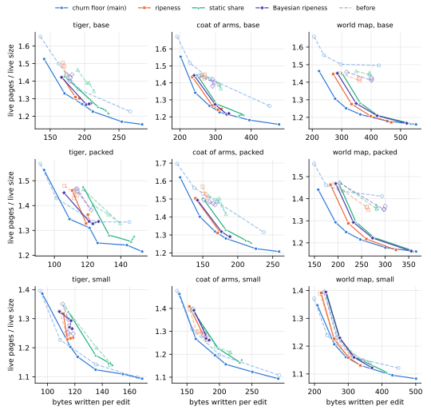
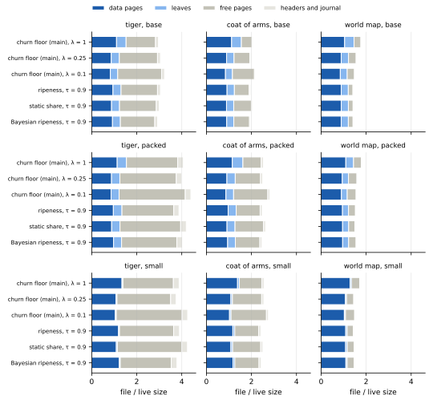

## Executive summary

**Dropping the leaves' fill floor changes the results of [Cleaning edited drawings and texts](cleaning-edits.md) most where the address table is a large part of the file, in the drawings' base and packed layouts; it changes them less in the drawings' small layout, and not at all on the texts.**
That page's budget loop held a rewrite of leaves to a data page's fill floor, so that leaves less than half full could be rewritten only three or more at a time.
Here, every branch holds it to the churn floor or to ripeness alone, and charges the budget the pages its restatements take; the same edits, branches and settings ran again with that one change.

**The leaves fill up: in the drawings' base and packed layouts, they come out 60 to 88 % full where they were 40 to 72 %, and the live pages fall by up to 22 % at the same setting.**
Leaves as full as the data pages would now save at most 6 % of the live pages, where they would have saved up to 25 %.
In the small layout and the texts, whose leaves are 3 to 9 % of the live pages, no setting's live pages move by more than 4 %.

**Main's churn floor reaches the earlier page's regime at λ = 0.25 instead of 0.1, with 13 to 31 % fewer writes.**
The regime is live pages about nine tenths full, which the ripeness branches target at τ = 0.9.
At λ = 0.25, the drawings' live pages are 87 to 92 % full and 1.12 to 1.28 times the live size; at λ = 0.1 they were 72 to 94 % full and 1.10 to 1.50 times, the world map's base and packed layouts held back by their leaves.
In the base and packed layouts, λ = 0.25 keeps as many live pages as λ = 0.1 did or up to 19 % fewer; in the small layout, 1 to 5 % more.
For the very space that λ = 0.1 kept, the churn floor now writes 20 to 48 % less in the base and packed layouts and 1 to 18 % less in the small one; on the texts, nothing changed.

**The ripeness branches reach their target of 0.9 on the world map, and come closer to it on the smaller drawings.**
At τ = 0.9, the live pages of the drawings' base and packed layouts are 81 to 90 % full, where they were 71 to 82 %, and 4 to 16 % fewer.
For the space they kept before, the branches now write 9 to 26 % less on the coat of arms and the world map in those layouts, and between 12 % less and 1 % more on the tiger.
At τ = 0.75, a target they reached before as well, they keep within 5 % of the live pages they kept, with between 14 % fewer and 4 % more writes.

**The churn floor now lies lowest on every workload, or within 1 % of the lowest: the ripeness branches' lead on the world map came from the fill floor.**
At equal writes, they kept 2 to 6 % fewer live pages than the churn floor in the world map's base and packed layouts; now no setting of theirs keeps more than 1 % fewer on any workload, and on the world map they keep up to 15 % more.
The churn floor's curve had flattened on the world map from λ = 0.25 on, its fuller data pages offset by more half-empty leaves; it no longer does.

**What the fix costs is leaf rewrites: at the same setting, the drawings write up to 30 % more under the churn floor, most of it leaves, and their flushes take 10 % longer at the median, up to 38 % on the world map; in the regime, at λ = 0.25, they take about as long as at λ = 0.1 before.**
In the drawings' base and packed layouts, leaves are rewritten 1.2 to 2.7 times as often, and they take 15 to 158 bytes of each edit's writes, where they took 14 to 71.
The ripeness branches, whose target is a fill, write between 8 % less and 20 % more at τ = 0.9.
The world map's files close 3 to 22 % smaller in the base and packed layouts; the other files close between 15 % smaller and 23 % larger, as the closed sizes vary between policies anyway.

## What changed

**Every branch now lets a rewrite of leaves pass without the fill floor, and charges the budget the pages it writes, not a page per offer.**
The budget loop opens a data page only when its offer fills it to `1 − θ`, 95 %, [as Consolidation has it](../impl/consolidation.md#the-budget-loop), so that a page opened for cleaning does not close half empty.
It held an offer of leaves to the same floor, but a rewrite of leaves opens no page: what its victims restate joins the leaves the cut packs full anyway, and only the cut's last leaf can close short.
So the floor protected no page, and it kept leaves less than half full from being rewritten unless three or more came together; [Sparse leaves](../drafts/consolidation-from-statements.md) traces how they piled up on main.

The fix is the same on every branch:

- **An offer of leaves passes on the churn floor alone, on main, and whenever its leaves are ripe, on the ripeness branches**; offers of data pages keep the fill floor.
- **It costs the budget the pages its restatements are estimated to take**, 1.25 times its leaves' coverage, where it cost a page; the budget loop counts what it has spent in pages.
- **On main, a leaf reclaims its page less the room its restatements take**, as a data victim reclaims its page less its survivors, so that it passes the churn floor at a coverage of up to `C / (1.25 (1 + λ))`, where it passed at up to `C / (1 + λ)` while the fill floor held its offer anyway.
  At λ = 1, that is 40 % of a page, where a data victim passes at up to 50 %.

An offer still gathers leaves only while their restatements fit one leaf and what is left of the budget.
[Consolidation](../impl/consolidation.md#the-budget-loop) and [the ripeness draft](../drafts/ripeness.md#the-budget-and-the-price) state the change since, and kladde-rs' `main` has it too, as `a5698e5`.

| branch | commit before | with the fix | policy |
| --- | --- | --- | --- |
| `defrag-shifts` | `e88fd47` | `714c602` | main's churn floor |
| `ripeness-svg` | `df6188f` | `94da80c` | cleaning by ripeness, one rate per page |
| `ripeness2-svg` | `1f88fb8` | `494d041` | ripeness with a static share per page |
| `bayesian-ripeness-svg` | `d0bd751` | `770aeb8` | Bayesian ripeness, rule (a), the empirical prior capped |

## What was measured

**Everything ran as [on the earlier page](cleaning-edits.md#what-was-measured)**: the same three drawings in the same three layouts, with the same edits, and the same two texts with the same keystrokes, on the same host; with the journal flushed at four pages, `text-bench` from kladde-rs `7c5cdd6` added to every branch, without its `--churn-floor` option on the ripeness branches, and the same settings.
Main's churn floor also ran at λ = 0.35 and 0.15, between the settings the earlier page ran.
Builds of the commits before the fix reproduced the earlier page's tables byte for byte, in all 45 configurations of the drawings that the timing passes ran them in, so every difference below is the fix's.

**The regime is live pages about nine tenths full**, the ripeness branches' τ = 0.9, as on the earlier page; but where that page cleaned with main's churn floor at λ = 0.1, the setting that filled its pages most, main now reaches that fill at λ = 0.25, so the tables give main at λ = 0.25 as well as at λ = 0.1.
Main's default, λ = 1, stays the reference.
Its budget controller held the budget at its maximum, 256 pages, in every run but those on the 512 KiB text, where it held it at one page, as before; only on the world map in its packed layout at λ = 0.15, whose whole file came closest to the controller's target fill of 0.8, did it dip, to 242 pages.

**Space and writes are what the earlier page measured, over the second half of each run**, and every table gives, in brackets, the earlier page's value at the same setting, from its data in `data/cleaning-edits/`.
They come from 198 runs of `svg-bench` and `text-bench`, eight at a time; the times from two further passes, one run at a time on an otherwise idle host, which ran the builds before the fix beside those with it.
Both timing passes reproduced the first runs' tables to the byte.
`data/leaf-floor/` keeps every run's table, `logs/` the end of its output, and `timing/` and `timing2/` that of the two timing passes, with the texts' tables, from which their keystroke rates come, and the builds before the fix under `before/`.

To reproduce a run, build as on the earlier page, on the commit with the fix:

```sh
git cherry-pick --no-commit 7c5cdd6   # text-bench; drop --churn-floor on the ripeness branches
cargo build --release -p kladde-svg --bin svg-bench --features packed
# --target-fill 0.9 instead of --churn-floor 0.25 on the ripeness branches
target/release/svg-bench crates/kladde-svg/corpus/drawings/world-map.svg \
    out/ --edits 177831 --journal-budget 4 --churn-floor 0.25
cargo build --release -p kladde-bench --bin text-bench
target/release/text-bench out/ --size 524288 --journal-budget 4 --churn-floor 0.25
```

The figures come from the tables here and, labelled `before/…`, from those of the earlier page:

```sh
D=content/evaluation/data/leaf-floor; B=content/evaluation/data/cleaning-edits
F=content/evaluation/figures/leaf-floor
runs=()
for dir in $D/*-*-*/ $B/*-*-*/; do
    IFS=- read -r p k l <<< "$(basename $dir)"; knob=${k%%[0-9]*}
    case $dir in $B/*) before=before/ ;; *) before= ;; esac
    runs+=("$before$p/$knob/${k#$knob}/$l=$dir")
done
tools/plot-evaluation.py --only svg-shift --out $F "${runs[@]}"
tools/plot-evaluation.py --only svg-pages --out $F $(printf '%s\n' "${runs[@]}" |
    grep -E '^(main/lambda/(1|0.25|0.1)|[a-z0-9]+/tau/0.9)/')
```

## The regime, and what it costs now

**For the space that each policy kept on the earlier page, cleaning as hard as it could, the churn floor now writes 20 to 48 % less in the drawings' base and packed layouts, and the ripeness branches up to 26 % less.**
Each cell gives the live pages over the live size that the earlier page reached at λ = 0.1 or τ = 0.9, the bytes written per edit or keystroke then, and the bytes the same policy now writes for that space, interpolated along its curve between the settings both pages ran:

| workload | layout or size | churn floor, λ = 0.1 | ripeness, τ = 0.9 | static share, τ = 0.9 | Bayesian, τ = 0.9 |
| --- | --- | --- | --- | --- | --- |
| tiger | base | 1.23: 266 → 212 (−20 %) | 1.51: 169 → 168 (0 %) | 1.39: 206 → 181 (−12 %) | 1.40: 179 → 172 (−4 %) |
| tiger | packed | 1.33: 145 → 111 (−23 %) | 1.43: 112 → 113 (+1 %) | 1.36: 132 → 126 (−5 %) | 1.38: 122 → 115 (−6 %) |
| tiger | small | 1.10: 166 → 164 (−1 %) | 1.24: 115 → 114 (−1 %) | 1.15: 146 → 145 (−1 %) | 1.25: 115 → — |
| coat of arms | base | 1.26: 452 → 290 (−36 %) | 1.45: 270 → 235 (−13 %) | 1.37: 315 → 274 (−13 %) | 1.38: 292 → 262 (−10 %) |
| coat of arms | packed | 1.32: 237 → 172 (−27 %) | 1.51: 157 → 140 (−11 %) | 1.42: 183 → 166 (−9 %) | 1.48: 165 → 146 (−11 %) |
| coat of arms | small | 1.11: 292 → 271 (−7 %) | 1.29: 173 → 176 (+1 %) | 1.21: 217 → 207 (−5 %) | 1.28: 176 → 177 (+1 %) |
| world map | base | 1.50: 427 → 223 (−48 %) | 1.42: 359 → 281 (−22 %) | 1.45: 394 → 302 (−23 %) | 1.42: 402 → 298 (−26 %) |
| world map | packed | 1.41: 294 → 165 (−44 %) | 1.35: 265 → 209 (−21 %) | 1.37: 281 → 223 (−21 %) | 1.35: 298 → 220 (−26 %) |
| world map | small | 1.12: 449 → 368 (−18 %) | 1.17: 306 → 293 (−4 %) | 1.17: 322 → 314 (−2 %) | 1.16: 315 → 316 (0 %) |
| text | 64 KiB | 1.13: 46.6 → — | 1.19: 43.1 → 42.9 (−1 %) | 1.19: 44.5 → 44.0 (−1 %) | 1.19: 43.7 → 43.7 (0 %) |
| text | 512 KiB | 1.09: 49.2 → — | 1.17: 50.5 → 50.4 (0 %) | 1.17: 54.1 → 54.2 (0 %) | 1.18: 52.6 → 51.8 (−1 %) |

A dash means that no setting reaches that space any more; the nearest misses it by at most 1 %.

**Main reaches that space at a more moderate setting: in the base and packed layouts, λ = 0.25 keeps as many live pages as λ = 0.1 did, or fewer, at 13 to 31 % fewer writes.**
In the small layout, λ = 0.25 keeps 1 to 5 % more live pages than λ = 0.1 did, and on the 64 KiB text 5 % more; there, the leaves are few, and λ = 0.1 still fills the pages most, as before.

## Live pages

**At the same setting, the drawings' base and packed layouts keep 2 to 22 % fewer live pages under the churn floor and 4 to 16 % fewer under the ripeness branches at τ = 0.9; the small layout and the texts keep what they kept, within 4 %.**
Each cell gives the live pages, the leaves among them in parentheses, and in brackets the change from the earlier page at the same setting; the first column gives the live bytes they hold, in data pages and in leaves:

| workload | layout or size | live bytes, KiB | λ = 1 | λ = 0.25 | λ = 0.1 | ripeness | static share | Bayesian |
| --- | --- | --- | --- | --- | --- | --- | --- | --- |
| tiger | base | 72 + 26 | 35.1 (9.8) [−8 %] | 28.2 (8.2) [−9 %] | 26.5 (7.5) [−6 %] | 29.9 (8.2) [−14 %] | 28.4 (8.1) [−11 %] | 29.2 (8.1) [−9 %] |
| tiger | packed | 37 + 14 | 18.2 (4.9) [−2 %] | 14.8 (4.4) [−6 %] | 14.4 (4.2) [−9 %] | 15.9 (4.5) [−6 %] | 14.9 (4.4) [−8 %] | 15.7 (4.2) [−4 %] |
| tiger | small | 45 + 1 | 16.1 (0.5) [−1 %] | 13.1 (0.5) [−1 %] | 12.7 (0.5) [0 %] | 14.3 (0.5) [−1 %] | 13.2 (0.6) [0 %] | 14.8 (0.5) [+1 %] |
| coat of arms | base | 203 + 67 | 97.9 (27.3) [−7 %] | 77.3 (20.8) [−14 %] | 72.8 (19.5) [−8 %] | 78.3 (20.5) [−14 %] | 76.4 (20.1) [−11 %] | 76.6 (19.8) [−12 %] |
| coat of arms | packed | 107 + 39 | 52.9 (15.3) [−4 %] | 41.8 (12.1) [−14 %] | 39.4 (11.1) [−8 %] | 43.2 (11.7) [−12 %] | 41.5 (11.6) [−10 %] | 42.0 (11.2) [−13 %] |
| coat of arms | small | 127 + 7 | 47.0 (2.6) [−1 %] | 37.1 (2.2) [−3 %] | 35.1 (2.1) [−1 %] | 40.4 (2.8) [−3 %] | 37.4 (2.5) [−4 %] | 40.5 (2.7) [−2 %] |
| world map | base | 1,109 + 346 | 494.5 (140.7) [−12 %] | 411.4 (109.6) [−19 %] | 392.2 (103.8) [−22 %] | 408.2 (106.3) [−15 %] | 409.5 (106.7) [−16 %] | 409.0 (107.3) [−15 %] |
| world map | packed | 834 + 203 | 342.7 (81.0) [−8 %] | 289.3 (64.3) [−15 %] | 276.3 (60.8) [−18 %] | 290.0 (63.2) [−10 %] | 291.6 (63.6) [−10 %] | 291.1 (62.7) [−10 %] |
| world map | small | 937 + 37 | 316.8 (14.0) [−2 %] | 266.1 (11.7) [−3 %] | 255.0 (12.2) [−3 %] | 273.1 (15.3) [−1 %] | 273.8 (17.0) [0 %] | 273.2 (14.2) [0 %] |
| text | 64 KiB | 192 + 13 | 60.4 (3.8) [−1 %] | 57.3 (3.8) [+1 %] | 54.3 (3.7) [0 %] | 57.4 (3.9) [0 %] | 57.5 (4.1) [0 %] | 57.3 (3.8) [0 %] |
| text | 512 KiB | 640 + 28 | 175.4 (7.7) [−1 %] | 175.1 (7.6) [0 %] | 175.3 (7.6) [0 %] | 188.5 (10.7) [0 %] | 187.9 (11.3) [0 %] | 189.9 (10.6) [0 %] |

Over the live size, with the earlier page's value in brackets:

| workload | layout or size | live size, KiB | λ = 1 | λ = 0.25 | λ = 0.1 | ripeness | static share | Bayesian |
| --- | --- | --- | --- | --- | --- | --- | --- | --- |
| tiger | base | 92 | 1.53 [1.65] | 1.23 [1.35] | 1.15 [1.23] | 1.30 [1.51] | 1.23 [1.39] | 1.27 [1.40] |
| tiger | packed | 47 | 1.54 [1.57] | 1.25 [1.33] | 1.21 [1.33] | 1.34 [1.43] | 1.26 [1.36] | 1.33 [1.38] |
| tiger | small | 46 | 1.39 [1.40] | 1.12 [1.14] | 1.09 [1.10] | 1.23 [1.24] | 1.14 [1.15] | 1.27 [1.25] |
| coat of arms | base | 252 | 1.55 [1.67] | 1.23 [1.42] | 1.16 [1.26] | 1.24 [1.45] | 1.21 [1.37] | 1.22 [1.38] |
| coat of arms | packed | 131 | 1.62 [1.70] | 1.28 [1.48] | 1.21 [1.32] | 1.32 [1.51] | 1.27 [1.42] | 1.29 [1.48] |
| coat of arms | small | 128 | 1.46 [1.48] | 1.16 [1.20] | 1.09 [1.11] | 1.26 [1.29] | 1.16 [1.21] | 1.26 [1.28] |
| world map | base | 1,353 | 1.46 [1.66] | 1.22 [1.50] | 1.16 [1.50] | 1.21 [1.42] | 1.21 [1.45] | 1.21 [1.42] |
| world map | packed | 954 | 1.44 [1.56] | 1.22 [1.43] | 1.16 [1.41] | 1.22 [1.35] | 1.22 [1.37] | 1.22 [1.35] |
| world map | small | 943 | 1.35 [1.37] | 1.13 [1.16] | 1.08 [1.12] | 1.16 [1.17] | 1.16 [1.17] | 1.16 [1.16] |
| text | 64 KiB | 193 | 1.25 [1.27] | 1.19 [1.18] | 1.13 [1.13] | 1.19 [1.19] | 1.19 [1.19] | 1.19 [1.19] |
| text | 512 KiB | 642 | 1.09 [1.10] | 1.09 [1.09] | 1.09 [1.09] | 1.17 [1.17] | 1.17 [1.17] | 1.18 [1.18] |

## Leaves and data pages

**The leaves of the drawings' base and packed layouts come out 62 to 86 % full in these columns, where they were 40 to 72 %, and in the regime 77 to 85 %, against data pages 82 to 93 % full.**
Each cell gives the fill of the data pages, of the leaves, and of all live pages, in percent, and in brackets the leaves' fill on the earlier page:

| workload | layout or size | λ = 1 | λ = 0.25 | λ = 0.1 | ripeness | static share | Bayesian |
| --- | --- | --- | --- | --- | --- | --- | --- |
| tiger | base | 71 / 66 / 70 [50] | 90 / 79 / 87 [59] | 95 / 86 / 92 [70] | 83 / 79 / 82 [51] | 90 / 80 / 87 [56] | 86 / 80 / 84 [58] |
| tiger | packed | 70 / 71 / 70 [62] | 90 / 80 / 87 [66] | 92 / 83 / 89 [61] | 83 / 77 / 81 [64] | 90 / 79 / 87 [64] | 82 / 83 / 83 [72] |
| tiger | small | 73 / 28 / 72 [17] | 91 / 33 / 89 [27] | 94 / 35 / 91 [23] | 83 / 29 / 81 [28] | 91 / 30 / 88 [27] | 81 / 30 / 79 [21] |
| coat of arms | base | 72 / 62 / 69 [50] | 90 / 80 / 88 [50] | 96 / 86 / 93 [64] | 89 / 82 / 87 [51] | 92 / 83 / 89 [57] | 91 / 85 / 89 [56] |
| coat of arms | packed | 71 / 63 / 69 [53] | 91 / 79 / 87 [52] | 95 / 85 / 93 [65] | 86 / 82 / 85 [54] | 91 / 82 / 89 [59] | 88 / 85 / 87 [56] |
| coat of arms | small | 72 / 66 / 71 [50] | 91 / 76 / 90 [47] | 97 / 82 / 96 [68] | 85 / 62 / 83 [49] | 92 / 69 / 90 [51] | 85 / 62 / 83 [47] |
| world map | base | 79 / 62 / 74 [42] | 92 / 79 / 89 [42] | 97 / 84 / 93 [40] | 93 / 83 / 90 [48] | 93 / 82 / 90 [46] | 93 / 82 / 90 [48] |
| world map | packed | 80 / 63 / 76 [47] | 93 / 79 / 90 [44] | 97 / 84 / 94 [43] | 93 / 81 / 90 [51] | 93 / 80 / 90 [49] | 92 / 82 / 90 [50] |
| world map | small | 78 / 66 / 77 [48] | 92 / 82 / 92 [49] | 97 / 87 / 96 [51] | 91 / 65 / 90 [47] | 92 / 59 / 90 [51] | 91 / 70 / 90 [54] |
| text | 64 KiB | 85 / 86 / 85 [84] | 90 / 86 / 90 [85] | 95 / 88 / 95 [85] | 90 / 81 / 90 [83] | 91 / 74 / 89 [72] | 90 / 84 / 90 [83] |
| text | 512 KiB | 96 / 91 / 96 [89] | 96 / 93 / 96 [90] | 96 / 93 / 96 [89] | 90 / 65 / 89 [66] | 91 / 61 / 89 [61] | 90 / 65 / 88 [65] |

**The leaves are now 22 to 30 % of the live pages in the drawings' base and packed layouts, where they were 30 to 43 %, and leaves as full as the data pages would save 1 to 4 % of the live pages in the regime, where they would have saved 4 to 25 %.**
The statements are still 20 to 28 % of the live bytes there, so the leaves remain a large part of the file, but no longer a sparse one.

**The leaves still fill less than the data pages, likely because the churn floor prices a leaf as costlier to clean.**
The restatements of a leaf are estimated at 1.25 times its coverage, so at λ = 0.25 a leaf is a budgeted victim only up to 64 % full, where a data page is one up to 80 % full; the leaves settle 10 to 14 points emptier than the data pages.
How well 1.25 estimates what a rewrite of leaves takes was not measured, and no run here tests a different estimate.
[Cleaning edits with leaves priced at their coverage](leaf-price.md) does both.

**Where the leaves hold little, the fix changes little.**
In the drawings' small layout, the leaves hold 2 to 5 % of the live bytes and are 3 to 7 % of the live pages, and on the texts 4 to 6 % and 4 to 7 %; their fill rose there too, but they were too few to matter.
On the 512 KiB text, the ripeness branches' leaves stay 61 to 65 % full, as before; they rewrite 8 to 29 leaves over a whole run, and this page has not traced why so few.

**The ripeness branches still give up the cleaning that costs nothing, and rewrite leaves about as often as the churn floor at λ = 0.25.**
Each cell gives, over a whole run, the data victims that free filling took, the data pages opened only to take victims, and the leaves rewritten, by the budget or by the cut's fillers, with the leaves rewritten on the earlier page in brackets:

| workload | layout or size | λ = 1 | λ = 0.25 | λ = 0.1 | ripeness | static share | Bayesian |
| --- | --- | --- | --- | --- | --- | --- | --- |
| tiger | base | 125 / 112 / 185 [139] | 73 / 511 / 300 [188] | 69 / 926 / 385 [310] | 8 / 333 / 292 [179] | 3 / 543 / 318 [202] | 5 / 400 / 315 [179] |
| tiger | packed | 81 / 78 / 113 [93] | 60 / 272 / 167 [123] | 49 / 452 / 199 [122] | 4 / 210 / 178 [108] | 4 / 347 / 170 [121] | 11 / 228 / 178 [126] |
| tiger | small | 97 / 120 / 61 [48] | 66 / 413 / 65 [54] | 59 / 664 / 63 [58] | 7 / 250 / 60 [53] | 8 / 427 / 62 [57] | 4 / 243 / 63 [52] |
| coat of arms | base | 210 / 238 / 340 [273] | 130 / 1,009 / 592 [312] | 125 / 2,174 / 963 [549] | 19 / 828 / 630 [301] | 11 / 1,234 / 738 [370] | 17 / 940 / 675 [339] |
| coat of arms | packed | 146 / 122 / 184 [149] | 85 / 595 / 352 [205] | 79 / 1,167 / 494 [339] | 12 / 441 / 365 [186] | 23 / 687 / 388 [235] | 10 / 497 / 421 [194] |
| coat of arms | small | 141 / 219 / 199 [151] | 96 / 867 / 239 [174] | 86 / 1,608 / 254 [217] | 4 / 534 / 218 [154] | 6 / 918 / 219 [174] | 6 / 575 / 215 [161] |
| world map | base | 964 / 1,192 / 2,547 [1,866] | 684 / 4,714 / 4,319 [2,037] | 635 / 10,232 / 6,278 [2,337] | 79 / 4,546 / 5,082 [2,341] | 97 / 4,616 / 5,191 [2,466] | 73 / 4,677 / 5,151 [2,484] |
| world map | packed | 786 / 818 / 1,537 [1,174] | 532 / 3,211 / 2,568 [1,245] | 519 / 6,411 / 3,481 [1,396] | 62 / 3,098 / 2,792 [1,456] | 98 / 3,251 / 2,915 [1,498] | 61 / 3,221 / 2,915 [1,561] |
| world map | small | 825 / 1,622 / 2,189 [1,702] | 532 / 6,083 / 3,324 [1,931] | 492 / 12,009 / 4,369 [2,296] | 88 / 4,423 / 2,502 [1,927] | 82 / 4,841 / 2,439 [2,028] | 100 / 4,439 / 2,882 [2,115] |
| text | 64 KiB | 57 / 14 / 149 [120] | 49 / 67 / 158 [119] | 49 / 218 / 162 [120] | 8 / 117 / 127 [114] | 8 / 148 / 119 [103] | 4 / 133 / 134 [112] |
| text | 512 KiB | 65 / 90 / 168 [156] | 62 / 98 / 180 [160] | 62 / 120 / 184 [143] | 6 / 137 / 22 [21] | 9 / 178 / 8 [8] | 6 / 146 / 29 [30] |

## The trade-off between space and writes

**Every policy's curve moved down in the drawings' base and packed layouts, and the churn floor's most, so that it now lies lowest on every workload, or within 1 % of the lowest.**
Each panel shows each policy's settings, from the one that cleans least, hollow, to the one that cleans most, as on the earlier page, and dashed and pale the same policy's curve on the earlier page:



- **On the world map, the churn floor no longer flattens.**
  In the base and packed layouts, λ = 0.25 and λ = 0.1 kept 1.41 to 1.50 times the live size before, the leaves offsetting the fuller data pages; they now keep 1.16 to 1.22 times.
  At equal writes, the ripeness branches kept 2 to 6 % fewer live pages than the churn floor in the base layout, and in the packed layout at τ = 0.85 and above; they now keep between 1 % fewer and 15 % more, the most at τ = 0.75.
- **On the coat of arms, the two lay within 2.5 % of each other in the base and packed layouts, and the churn floor up to 7 % lower in the small one; at equal writes, the ripeness branches now keep between 1 % fewer and 9 % more live pages than the churn floor in every layout.**
- **On the tiger, the churn floor lay lowest, and still does**, the ripeness branches keeping 1 to 14 % more live pages at equal writes.
- **The ripeness branches' curves no longer bunch on the world map**: τ = 0.85, 0.9 and 0.95 now keep 1.16 to 1.29 times the live size there, where they kept 1.35 to 1.45 alike; on the tiger and the coat of arms in their base and packed layouts, they still bunch once τ passes 0.85, at 1.21 to 1.36 times.
- **On the texts, nothing changed**: every setting of every policy keeps its live pages within 1.3 % and its writes within 4 % of the earlier page's, whose [figure](cleaning-edits.md#the-trade-off-between-space-and-writes) stands.

The equal-write comparisons interpolate the churn floor's curve between the settings both pages ran, at every setting of the ripeness branches whose writes lie within it.

## Files

**The world map's files shrink with their live pages; the smaller drawings' files stay within 9 % of their size, the live pages they save mostly turning into free pages.**
Each bar is a drawing's file averaged over the second half of the edits, in multiples of the live size:



Each cell gives the file's pages during the edits, and in parentheses the free ones among them, with the earlier page's in brackets:

| workload | layout or size | λ = 1 | λ = 0.25 | λ = 0.1 | ripeness | static share | Bayesian |
| --- | --- | --- | --- | --- | --- | --- | --- |
| tiger | base | 68 (30) [69 (28)] | 70 (39) [67 (33)] | 74 (45) [68 (37)] | 70 (37) [66 (29)] | 69 (38) [71 (36)] | 67 (35) [65 (30)] |
| tiger | packed | 48 (27) [46 (24)] | 47 (30) [48 (29)] | 52 (35) [51 (32)] | 46 (27) [48 (28)] | 50 (32) [53 (34)] | 47 (29) [47 (27)] |
| tiger | small | 45 (26) [45 (26)] | 44 (28) [46 (30)] | 49 (34) [48 (32)] | 45 (28) [43 (26)] | 49 (33) [46 (30)] | 44 (26) [45 (27)] |
| coat of arms | base | 130 (30) [138 (30)] | 124 (44) [136 (43)] | 137 (62) [134 (52)] | 123 (41) [133 (38)] | 129 (49) [135 (46)] | 124 (44) [133 (43)] |
| coat of arms | packed | 83 (27) [84 (26)] | 82 (37) [84 (33)] | 92 (50) [88 (42)] | 81 (35) [83 (31)] | 86 (41) [86 (36)] | 80 (36) [84 (33)] |
| coat of arms | small | 82 (32) [77 (26)] | 82 (42) [80 (39)] | 88 (50) [89 (50)] | 77 (34) [78 (34)] | 80 (40) [80 (39)] | 78 (34) [77 (33)] |
| world map | base | 598 (101) [661 (98)] | 529 (114) [590 (80)] | 503 (108) [628 (120)] | 481 (69) [563 (80)] | 483 (70) [593 (100)] | 482 (70) [569 (88)] |
| world map | packed | 429 (84) [448 (74)] | 383 (91) [427 (83)] | 373 (94) [426 (88)] | 363 (70) [409 (85)] | 360 (65) [410 (82)] | 374 (80) [408 (83)] |
| world map | small | 407 (87) [408 (82)] | 344 (75) [340 (63)] | 353 (95) [358 (91)] | 340 (64) [349 (71)] | 348 (71) [347 (70)] | 348 (72) [355 (78)] |
| text | 64 KiB | 79 (16) [80 (16)] | 79 (19) [79 (20)] | 82 (25) [82 (25)] | 81 (21) [81 (21)] | 83 (23) [82 (22)] | 82 (22) [83 (23)] |
| text | 512 KiB | 201 (23) [202 (23)] | 201 (23) [201 (23)] | 201 (23) [200 (23)] | 214 (23) [215 (24)] | 216 (26) [216 (26)] | 217 (25) [217 (25)] |

On the tiger and the coat of arms, the pages that cleaning the leaves frees stay in the file, as those that cleaning harder freed did on the earlier page: [truncation and compaction mode](cleaning-edits.md#files) return free pages only in bulk.

**Closed, the world map's files in the base and packed layouts are 3 to 22 % smaller; the other files close between 15 % smaller and 23 % larger.**
Each cell gives the closed file in KiB, with the earlier page's in brackets:

| workload | layout or size | λ = 1 | λ = 0.25 | λ = 0.1 | ripeness | static share | Bayesian |
| --- | --- | --- | --- | --- | --- | --- | --- |
| tiger | base | 240 [236] | 220 [240] | 292 [240] | 232 [244] | 240 [216] | 244 [236] |
| tiger | packed | 144 [144] | 172 [140] | 184 [168] | 156 [164] | 152 [176] | 148 [152] |
| tiger | small | 136 [132] | 164 [156] | 168 [164] | 124 [144] | 176 [172] | 144 [140] |
| coat of arms | base | 500 [556] | 452 [532] | 500 [520] | 468 [544] | 484 [492] | 476 [524] |
| coat of arms | packed | 320 [336] | 292 [284] | 320 [300] | 288 [260] | 316 [340] | 304 [324] |
| coat of arms | small | 280 [296] | 268 [304] | 336 [300] | 272 [292] | 288 [328] | 284 [300] |
| world map | base | 2,088 [2,452] | 1,856 [2,280] | 1,772 [2,192] | 1,736 [2,052] | 1,768 [2,092] | 1,704 [2,184] |
| world map | packed | 1,372 [1,448] | 1,272 [1,560] | 1,252 [1,524] | 1,332 [1,380] | 1,228 [1,408] | 1,212 [1,436] |
| world map | small | 1,324 [1,284] | 1,120 [1,172] | 1,212 [1,200] | 1,180 [1,252] | 1,196 [1,200] | 1,152 [1,268] |
| text | 64 KiB | 372 [384] | 384 [360] | 388 [356] | 380 [376] | 404 [388] | 380 [416] |
| text | 512 KiB | 844 [836] | 824 [868] | 860 [856] | 944 [936] | 924 [932] | 932 [940] |

As on the earlier page, a closed size depends on where the last live page lies when the edits end, which varies by up to a third between runs that keep nearly as many live pages.

## Writes

**At the same setting, the drawings write up to 30 % more under the churn floor, and most of it is leaves.**
Each cell gives the bytes written per edit, or per keystroke on the texts, with the change from the earlier page at the same setting in brackets; the journal and the headers write what they wrote before:

| workload | layout or size | journal + headers | λ = 1 | λ = 0.25 | λ = 0.1 | ripeness | static share | Bayesian |
| --- | --- | --- | --- | --- | --- | --- | --- | --- |
| tiger | base | 52 + 15 | 141 [+4 %] | 212 [+11 %] | 284 [+7 %] | 193 [+14 %] | 231 [+12 %] | 209 [+17 %] |
| tiger | packed | 37 + 11 | 94 [+3 %] | 126 [+2 %] | 153 [+5 %] | 121 [+8 %] | 146 [+10 %] | 123 [+1 %] |
| tiger | small | 37 + 11 | 96 [+2 %] | 135 [0 %] | 169 [+2 %] | 118 [+3 %] | 147 [+1 %] | 116 [+1 %] |
| coat of arms | base | 65 + 18 | 202 [+5 %] | 311 [+10 %] | 478 [+6 %] | 307 [+14 %] | 379 [+20 %] | 332 [+14 %] |
| coat of arms | packed | 44 + 12 | 118 [+4 %] | 183 [+7 %] | 259 [+9 %] | 174 [+11 %] | 211 [+15 %] | 189 [+15 %] |
| coat of arms | small | 45 + 13 | 138 [+3 %] | 210 [+5 %] | 290 [0 %] | 179 [+3 %] | 231 [+7 %] | 184 [+5 %] |
| world map | base | 63 + 17 | 223 [+8 %] | 363 [+22 %] | 552 [+30 %] | 399 [+11 %] | 422 [+7 %] | 421 [+5 %] |
| world map | packed | 49 + 14 | 158 [+6 %] | 247 [+17 %] | 365 [+25 %] | 260 [−2 %] | 276 [−2 %] | 273 [−8 %] |
| world map | small | 51 + 14 | 209 [+5 %] | 339 [+12 %] | 501 [+12 %] | 301 [−2 %] | 316 [−2 %] | 317 [+1 %] |
| text | 64 KiB | 13.2 + 4.1 | 36.6 [0 %] | 40.3 [+1 %] | 48.3 [+4 %] | 42.8 [−1 %] | 44.0 [−1 %] | 44.3 [+1 %] |
| text | 512 KiB | 13.2 + 4.1 | 49.9 [+1 %] | 50.0 [+1 %] | 50.5 [+3 %] | 50.4 [0 %] | 54.2 [0 %] | 51.8 [−1 %] |

Each cell splits the rest into data pages and leaves, with the earlier page's split in brackets:

| workload | layout or size | λ = 1 | λ = 0.25 | λ = 0.1 | ripeness | static share | Bayesian |
| --- | --- | --- | --- | --- | --- | --- | --- |
| tiger | base | 49 + 25 [50 + 19] | 106 + 39 [101 + 23] | 168 + 49 [163 + 36] | 85 + 41 [82 + 20] | 120 + 44 [114 + 26] | 98 + 45 [88 + 24] |
| tiger | packed | 30 + 15 [29 + 14] | 55 + 23 [57 + 18] | 78 + 27 [81 + 16] | 48 + 24 [47 + 16] | 74 + 24 [68 + 16] | 50 + 25 [56 + 18] |
| tiger | small | 41 + 7 [40 + 6] | 79 + 8 [81 + 7] | 114 + 8 [111 + 7] | 63 + 8 [60 + 7] | 91 + 8 [91 + 7] | 60 + 8 [60 + 7] |
| coat of arms | base | 81 + 39 [79 + 31] | 164 + 65 [166 + 36] | 293 + 103 [298 + 71] | 153 + 71 [154 + 34] | 212 + 84 [188 + 45] | 172 + 77 [171 + 38] |
| coat of arms | packed | 43 + 19 [41 + 16] | 90 + 37 [91 + 24] | 152 + 51 [146 + 35] | 79 + 39 [81 + 20] | 112 + 43 [103 + 24] | 88 + 46 [89 + 20] |
| coat of arms | small | 60 + 21 [62 + 16] | 127 + 26 [125 + 17] | 206 + 27 [211 + 24] | 98 + 24 [99 + 17] | 149 + 25 [141 + 19] | 103 + 24 [101 + 17] |
| world map | base | 80 + 63 [79 + 47] | 173 + 110 [165 + 52] | 314 + 158 [286 + 60] | 188 + 130 [220 + 59] | 210 + 131 [252 + 62] | 207 + 133 [260 + 62] |
| world map | packed | 58 + 36 [58 + 28] | 121 + 63 [117 + 29] | 213 + 89 [196 + 34] | 128 + 69 [165 + 36] | 141 + 71 [182 + 36] | 137 + 72 [196 + 38] |
| world map | small | 94 + 50 [95 + 38] | 197 + 76 [192 + 44] | 334 + 102 [329 + 54] | 176 + 60 [197 + 44] | 193 + 58 [209 + 47] | 183 + 69 [200 + 49] |
| text | 64 KiB | 4.5 + 14.8 [4.8 + 14.5] | 7.8 + 15.2 [8.0 + 14.6] | 16.1 + 15.0 [14.7 + 14.7] | 11.0 + 14.6 [11.5 + 14.3] | 12.6 + 14.1 [13.0 + 14.2] | 12.3 + 14.7 [12.0 + 14.4] |
| text | 512 KiB | 4.7 + 27.9 [4.8 + 27.4] | 4.6 + 28.1 [5.0 + 27.3] | 4.8 + 28.3 [5.0 + 26.9] | 5.7 + 27.4 [5.8 + 27.4] | 9.7 + 27.1 [9.7 + 27.1] | 7.4 + 27.1 [7.9 + 27.3] |

- **The churn floor writes as many data pages as before, and more leaves**: at λ = 0.25, the leaves take 23 to 110 bytes of each edit in the base and packed layouts, where they took 18 to 52.
- **The ripeness branches write fewer data pages on the world map**: 128 to 210 bytes per edit, where they wrote 165 to 260.
  Their controller aims the data pages and the leaves together at τ, so fuller leaves leave less for the data pages to do.
- **On the texts, splices fill the leaves, as before**, 14 and 27 to 28 bytes of each keystroke, the same under every policy.

## Times

**Measured beside the builds before the fix, at the same setting, the fix makes edits 5 % slower and the median flush 10 % longer, at the median over the drawings; the most on the world map at λ = 0.1, whose edits run 18 to 24 % slower and whose flushes take 29 to 38 % longer.**
Each cell gives the change in the edits per second in kladde's calls, in the median flush at the rows, and in the median time to reopen the closed file, in percent, against the build before the fix at the same setting, both measured in the same passes:

| workload | layout | λ = 1 | λ = 0.1 | ripeness | static share | Bayesian |
| --- | --- | --- | --- | --- | --- | --- |
| tiger | base | −2 / +10 / −17 | −2 / +8 / −5 | −3 / +22 / −6 | −11 / +8 / +3 | −3 / +18 / −19 |
| tiger | packed | +8 / −5 / −22 | −1 / −1 / −26 | −1 / +17 / −10 | +12 / +1 / −23 | +3 / +10 / −7 |
| tiger | small | −1 / 0 / −1 | −5 / 0 / +11 | −4 / −10 / +5 | −6 / +7 / +7 | −2 / 0 / +9 |
| coat of arms | base | −3 / +5 / −7 | −9 / +29 / +1 | −14 / +23 / −13 | −13 / +19 / −6 | −9 / +18 / −21 |
| coat of arms | packed | −5 / +9 / 0 | −9 / +27 / −11 | −12 / +16 / −7 | −5 / +3 / −15 | −13 / +23 / −13 |
| coat of arms | small | −2 / +6 / +2 | −3 / −1 / −6 | −2 / −5 / +4 | +8 / +3 / +10 | −4 / +7 / +1 |
| world map | base | −5 / +12 / −18 | −24 / +37 / −33 | −13 / +34 / −23 | −8 / +8 / −28 | −8 / +20 / −25 |
| world map | packed | −5 / +21 / −7 | −19 / +38 / −25 | −10 / +26 / −39 | −7 / +13 / −23 | −6 / +9 / −15 |
| world map | small | −6 / +10 / −4 | −18 / +29 / −10 | −5 / +9 / −9 | −1 / +4 / −1 | −6 / +12 / −11 |

- **The flushes take longer where the fix rewrites the most leaves**: on the world map in every layout and on the coat of arms in its base and packed layouts, by 3 to 38 %.
  The tiger's runs, of 31 rows each, are too short to tell a change of a fifth from the difference between identical runs.
- **Reopening the world map takes 1 to 39 % less time**, since its files hold fewer leaves to read; on the smaller drawings, reopening takes a few milliseconds either way, and its changes are as large as those between identical runs.
- **In the regime, cleaning takes about the time it took before**: at λ = 0.25, kladde edits the drawings between 8 % slower and 17 % faster than at λ = 0.1 before the fix, with median flushes between 24 % shorter and 14 % longer, and reopens the world map 32 % faster in its base layout and 23 % faster in its packed one.

**Edits stay fast and flushes short under every policy.**
Each cell gives the edits per second in kladde's calls, in thousands, or on the texts the keystrokes per second; the median flush at the rows, in milliseconds; and the median time to reopen the closed file, in milliseconds; each the mean of the two timing passes:

| workload | layout or size | λ = 1 | λ = 0.25 | λ = 0.1 | ripeness | static share | Bayesian |
| --- | --- | --- | --- | --- | --- | --- | --- |
| tiger | base | 91 / 2.9 / 1.4 | 79 / 3.2 / 1.5 | 70 / 4.6 / 1.2 | 83 / 3.5 / 1.3 | 69 / 4.2 / 1.5 | 72 / 4.7 / 1.2 |
| tiger | packed | 117 / 3.0 / 1.3 | 107 / 3.5 / 1.3 | 101 / 3.8 / 1.3 | 109 / 3.9 / 1.2 | 104 / 4.3 / 1.4 | 91 / 4.9 / 1.6 |
| tiger | small | 102 / 2.8 / 0.9 | 95 / 3.8 / 0.9 | 89 / 4.0 / 0.9 | 101 / 3.0 / 0.9 | 94 / 4.0 / 0.9 | 100 / 3.0 / 0.9 |
| coat of arms | base | 66 / 3.0 / 3.6 | 55 / 3.9 / 3.3 | 43 / 5.1 / 3.2 | 54 / 4.0 / 3.2 | 43 / 5.1 / 3.8 | 44 / 5.7 / 3.2 |
| coat of arms | packed | 88 / 3.5 / 3.6 | 71 / 5.0 / 3.2 | 63 / 5.6 / 2.9 | 75 / 4.4 / 3.2 | 67 / 5.1 / 3.3 | 62 / 6.1 / 3.2 |
| coat of arms | small | 77 / 4.1 / 1.9 | 71 / 4.8 / 1.8 | 64 / 5.7 / 1.8 | 74 / 4.2 / 1.8 | 64 / 5.5 / 2.0 | 68 / 4.8 / 1.9 |
| world map | base | 40 / 4.3 / 18.4 | 33 / 5.3 / 16.2 | 27 / 7.0 / 16.0 | 31 / 6.7 / 15.9 | 23 / 8.6 / 17.1 | 22 / 10.9 / 16.9 |
| world map | packed | 47 / 4.3 / 17.3 | 41 / 5.2 / 15.9 | 36 / 6.3 / 15.4 | 40 / 5.8 / 15.4 | 32 / 7.2 / 15.8 | 27 / 9.4 / 15.8 |
| world map | small | 38 / 5.5 / 8.3 | 32 / 6.9 / 8.0 | 27 / 8.8 / 8.1 | 35 / 6.6 / 7.8 | 29 / 8.4 / 8.7 | 26 / 10.6 / 8.3 |
| text | 64 KiB | 958 / 7.1 / 0.7 | 1,000 / 7.0 / 0.7 | 1,009 / 7.0 / 0.7 | 1,009 / 6.9 / 0.7 | 1,018 / 7.3 / 0.9 | 1,002 / 7.2 / 0.9 |
| text | 512 KiB | 973 / 9.1 / 1.5 | 975 / 9.1 / 1.4 | 984 / 9.4 / 1.4 | 978 / 8.8 / 1.6 | 985 / 10.6 / 1.8 | 966 / 9.7 / 2.3 |

- **In the regime, kladde's calls take 22,000 to 109,000 edits per second on the drawings, and the median flush takes 3.0 to 10.9 ms**; as on the earlier page, the static share and the Bayesian posterior flush the world map the slowest, 1.2 to 1.6 times as long as single-rate ripeness.
- **On the texts, the policies differ by little**: 958,000 to 1,018,000 keystrokes per second at every setting, median flushes of 6.8 to 7.5 ms at 64 KiB and 8.8 to 10.6 ms at 512 KiB, and reopens of 0.7 to 2.3 ms.
- **The absolute times do not compare with the earlier page's**: this host ran the builds before the fix 11 % faster at the median than the earlier page measured them, so only the comparisons within these passes, above, measure the fix.

**Identical runs differed by little.**
The two timing passes differed in the drawings' edit rate by 1 % at the median and 28 % at most, in their median flush by 3 % and 32 %, and in their reopen times by 3 % and 86 %, the largest on the smaller drawings, whose reopens take a millisecond or two; on the texts, by 1 % at the median and at most 5 %, 4 % and 9 %.
A first pass, run while the host did other work, was discarded.

## The sweep in numbers

**Every setting's steady state: the live pages over the live size, and the bytes written per edit or keystroke.**
These are the points of [the trade-off figure](#the-trade-off-between-space-and-writes); the earlier page's [sweep](cleaning-edits.md#the-sweep-in-numbers) gives those before the fix.

| base | tiger | coat of arms | world map |
| --- | --- | --- | --- |
| churn floor, λ = 1 | 1.53, 141 | 1.55, 202 | 1.46, 223 |
| churn floor, λ = 0.5 | 1.33, 171 | 1.34, 243 | 1.31, 278 |
| churn floor, λ = 0.35 | 1.27, 196 | 1.27, 283 | 1.25, 315 |
| churn floor, λ = 0.25 | 1.23, 212 | 1.23, 311 | 1.22, 363 |
| churn floor, λ = 0.15 | 1.17, 254 | 1.18, 395 | 1.18, 455 |
| churn floor, λ = 0.1 | 1.15, 284 | 1.16, 478 | 1.16, 552 |
| ripeness, τ = 0.75 | 1.42, 168 | 1.44, 235 | 1.45, 272 |
| ripeness, τ = 0.85 | 1.30, 188 | 1.27, 291 | 1.28, 333 |
| ripeness, τ = 0.9 | 1.30, 193 | 1.24, 307 | 1.21, 399 |
| ripeness, τ = 0.95 | 1.31, 187 | 1.25, 316 | 1.17, 468 |
| static share, τ = 0.75 | 1.43, 171 | 1.45, 248 | 1.46, 300 |
| static share, τ = 0.85 | 1.25, 220 | 1.28, 303 | 1.28, 363 |
| static share, τ = 0.9 | 1.23, 231 | 1.21, 379 | 1.21, 422 |
| static share, τ = 0.95 | 1.22, 235 | 1.21, 366 | 1.16, 535 |
| Bayesian, τ = 0.75 | 1.42, 167 | 1.44, 240 | 1.45, 285 |
| Bayesian, τ = 0.85 | 1.27, 203 | 1.27, 299 | 1.28, 349 |
| Bayesian, τ = 0.9 | 1.27, 209 | 1.22, 332 | 1.21, 421 |
| Bayesian, τ = 0.95 | 1.27, 206 | 1.22, 337 | 1.17, 521 |

| packed | tiger | coat of arms | world map |
| --- | --- | --- | --- |
| churn floor, λ = 1 | 1.54, 94 | 1.62, 118 | 1.44, 158 |
| churn floor, λ = 0.5 | 1.35, 109 | 1.40, 146 | 1.29, 195 |
| churn floor, λ = 0.35 | 1.31, 121 | 1.32, 168 | 1.25, 217 |
| churn floor, λ = 0.25 | 1.25, 126 | 1.28, 183 | 1.22, 247 |
| churn floor, λ = 0.15 | 1.24, 144 | 1.22, 226 | 1.18, 300 |
| churn floor, λ = 0.1 | 1.21, 153 | 1.21, 259 | 1.16, 365 |
| ripeness, τ = 0.75 | 1.46, 111 | 1.50, 140 | 1.46, 184 |
| ripeness, τ = 0.85 | 1.33, 119 | 1.32, 174 | 1.29, 222 |
| ripeness, τ = 0.9 | 1.34, 121 | 1.32, 174 | 1.22, 260 |
| ripeness, τ = 0.95 | 1.36, 120 | 1.31, 171 | 1.17, 323 |
| static share, τ = 0.75 | 1.48, 117 | 1.51, 150 | 1.47, 201 |
| static share, τ = 0.85 | 1.28, 133 | 1.33, 183 | 1.29, 238 |
| static share, τ = 0.9 | 1.26, 146 | 1.27, 211 | 1.22, 276 |
| static share, τ = 0.95 | 1.28, 148 | 1.26, 219 | 1.16, 360 |
| Bayesian, τ = 0.75 | 1.45, 106 | 1.49, 142 | 1.47, 195 |
| Bayesian, τ = 0.85 | 1.34, 121 | 1.32, 177 | 1.29, 233 |
| Bayesian, τ = 0.9 | 1.33, 123 | 1.29, 189 | 1.22, 273 |
| Bayesian, τ = 0.95 | 1.34, 127 | 1.29, 189 | 1.16, 355 |

| small | tiger | coat of arms | world map |
| --- | --- | --- | --- |
| churn floor, λ = 1 | 1.39, 96 | 1.46, 138 | 1.35, 209 |
| churn floor, λ = 0.5 | 1.20, 117 | 1.27, 164 | 1.21, 259 |
| churn floor, λ = 0.35 | 1.17, 122 | 1.20, 193 | 1.16, 294 |
| churn floor, λ = 0.25 | 1.12, 135 | 1.16, 210 | 1.13, 339 |
| churn floor, λ = 0.15 | 1.11, 155 | 1.12, 251 | 1.10, 431 |
| churn floor, λ = 0.1 | 1.09, 169 | 1.09, 290 | 1.08, 501 |
| ripeness, τ = 0.75 | 1.32, 112 | 1.41, 154 | 1.39, 220 |
| ripeness, τ = 0.85 | 1.23, 115 | 1.26, 179 | 1.23, 258 |
| ripeness, τ = 0.9 | 1.23, 118 | 1.26, 179 | 1.16, 301 |
| ripeness, τ = 0.95 | 1.23, 117 | 1.28, 179 | 1.13, 336 |
| static share, τ = 0.75 | 1.32, 115 | 1.39, 160 | 1.40, 234 |
| static share, τ = 0.85 | 1.17, 135 | 1.23, 198 | 1.23, 273 |
| static share, τ = 0.9 | 1.14, 147 | 1.16, 231 | 1.16, 316 |
| static share, τ = 0.95 | 1.15, 145 | 1.18, 234 | 1.11, 414 |
| Bayesian, τ = 0.75 | 1.32, 109 | 1.39, 161 | 1.39, 234 |
| Bayesian, τ = 0.85 | 1.29, 117 | 1.26, 183 | 1.23, 275 |
| Bayesian, τ = 0.9 | 1.27, 116 | 1.26, 184 | 1.16, 317 |
| Bayesian, τ = 0.95 | 1.27, 118 | 1.27, 179 | 1.12, 370 |

| text | 64 KiB | 512 KiB |
| --- | --- | --- |
| churn floor, λ = 1 | 1.25, 36.6 | 1.09, 49.9 |
| churn floor, λ = 0.5 | 1.23, 37.8 | 1.09, 50.4 |
| churn floor, λ = 0.35 | 1.21, 39.2 | 1.09, 50.5 |
| churn floor, λ = 0.25 | 1.19, 40.3 | 1.09, 50.0 |
| churn floor, λ = 0.15 | 1.15, 43.9 | 1.09, 50.6 |
| churn floor, λ = 0.1 | 1.13, 48.3 | 1.09, 50.5 |
| ripeness, τ = 0.75 | 1.45, 37.9 | 1.21, 49.5 |
| ripeness, τ = 0.85 | 1.26, 40.2 | 1.19, 49.9 |
| ripeness, τ = 0.9 | 1.19, 42.8 | 1.17, 50.4 |
| ripeness, τ = 0.95 | 1.17, 43.7 | 1.13, 53.5 |
| static share, τ = 0.75 | 1.44, 40.5 | 1.20, 51.8 |
| static share, τ = 0.85 | 1.26, 42.3 | 1.19, 52.6 |
| static share, τ = 0.9 | 1.19, 44.0 | 1.17, 54.2 |
| static share, τ = 0.95 | 1.15, 48.7 | 1.12, 56.3 |
| Bayesian, τ = 0.75 | 1.45, 39.3 | 1.22, 51.0 |
| Bayesian, τ = 0.85 | 1.27, 41.2 | 1.21, 51.1 |
| Bayesian, τ = 0.9 | 1.19, 44.3 | 1.18, 51.8 |
| Bayesian, τ = 0.95 | 1.19, 44.0 | 1.12, 55.0 |
