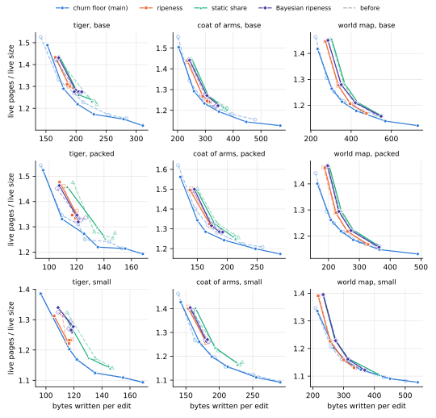
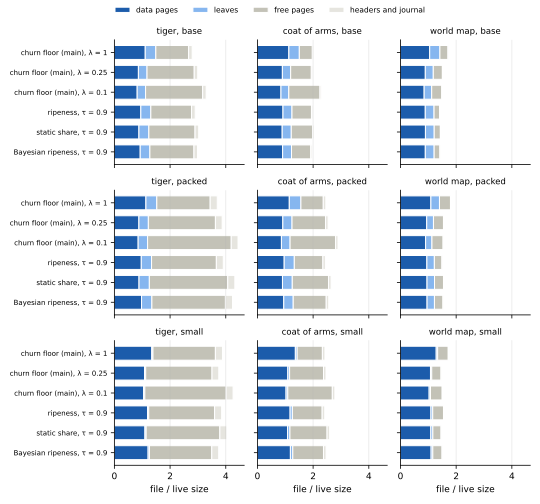

## Executive summary

**Pricing a leaf at its coverage fills the leaves as full as the data pages under main's churn floor, and otherwise changes little: the churn floor's trade-off between space and writes stays within 3 % of where [Cleaning edits without the leaves' fill floor](leaf-floor.md) measured it, and the ripeness branches' results within 2 %.**
That page's kladde-rs priced a leaf's restatements at 1.25 times its coverage; restated on their own, they take 0.94 to 1.05 times it, so a leaf now costs what its coverage says, as [Consolidation](../impl/consolidation.md#the-page-rewrite) has it.
The cut also computes a leaf's restatements before it takes the leaf into its last page, and the rotating window counts the `Size` statements it calls for, so that the last page no longer spills into a leaf of its own: under the churn floor at λ = 1 and 0.25, it spilled in 156 of 6,064 cuts, into leaves of 4 to 1,980 bytes.
The price and the fillers' fit do most of what follows: at λ = 0.25 they fill the leaves 85 to 89 % full, and the window's fit, which ends the spills, raises that to 88 to 90 % and takes up to 3 % more of the live pages off.

**Under the churn floor, the leaves now come out as full as the data pages: at λ = 0.25, 88 to 90 % in the drawings' base and packed layouts, where they were 79 to 80 %, and the data pages are 89 to 93 %.**
Leaves as full as the data pages would save at most 2.5 % of the live pages at λ = 0.25 and 0.1, where they would have saved up to 3.8 %.
At the same setting, the drawings keep up to 4 % fewer live pages, for up to 17 % more writes at λ = 0.25 and up to 34 % more at λ = 0.1.

**The churn floor moves along its curve rather than off it: each setting cleans more leaves now that they cost less, and the space they free costs about the writes it did.**
For the space that λ = 0.25 kept before, the churn floor now writes between 9 % less and 3 % more, and at equal writes its live pages lie within 3 % of before.
λ = 0.25 fills the drawings' live pages 89 to 92 % full, where it filled them 87 to 92 %, so it still marks [the earlier page's regime](leaf-floor.md#what-was-measured), live pages about nine tenths full; λ = 0.1 reaches further than before, to 1.08 to 1.19 times the live size, where it reached 1.08 to 1.21.

**The ranking of the policies stands: at equal writes, no setting of the ripeness branches keeps more than 0.7 % fewer live pages than the churn floor on any workload, and none keeps fewer in the drawings' base and packed layouts.**
The ripeness branches never priced a leaf by the old estimate for cleaning it, only for its charge to the budget and for the room of the cut's last page, so their live pages move by about 2 % at most, and their leaves stay 79 to 86 % full at τ = 0.9, as before.

**What the change costs is time under the churn floor, which now cleans more at each setting: its edits run 7 % slower and its median flush takes 8 % longer, at the median over the drawings, and up to 28 % slower and 44 % longer at λ = 0.1.**
The ripeness branches take as long as before, and reopening the churn floor's files takes 6 % less time at the median, since they hold fewer leaves.

## What changed

**kladde-rs prices a leaf at its coverage, computes what a leaf restates before it takes it into the cut's last page, and has the rotating window count the `Size` statements it calls for.**
Until now, every branch estimated the restatements of a leaf at 1.25 times its coverage, for three things: on main, the churn floor's price of a leaf, `C − 1.25 u` reclaimed for `1.25 u` written; on every branch, the budget's charge for an offer of leaves; and whether a leaf fits the room left in the cut's last page.
Measured on the drawings and texts of the earlier pages, a leaf's restatements, derived on their own, take 0.94 to 1.05 times its coverage, and 1.00 to 1.02 times in the drawings' base and packed layouts: the live bytes of a leaf there are 67 to 83 % inline payload, which a rewrite copies byte for byte, its statements are rarely split, 1.01 to 1.10 pieces per statement, and its neighbours' deltas barely matter.
So the estimate made a leaf look a quarter costlier than it is: under the churn floor at λ = 0.25, a leaf was a victim only up to 64 % full, where a data page is one up to 80 %.

The change, on every branch, is three things:

- **A leaf is priced at its coverage**, for the churn floor and for the budget, as [the page rewrite](../impl/consolidation.md#the-page-rewrite) prices it.
- **The cut takes a leaf into the room of its last page only once its restatements are computed**: from the fragment map, before taking the leaf, as one run of their own, which bounds what they add to the page they join, so the check needs no slack.
  A leaf that would not fit is passed over.
- **The rotating window counts the `Size` statements it calls for against that room**, and no longer forgets what it took before its walk wrapped around the key space; with the fillers fitting exactly, the last page still spilled wherever the window took too much, sometimes by more than a kilobyte.
  In debug builds, the cut now asserts that its last page does not spill.

| branch | commit before | with the change | policy |
| --- | --- | --- | --- |
| `defrag-shifts` | `714c602` | `7eb2ec4` | main's churn floor |
| `ripeness-svg` | `94da80c` | `d3b3a7e` | cleaning by ripeness, one rate per page |
| `ripeness2-svg` | `494d041` | `f659de7` | ripeness with a static share per page |
| `bayesian-ripeness-svg` | `770aeb8` | `65d041a` | Bayesian ripeness, rule (a), the empirical prior capped |

Each branch has the change in two commits, the price and the fillers' fit first, then the window, and a third that updates its implementation notes; `main` has it as well, as `f4f7826` and `8155b9c`.
The commits "before" are those [the earlier page](leaf-floor.md#what-changed) measured; the branches' notes commits since change no code.

## What was measured

**Everything ran as [on the earlier page](leaf-floor.md#what-was-measured)**: the same drawings, layouts, edits, texts, keystrokes and settings, on the same host, with `text-bench` from kladde-rs `7c5cdd6` added to every branch, without its `--churn-floor` option on the ripeness branches.
The regime is again live pages about nine tenths full: main's churn floor at λ = 0.25, and the ripeness branches at τ = 0.9; the tables give main at λ = 1 and 0.1 as well.
Main's budget controller held the budget at its maximum, 256 pages, in every run but those on the 512 KiB text, where it held it at one page, as before, and four on the world map at λ = 0.35 and below, whose whole files now come close to the controller's target fill of 0.8, where it dipped at times, to 196 pages at the lowest.

**Every table gives, in brackets, the earlier page's value at the same setting**, from its data in `data/leaf-floor/`, which are also the dashed curves of the figure below.
The space and writes come from 198 runs, eight at a time, of the builds with the change, and 198 more of the builds with the first commit alone, which attribute the change to its two parts; the overflows of the cut's last page from scratch builds that counted them, of main's churn floor at λ = 1 and 0.25, without changing what was written; and the times from two further passes, one run at a time on an otherwise idle host, which ran the earlier page's builds beside those with the change.
Both timing passes reproduced the first runs' tables to the byte.
`data/leaf-price/` keeps every run's table and, under `logs/`, the end of its output, the runs of the first commit alone under `price-only/`, and the timing passes under `timing/` and `timing2/`, with the earlier page's builds under `before/`.

To reproduce a run, build as on the earlier page, on the commit with the change:

```sh
git cherry-pick --no-commit 7c5cdd6   # text-bench; drop --churn-floor on the ripeness branches
cargo build --release -p kladde-svg --bin svg-bench --features packed
# --target-fill 0.9 instead of --churn-floor 0.25 on the ripeness branches
target/release/svg-bench crates/kladde-svg/corpus/drawings/world-map.svg \
    out/ --edits 177831 --journal-budget 4 --churn-floor 0.25
cargo build --release -p kladde-bench --bin text-bench
target/release/text-bench out/ --size 524288 --journal-budget 4 --churn-floor 0.25
```

The figures come from the tables here and, labelled `before/…`, from those of the earlier page:

```sh
D=content/evaluation/data/leaf-price; B=content/evaluation/data/leaf-floor
F=content/evaluation/figures/leaf-price
runs=()
for dir in $D/*-*-*/ $B/*-*-*/; do
    IFS=- read -r p k l <<< "$(basename $dir)"; knob=${k%%[0-9]*}
    case $dir in $B/*) before=before/ ;; *) before= ;; esac
    runs+=("$before$p/$knob/${k#$knob}/$l=$dir")
done
tools/plot-evaluation.py --only svg-shift --out $F "${runs[@]}"
tools/plot-evaluation.py --only svg-pages --out $F $(printf '%s\n' "${runs[@]}" |
    grep -E '^(main/lambda/(1|0.25|0.1)|[a-z0-9]+/tau/0.9)/')
```

## The regime, and what it costs now

**For the space that each policy kept on the earlier page in the regime, the churn floor now writes between 9 % less and 3 % more, and the ripeness branches between 3 % less and 3 % more.**
Each cell gives the live pages over the live size that the earlier page reached at λ = 0.25 or τ = 0.9, the bytes written per edit or keystroke then, and the bytes the same policy now writes for that space, interpolated along its curve:

| workload | layout or size | churn floor, λ = 0.25 | ripeness, τ = 0.9 | static share, τ = 0.9 | Bayesian, τ = 0.9 |
| --- | --- | --- | --- | --- | --- |
| tiger | base | 1.23: 212 → 200 (−6 %) | 1.30: 193 → 188 (−2 %) | 1.23: 231 → 224 (−3 %) | 1.27: 209 → — |
| tiger | packed | 1.25: 126 → 130 (+3 %) | 1.34: 121 → 118 (−3 %) | 1.26: 146 → 141 (−4 %) | 1.33: 123 → 121 (−2 %) |
| tiger | small | 1.12: 135 → 135 (0 %) | 1.23: 118 → 115 (−3 %) | 1.14: 147 → 146 (−1 %) | 1.27: 116 → 117 (+1 %) |
| coat of arms | base | 1.23: 311 → 304 (−2 %) | 1.24: 307 → 310 (+1 %) | 1.21: 379 → 368 (−3 %) | 1.22: 332 → — |
| coat of arms | packed | 1.28: 183 → 167 (−9 %) | 1.32: 174 → 171 (−2 %) | 1.27: 211 → 206 (−3 %) | 1.29: 189 → 186 (−2 %) |
| coat of arms | small | 1.16: 210 → 213 (+1 %) | 1.26: 179 → 179 (0 %) | 1.16: 231 → — | 1.26: 184 → — |
| world map | base | 1.22: 363 → 352 (−3 %) | 1.21: 399 → 395 (−1 %) | 1.21: 422 → 434 (+3 %) | 1.21: 421 → 423 (+1 %) |
| world map | packed | 1.22: 247 → 244 (−1 %) | 1.22: 260 → 261 (0 %) | 1.22: 276 → 280 (+1 %) | 1.22: 273 → 272 (0 %) |
| world map | small | 1.13: 339 → 346 (+2 %) | 1.16: 301 → 300 (0 %) | 1.16: 316 → 316 (0 %) | 1.16: 317 → 316 (0 %) |
| text | 64 KiB | 1.19: 40.3 → 40.1 (−1 %) | 1.19: 42.8 → 42.8 (0 %) | 1.19: 44.0 → 44.0 (0 %) | 1.19: 44.3 → 43.8 (−1 %) |
| text | 512 KiB | 1.09: 50.0 → 50.6 (+1 %) | 1.17: 50.4 → 50.4 (0 %) | 1.17: 54.2 → 54.2 (0 %) | 1.18: 51.8 → 51.8 (0 %) |

A dash means that no setting reaches that space any more; the nearest misses it by at most 0.5 %.

## Live pages

**At the same setting, the drawings keep up to 4 % fewer live pages under the churn floor, and within 2 % of as many under the ripeness branches.**
Each cell gives the live pages, the leaves among them in parentheses, and in brackets the change from the earlier page at the same setting; the first column gives the live bytes they hold, in data pages and in leaves:

| workload | layout or size | live bytes, KiB | λ = 1 | λ = 0.25 | λ = 0.1 | ripeness | static share | Bayesian |
| --- | --- | --- | --- | --- | --- | --- | --- | --- |
| tiger | base | 72 + 26 | 34.2 (8.8) [−2 %] | 26.9 (7.1) [−4 %] | 25.8 (6.9) [−3 %] | 30.1 (8.2) [0 %] | 28.4 (8.2) [0 %] | 29.3 (8.0) [0 %] |
| tiger | packed | 37 + 14 | 18.0 (4.6) [−1 %] | 14.4 (4.0) [−3 %] | 14.1 (4.0) [−2 %] | 15.8 (4.4) [0 %] | 14.9 (4.4) [0 %] | 15.9 (4.4) [+2 %] |
| tiger | small | 45 + 1 | 16.1 (0.5) [0 %] | 13.1 (0.5) [0 %] | 12.7 (0.5) [0 %] | 14.3 (0.5) [0 %] | 13.2 (0.5) [0 %] | 14.6 (0.6) [−1 %] |
| coat of arms | base | 203 + 67 | 94.8 (23.7) [−3 %] | 75.2 (18.8) [−3 %] | 71.0 (17.7) [−3 %] | 78.2 (20.3) [0 %] | 76.6 (20.5) [0 %] | 77.1 (20.0) [+1 %] |
| coat of arms | packed | 107 + 38 | 51.0 (13.6) [−4 %] | 40.6 (10.8) [−3 %] | 38.3 (10.1) [−3 %] | 43.2 (11.9) [0 %] | 40.9 (11.5) [−1 %] | 42.0 (11.0) [0 %] |
| coat of arms | small | 127 + 7 | 45.8 (2.1) [−2 %] | 37.1 (2.0) [0 %] | 35.0 (2.0) [0 %] | 40.3 (2.6) [0 %] | 37.5 (2.8) [0 %] | 40.8 (2.8) [+1 %] |
| world map | base | 1,110 + 345 | 478.8 (123.6) [−3 %] | 398.6 (96.6) [−3 %] | 379.4 (91.6) [−3 %] | 408.0 (106.3) [0 %] | 409.8 (106.1) [0 %] | 409.2 (107.1) [0 %] |
| world map | packed | 834 + 202 | 333.2 (72.6) [−3 %] | 282.2 (57.0) [−2 %] | 269.3 (53.8) [−3 %] | 290.0 (63.3) [0 %] | 291.3 (63.5) [0 %] | 290.8 (62.6) [0 %] |
| world map | small | 937 + 36 | 314.1 (12.0) [−1 %] | 264.6 (10.6) [−1 %] | 253.8 (11.1) [0 %] | 273.1 (15.1) [0 %] | 274.1 (17.1) [0 %] | 273.7 (14.3) [0 %] |
| text | 64 KiB | 192 + 13 | 60.4 (3.8) [0 %] | 56.9 (3.8) [−1 %] | 54.3 (3.7) [0 %] | 57.4 (3.9) [0 %] | 57.5 (4.1) [0 %] | 57.3 (3.8) [0 %] |
| text | 512 KiB | 640 + 28 | 175.7 (7.6) [0 %] | 176.5 (7.6) [+1 %] | 175.2 (7.6) [0 %] | 188.5 (10.7) [0 %] | 187.9 (11.3) [0 %] | 189.9 (10.6) [0 %] |

Over the live size, with the earlier page's value in brackets:

| workload | layout or size | live size, KiB | λ = 1 | λ = 0.25 | λ = 0.1 | ripeness | static share | Bayesian |
| --- | --- | --- | --- | --- | --- | --- | --- | --- |
| tiger | base | 92 | 1.49 [1.53] | 1.17 [1.23] | 1.12 [1.15] | 1.31 [1.30] | 1.24 [1.23] | 1.28 [1.27] |
| tiger | packed | 47 | 1.52 [1.54] | 1.22 [1.25] | 1.19 [1.21] | 1.33 [1.34] | 1.26 [1.26] | 1.35 [1.33] |
| tiger | small | 46 | 1.39 [1.39] | 1.12 [1.12] | 1.09 [1.09] | 1.23 [1.23] | 1.14 [1.14] | 1.26 [1.27] |
| coat of arms | base | 252 | 1.50 [1.55] | 1.19 [1.23] | 1.13 [1.16] | 1.24 [1.24] | 1.22 [1.21] | 1.22 [1.22] |
| coat of arms | packed | 131 | 1.56 [1.62] | 1.24 [1.28] | 1.17 [1.21] | 1.32 [1.32] | 1.25 [1.27] | 1.29 [1.29] |
| coat of arms | small | 128 | 1.43 [1.46] | 1.16 [1.16] | 1.09 [1.09] | 1.26 [1.26] | 1.17 [1.16] | 1.27 [1.26] |
| world map | base | 1,353 | 1.42 [1.46] | 1.18 [1.22] | 1.12 [1.16] | 1.21 [1.21] | 1.21 [1.21] | 1.21 [1.21] |
| world map | packed | 954 | 1.40 [1.44] | 1.18 [1.22] | 1.13 [1.16] | 1.22 [1.22] | 1.22 [1.22] | 1.22 [1.22] |
| world map | small | 943 | 1.34 [1.35] | 1.12 [1.13] | 1.08 [1.08] | 1.16 [1.16] | 1.16 [1.16] | 1.16 [1.16] |
| text | 64 KiB | 193 | 1.25 [1.25] | 1.18 [1.19] | 1.13 [1.13] | 1.19 [1.19] | 1.19 [1.19] | 1.19 [1.19] |
| text | 512 KiB | 642 | 1.09 [1.09] | 1.10 [1.09] | 1.09 [1.09] | 1.17 [1.17] | 1.17 [1.17] | 1.18 [1.18] |

## Leaves and data pages

**Under the churn floor, the leaves of the drawings' base and packed layouts now fill about as much as the data pages, 70 to 75 % at λ = 1, 88 to 90 % at λ = 0.25 and 86 to 95 % at λ = 0.1; under the ripeness branches, they fill as before.**
Each cell gives the fill of the data pages, of the leaves, and of all live pages, in percent, and in brackets the leaves' fill on the earlier page:

| workload | layout or size | λ = 1 | λ = 0.25 | λ = 0.1 | ripeness | static share | Bayesian |
| --- | --- | --- | --- | --- | --- | --- | --- |
| tiger | base | 71 / 74 / 71 [66] | 91 / 90 / 91 [79] | 96 / 93 / 95 [86] | 83 / 79 / 82 [79] | 90 / 79 / 87 [80] | 85 / 81 / 84 [80] |
| tiger | packed | 70 / 75 / 71 [71] | 89 / 88 / 89 [80] | 93 / 86 / 91 [83] | 82 / 80 / 81 [77] | 90 / 79 / 87 [79] | 82 / 80 / 81 [83] |
| tiger | small | 73 / 28 / 72 [28] | 91 / 33 / 89 [33] | 94 / 35 / 91 [35] | 83 / 28 / 81 [29] | 90 / 29 / 88 [30] | 82 / 32 / 80 [30] |
| coat of arms | base | 72 / 71 / 72 [62] | 90 / 89 / 90 [80] | 96 / 94 / 95 [86] | 89 / 83 / 87 [82] | 92 / 82 / 89 [83] | 90 / 84 / 88 [85] |
| coat of arms | packed | 72 / 71 / 72 [63] | 90 / 89 / 90 [79] | 96 / 93 / 95 [85] | 86 / 81 / 85 [82] | 92 / 83 / 90 [82] | 88 / 86 / 87 [85] |
| coat of arms | small | 73 / 80 / 73 [66] | 91 / 81 / 90 [76] | 97 / 85 / 96 [82] | 85 / 64 / 84 [62] | 92 / 65 / 90 [69] | 84 / 63 / 83 [62] |
| world map | base | 78 / 70 / 76 [62] | 92 / 89 / 92 [79] | 97 / 95 / 96 [84] | 93 / 83 / 90 [83] | 92 / 83 / 90 [82] | 93 / 82 / 90 [82] |
| world map | packed | 80 / 70 / 78 [63] | 93 / 89 / 92 [79] | 97 / 95 / 97 [84] | 93 / 81 / 90 [81] | 93 / 80 / 90 [80] | 92 / 81 / 90 [82] |
| world map | small | 78 / 76 / 78 [66] | 93 / 91 / 92 [82] | 97 / 94 / 97 [87] | 91 / 66 / 90 [65] | 92 / 59 / 90 [59] | 91 / 70 / 90 [70] |
| text | 64 KiB | 85 / 87 / 85 [86] | 91 / 87 / 90 [86] | 95 / 88 / 95 [88] | 90 / 81 / 90 [81] | 91 / 74 / 89 [74] | 90 / 84 / 90 [84] |
| text | 512 KiB | 96 / 93 / 95 [91] | 95 / 93 / 95 [93] | 96 / 94 / 96 [93] | 90 / 65 / 89 [65] | 91 / 61 / 89 [61] | 90 / 65 / 88 [65] |

**Leaves as full as the data pages would save at most 2.8 % of the live pages under the churn floor, and at most 3.5 % under the ripeness branches at τ = 0.9.**
The leaves stay 20 to 29 % of the live pages in the drawings' base and packed layouts, since the statements stay 20 to 27 % of the live bytes there.

**The ripeness branches' leaves stay 79 to 86 % full at τ = 0.9, against data pages 82 to 93 % full**: their ranking of leaves by ripeness never used the 1.25, and this page has not traced what keeps their leaves a few points emptier.

**The churn floor rewrites more leaves at the same setting, and the ripeness branches as many.**
Each cell gives, over a whole run, the data victims that free filling took, the data pages opened only to take victims, and the leaves rewritten, by the budget or by the cut's fillers, with the leaves rewritten on the earlier page in brackets:

| workload | layout or size | λ = 1 | λ = 0.25 | λ = 0.1 | ripeness | static share | Bayesian |
| --- | --- | --- | --- | --- | --- | --- | --- |
| tiger | base | 112 / 145 / 219 [185] | 66 / 545 / 411 [300] | 78 / 923 / 601 [385] | 7 / 340 / 292 [292] | 5 / 524 / 310 [318] | 6 / 395 / 324 [315] |
| tiger | packed | 90 / 64 / 118 [113] | 56 / 301 / 200 [167] | 51 / 482 / 275 [199] | 8 / 196 / 168 [178] | 1 / 336 / 168 [170] | 0 / 213 / 175 [178] |
| tiger | small | 97 / 120 / 61 [61] | 66 / 413 / 65 [65] | 59 / 664 / 63 [63] | 8 / 241 / 61 [60] | 5 / 415 / 61 [62] | 7 / 245 / 64 [63] |
| coat of arms | base | 215 / 226 / 388 [340] | 131 / 1,045 / 858 [592] | 100 / 2,282 / 1,569 [963] | 9 / 847 / 645 [630] | 11 / 1,155 / 660 [738] | 15 / 1,004 / 737 [675] |
| coat of arms | packed | 123 / 145 / 223 [184] | 90 / 604 / 460 [352] | 84 / 1,186 / 748 [494] | 13 / 433 / 348 [365] | 13 / 701 / 390 [388] | 20 / 495 / 443 [421] |
| coat of arms | small | 147 / 225 / 202 [199] | 98 / 883 / 249 [239] | 77 / 1,589 / 255 [254] | 11 / 536 / 219 [218] | 10 / 931 / 229 [219] | 6 / 552 / 208 [215] |
| world map | base | 919 / 1,194 / 3,002 [2,547] | 673 / 4,729 / 6,522 [4,319] | 646 / 10,636 / 12,451 [6,278] | 72 / 4,405 / 5,112 [5,082] | 88 / 4,630 / 5,657 [5,191] | 96 / 4,720 / 5,256 [5,151] |
| world map | packed | 795 / 817 / 1,792 [1,537] | 573 / 3,130 / 3,867 [2,568] | 523 / 7,691 / 7,993 [3,481] | 50 / 3,102 / 2,865 [2,792] | 97 / 3,269 / 3,050 [2,915] | 60 / 3,173 / 3,018 [2,915] |
| world map | small | 774 / 1,673 / 2,400 [2,189] | 571 / 5,996 / 4,157 [3,324] | 515 / 12,072 / 5,903 [4,369] | 76 / 4,406 / 2,435 [2,502] | 116 / 4,809 / 2,380 [2,439] | 87 / 4,357 / 2,870 [2,882] |
| text | 64 KiB | 54 / 14 / 157 [149] | 50 / 69 / 161 [158] | 45 / 210 / 162 [162] | 8 / 117 / 127 [127] | 8 / 148 / 119 [119] | 4 / 133 / 134 [134] |
| text | 512 KiB | 63 / 90 / 174 [168] | 57 / 101 / 190 [180] | 61 / 110 / 186 [184] | 6 / 137 / 22 [22] | 9 / 178 / 8 [8] | 6 / 146 / 29 [29] |

## The cut's last page

**The cut's last page no longer spills: under the churn floor at λ = 1 and 0.25, it spilled in 156 of 6,064 cuts before, into leaves of 4 to 1,980 bytes, and in none since.**
Each cell gives the cuts whose last page spilled into a leaf of its own, before the change, with its first commit alone, and with both, and the cuts in all:

| workload | layout or size | λ = 1 | λ = 0.25 |
| --- | --- | --- | --- |
| tiger | base | 2 / 6 / 0 of 115 | 4 / 6 / 0 of 115 |
| tiger | packed | 7 / 5 / 0 of 90 | 15 / 5 / 0 of 90 |
| tiger | small | 0 / 0 / 0 of 89 | 0 / 0 / 0 of 89 |
| coat of arms | base | 3 / 7 / 0 of 175 | 6 / 3 / 0 of 175 |
| coat of arms | packed | 4 / 6 / 0 of 127 | 6 / 6 / 0 of 127 |
| coat of arms | small | 5 / 5 / 0 of 129 | 0 / 0 / 0 of 129 |
| world map | base | 5 / 5 / 0 of 778 | 5 / 15 / 0 of 778 |
| world map | packed | 3 / 5 / 0 of 656 | 6 / 5 / 0 of 656 |
| world map | small | 44 / 51 / 0 of 667 | 39 / 25 / 0 of 667 |
| text | 64 KiB | 0 / 0 / 0 of 103 | 0 / 0 / 0 of 103 |
| text | 512 KiB | 2 / 1 / 0 of 103 | 0 / 0 / 0 of 103 |

With the first commit alone, which fits the fillers exactly, the last page spilled about as often, and in every such cut the window had taken part of its room.
The small spills were the window's `Size` statements, a leaf of about ten bytes each; the large ones came from the window forgetting, once its walk wrapped around the key space, the bytes it had taken before.

## The trade-off between space and writes

**The churn floor's curve stays within 3 % of where it was, and reaches further at λ = 0.1; the ripeness branches' curves stay where they were.**
Each panel shows each policy's settings, from the one that cleans least, hollow, to the one that cleans most, and dashed and pale the same policy's curve on the earlier page:



- **At equal writes, the churn floor's live pages lie between 3 % fewer and 3 % more than before**, mostly fewer in the base and packed layouts at the lower churn floors.
- **At λ = 0.1, the churn floor reaches 1.12 and 1.13 times the live size on the world map in its base and packed layouts**, where it reached 1.16, for 32 and 34 % more writes.
- **The ripeness branches keep 0.3 to 15 % more live pages than the churn floor at equal writes in the drawings' base and packed layouts, and between 0.7 % fewer and 8 % more in the small layout.**
- **On the texts, nothing changed**: every setting keeps its live pages within 1 % and its writes within 3 % of the earlier page's.

## Files

**The files hold between 8 % fewer and 8 % more pages than before, as their free pages come and go with compaction mode and truncation.**
Each bar is a drawing's file averaged over the second half of the edits, in multiples of the live size:



Each cell gives the file's pages during the edits, and in parentheses the free ones among them, with the earlier page's in brackets:

| workload | layout or size | λ = 1 | λ = 0.25 | λ = 0.1 | ripeness | static share | Bayesian |
| --- | --- | --- | --- | --- | --- | --- | --- |
| tiger | base | 64 (27) [68 (30)] | 69 (39) [70 (39)] | 76 (47) [74 (45)] | 67 (34) [70 (37)] | 70 (38) [69 (38)] | 69 (36) [67 (35)] |
| tiger | packed | 44 (23) [48 (27)] | 46 (29) [47 (30)] | 52 (35) [52 (35)] | 46 (28) [46 (27)] | 51 (33) [50 (32)] | 50 (31) [47 (29)] |
| tiger | small | 45 (26) [45 (26)] | 44 (28) [44 (28)] | 49 (34) [49 (34)] | 45 (27) [45 (28)] | 47 (31) [49 (33)] | 43 (26) [44 (26)] |
| coat of arms | base | 127 (29) [130 (30)] | 125 (47) [124 (44)] | 144 (71) [137 (62)] | 125 (44) [123 (41)] | 128 (48) [129 (49)] | 124 (44) [124 (44)] |
| coat of arms | packed | 80 (26) [83 (27)] | 83 (39) [82 (37)] | 94 (53) [92 (50)] | 80 (33) [81 (35)] | 86 (43) [86 (41)] | 84 (39) [80 (36)] |
| coat of arms | small | 78 (29) [82 (32)] | 79 (39) [82 (42)] | 89 (51) [88 (50)] | 78 (34) [77 (34)] | 83 (43) [80 (40)] | 79 (35) [78 (34)] |
| world map | base | 579 (97) [598 (101)] | 510 (109) [529 (114)] | 504 (121) [503 (108)] | 477 (66) [481 (69)] | 487 (74) [483 (70)] | 482 (69) [482 (70)] |
| world map | packed | 428 (92) [429 (84)] | 369 (83) [383 (91)] | 367 (94) [373 (94)] | 357 (64) [363 (70)] | 371 (76) [360 (65)] | 365 (71) [374 (80)] |
| world map | small | 408 (91) [407 (87)] | 346 (78) [344 (75)] | 355 (98) [353 (95)] | 367 (91) [340 (64)] | 345 (68) [348 (71)] | 354 (77) [348 (72)] |
| text | 64 KiB | 79 (16) [79 (16)] | 79 (20) [79 (19)] | 81 (24) [82 (25)] | 81 (21) [81 (21)] | 83 (23) [83 (23)] | 82 (22) [82 (22)] |
| text | 512 KiB | 201 (23) [201 (23)] | 203 (24) [201 (23)] | 201 (24) [201 (23)] | 214 (23) [214 (23)] | 216 (26) [216 (26)] | 217 (25) [217 (25)] |

Each cell gives the closed file in KiB, with the earlier page's in brackets:

| workload | layout or size | λ = 1 | λ = 0.25 | λ = 0.1 | ripeness | static share | Bayesian |
| --- | --- | --- | --- | --- | --- | --- | --- |
| tiger | base | 244 [240] | 228 [220] | 296 [292] | 248 [232] | 248 [240] | 228 [244] |
| tiger | packed | 164 [144] | 164 [172] | 172 [184] | 164 [156] | 148 [152] | 148 [148] |
| tiger | small | 136 [136] | 164 [164] | 168 [168] | 144 [124] | 156 [176] | 144 [144] |
| coat of arms | base | 544 [500] | 472 [452] | 524 [500] | 484 [468] | 488 [484] | 480 [476] |
| coat of arms | packed | 312 [320] | 312 [292] | 332 [320] | 292 [288] | 272 [316] | 304 [304] |
| coat of arms | small | 292 [280] | 276 [268] | 324 [336] | 280 [272] | 300 [288] | 296 [284] |
| world map | base | 1,980 [2,088] | 1,912 [1,856] | 1,796 [1,772] | 1,764 [1,736] | 1,760 [1,768] | 1,756 [1,704] |
| world map | packed | 1,508 [1,372] | 1,356 [1,272] | 1,272 [1,252] | 1,240 [1,332] | 1,188 [1,228] | 1,324 [1,212] |
| world map | small | 1,280 [1,324] | 1,120 [1,120] | 1,196 [1,212] | 1,160 [1,180] | 1,156 [1,196] | 1,140 [1,152] |
| text | 64 KiB | 384 [372] | 360 [384] | 400 [388] | 380 [380] | 404 [404] | 380 [380] |
| text | 512 KiB | 848 [844] | 868 [824] | 876 [860] | 944 [944] | 924 [924] | 932 [932] |

As on the earlier pages, a closed size depends on where the last live page lies when the edits end, which varies by up to a third between runs that keep nearly as many live pages.

## Writes

**At the same setting, the churn floor writes up to 34 % more, nearly all of it leaves, and the ripeness branches between 4 % less and 5 % more.**
Each cell gives the bytes written per edit, or per keystroke on the texts, with the change from the earlier page at the same setting in brackets; the journal and the headers write what they wrote before:

| workload | layout or size | journal + headers | λ = 1 | λ = 0.25 | λ = 0.1 | ripeness | static share | Bayesian |
| --- | --- | --- | --- | --- | --- | --- | --- | --- |
| tiger | base | 52 + 15 | 152 [+8 %] | 230 [+8 %] | 311 [+10 %] | 185 [−4 %] | 227 [−2 %] | 210 [0 %] |
| tiger | packed | 37 + 11 | 96 [+2 %] | 136 [+8 %] | 168 [+10 %] | 119 [−1 %] | 141 [−4 %] | 120 [−2 %] |
| tiger | small | 37 + 11 | 96 [0 %] | 135 [0 %] | 169 [0 %] | 118 [−1 %] | 146 [−1 %] | 118 [+2 %] |
| coat of arms | base | 65 + 18 | 204 [+1 %] | 349 [+12 %] | 569 [+19 %] | 312 [+2 %] | 365 [−4 %] | 348 [+5 %] |
| coat of arms | packed | 44 + 12 | 121 [+3 %] | 195 [+6 %] | 289 [+12 %] | 170 [−2 %] | 214 [+1 %] | 187 [−1 %] |
| coat of arms | small | 45 + 13 | 142 [+3 %] | 213 [+1 %] | 291 [0 %] | 180 [0 %] | 228 [−1 %] | 182 [−1 %] |
| world map | base | 63 + 17 | 233 [+4 %] | 426 [+17 %] | 731 [+32 %] | 395 [−1 %] | 432 [+3 %] | 421 [0 %] |
| world map | packed | 49 + 14 | 164 [+4 %] | 280 [+13 %] | 489 [+34 %] | 261 [+1 %] | 280 [+1 %] | 273 [0 %] |
| world map | small | 51 + 14 | 215 [+3 %] | 356 [+5 %] | 541 [+8 %] | 300 [0 %] | 315 [0 %] | 314 [−1 %] |
| text | 64 KiB | 13.2 + 4.1 | 36.8 [0 %] | 40.5 [+1 %] | 47.9 [−1 %] | 42.8 [0 %] | 44.0 [0 %] | 44.3 [0 %] |
| text | 512 KiB | 13.2 + 4.1 | 49.9 [0 %] | 51.5 [+3 %] | 51.7 [+2 %] | 50.4 [0 %] | 54.2 [0 %] | 51.8 [0 %] |

Each cell splits the rest into data pages and leaves, with the earlier page's split in brackets:

| workload | layout or size | λ = 1 | λ = 0.25 | λ = 0.1 | ripeness | static share | Bayesian |
| --- | --- | --- | --- | --- | --- | --- | --- |
| tiger | base | 56 + 30 [49 + 25] | 111 + 51 [106 + 39] | 165 + 79 [168 + 49] | 81 + 37 [85 + 41] | 118 + 42 [120 + 44] | 99 + 44 [98 + 45] |
| tiger | packed | 31 + 16 [30 + 15] | 60 + 27 [55 + 23] | 84 + 35 [78 + 27] | 47 + 23 [48 + 24] | 69 + 23 [74 + 24] | 48 + 23 [50 + 25] |
| tiger | small | 41 + 7 [41 + 7] | 79 + 8 [79 + 8] | 114 + 8 [114 + 8] | 62 + 7 [63 + 8] | 91 + 7 [91 + 8] | 62 + 8 [60 + 8] |
| coat of arms | base | 78 + 43 [81 + 39] | 171 + 95 [164 + 65] | 311 + 176 [293 + 103] | 156 + 74 [153 + 71] | 205 + 77 [212 + 84] | 181 + 85 [172 + 77] |
| coat of arms | packed | 43 + 23 [43 + 19] | 91 + 48 [90 + 37] | 153 + 80 [152 + 51] | 77 + 37 [79 + 39] | 114 + 44 [112 + 43] | 85 + 45 [88 + 46] |
| coat of arms | small | 63 + 21 [60 + 21] | 129 + 27 [127 + 26] | 208 + 26 [206 + 27] | 97 + 25 [98 + 24] | 146 + 25 [149 + 25] | 101 + 23 [103 + 24] |
| world map | base | 80 + 73 [80 + 63] | 176 + 169 [173 + 110] | 329 + 322 [314 + 158] | 185 + 130 [188 + 130] | 209 + 143 [210 + 131] | 207 + 134 [207 + 133] |
| world map | packed | 58 + 42 [58 + 36] | 120 + 97 [121 + 63] | 230 + 196 [213 + 89] | 127 + 70 [128 + 69] | 143 + 73 [141 + 71] | 135 + 75 [137 + 72] |
| world map | small | 95 + 54 [94 + 50] | 196 + 95 [197 + 76] | 336 + 139 [334 + 102] | 176 + 58 [176 + 60] | 193 + 57 [193 + 58] | 180 + 68 [183 + 69] |
| text | 64 KiB | 4.6 + 14.9 [4.5 + 14.8] | 8.0 + 15.2 [7.8 + 15.2] | 15.3 + 15.3 [16.1 + 15.0] | 11.0 + 14.6 [11.0 + 14.6] | 12.6 + 14.1 [12.6 + 14.1] | 12.3 + 14.7 [12.3 + 14.7] |
| text | 512 KiB | 4.8 + 27.8 [4.7 + 27.9] | 4.7 + 29.5 [4.6 + 28.1] | 4.8 + 29.5 [4.8 + 28.3] | 5.7 + 27.4 [5.7 + 27.4] | 9.7 + 27.1 [9.7 + 27.1] | 7.4 + 27.1 [7.4 + 27.1] |

## Times

**Measured beside the builds of the earlier page, at the same setting, the churn floor's edits run 7 % slower and its median flush takes 8 % longer, at the median over the drawings, and up to 28 % slower and 44 % longer at λ = 0.1; the ripeness branches' times do not change.**
Each cell gives the change in the edits per second in kladde's calls, in the median flush at the rows, and in the median time to reopen the closed file, in percent, against the earlier page's build at the same setting, both measured in the same passes:

| workload | layout | λ = 1 | λ = 0.25 | λ = 0.1 | ripeness | static share | Bayesian |
| --- | --- | --- | --- | --- | --- | --- | --- |
| tiger | base | −9 / +9 / −9 | −13 / +29 / −2 | −9 / +8 / −13 | −7 / +10 / +11 | +8 / +4 / −2 | −2 / −14 / +3 |
| tiger | packed | −2 / +4 / −6 | −1 / +15 / −12 | −7 / +6 / 0 | +1 / −12 / −5 | +2 / −4 / −8 | 0 / −14 / −4 |
| tiger | small | +2 / +2 / −5 | −1 / +1 / +2 | +2 / 0 / −6 | −1 / +20 / +3 | +1 / −11 / +8 | −1 / +16 / +30 |
| coat of arms | base | −5 / +8 / −5 | −11 / +13 / −8 | −23 / +44 / −6 | +2 / −6 / −3 | +4 / +12 / −7 | −4 / −5 / +1 |
| coat of arms | packed | −4 / +1 / −3 | −8 / +17 / −7 | −13 / +33 / 0 | +2 / −3 / −3 | 0 / +5 / −1 | −2 / +5 / −3 |
| coat of arms | small | −1 / +6 / −9 | −5 / +6 / −8 | +2 / −11 / −2 | +1 / +8 / +1 | 0 / −2 / −1 | +1 / −3 / −1 |
| world map | base | −6 / +1 / −4 | −13 / +21 / −7 | −23 / +30 / −9 | 0 / +2 / −3 | −1 / −1 / 0 | 0 / −3 / 0 |
| world map | packed | −5 / +2 / −6 | −13 / +14 / −6 | −28 / +39 / −9 | −2 / +4 / 0 | 0 / +1 / +1 | 0 / +1 / +1 |
| world map | small | −2 / +7 / −7 | −8 / +10 / −1 | −11 / +24 / −5 | +1 / −2 / +2 | 0 / −4 / −12 | 0 / 0 / +1 |

- **The churn floor's flushes take longer where it now rewrites more leaves**: at λ = 0.25 by 1 to 29 %, and at λ = 0.1, in the base and packed layouts, by 6 to 44 %; the tiger's runs, of 31 rows each, are too short to tell a change of a fifth from the difference between identical runs.
- **Reopening the churn floor's files takes 6 % less time at the median**, since they hold fewer leaves to read.
- **The ripeness branches' edits, flushes and reopens change by no more than identical runs differ**, at the median by 0, −1 and 0 %.

**Edits stay fast and flushes short under every policy.**
Each cell gives the edits per second in kladde's calls, in thousands, or on the texts the keystrokes per second; the median flush at the rows, in milliseconds; and the median time to reopen the closed file, in milliseconds; each the mean of the two timing passes:

| workload | layout or size | λ = 1 | λ = 0.25 | λ = 0.1 | ripeness | static share | Bayesian |
| --- | --- | --- | --- | --- | --- | --- | --- |
| tiger | base | 86 / 3.0 / 1.3 | 74 / 4.2 / 1.2 | 68 / 4.8 / 1.1 | 84 / 3.4 / 1.2 | 79 / 4.1 / 1.2 | 73 / 3.6 / 1.2 |
| tiger | packed | 119 / 2.8 / 1.2 | 105 / 3.8 / 1.2 | 90 / 4.2 / 1.4 | 107 / 3.4 / 1.3 | 101 / 4.1 / 1.4 | 95 / 3.9 / 1.4 |
| tiger | small | 111 / 2.6 / 0.8 | 101 / 3.6 / 0.8 | 99 / 3.9 / 0.8 | 108 / 3.2 / 0.8 | 100 / 3.3 / 0.9 | 102 / 3.3 / 1.1 |
| coat of arms | base | 62 / 3.2 / 3.4 | 49 / 4.3 / 3.0 | 34 / 6.9 / 2.9 | 55 / 3.8 / 3.1 | 45 / 5.3 / 3.5 | 42 / 5.3 / 3.3 |
| coat of arms | packed | 85 / 3.5 / 3.4 | 70 / 5.2 / 3.0 | 58 / 7.5 / 2.9 | 77 / 4.4 / 3.1 | 67 / 5.3 / 3.3 | 60 / 6.5 / 3.0 |
| coat of arms | small | 74 / 4.2 / 1.8 | 67 / 5.0 / 1.7 | 64 / 5.1 / 1.7 | 75 / 4.5 / 1.8 | 64 / 5.3 / 2.0 | 68 / 4.8 / 1.8 |
| world map | base | 37 / 4.5 / 17.6 | 29 / 6.3 / 15.2 | 21 / 9.4 / 14.5 | 31 / 6.6 / 16.0 | 23 / 8.6 / 17.0 | 22 / 10.6 / 16.8 |
| world map | packed | 45 / 4.3 / 16.3 | 35 / 5.8 / 14.8 | 26 / 8.6 / 14.0 | 39 / 6.0 / 15.4 | 32 / 7.3 / 16.7 | 27 / 9.4 / 16.0 |
| world map | small | 37 / 6.1 / 8.0 | 29 / 7.8 / 7.9 | 24 / 10.8 / 7.6 | 35 / 6.3 / 8.2 | 29 / 8.1 / 8.2 | 26 / 10.5 / 8.2 |
| text | 64 KiB | 982 / 6.9 / 0.7 | 1,016 / 6.8 / 0.7 | 968 / 7.2 / 0.7 | 990 / 6.8 / 0.7 | 994 / 7.3 / 0.9 | 968 / 7.3 / 0.9 |
| text | 512 KiB | 958 / 9.2 / 1.4 | 993 / 8.9 / 1.4 | 966 / 9.0 / 1.5 | 936 / 9.1 / 1.7 | 975 / 10.8 / 1.9 | 970 / 9.4 / 2.2 |

- **In the regime, kladde's calls take 22,000 to 108,000 edits per second on the drawings, and the median flush takes 3.2 to 10.6 ms.**
- **On the texts, every setting takes 936,000 to 1,016,000 keystrokes per second, median flushes of 6.8 to 7.7 ms at 64 KiB and 8.8 to 10.8 ms at 512 KiB, and reopens of 0.7 to 2.3 ms.**
- **The earlier page's builds ran here as fast as in its own timing passes**, by 0 % at the median and within 9 % in every configuration, so its times compare with these.

**Identical runs differed by little.**
The two timing passes differed in the drawings' edit rate by 1 % at the median and 23 % at most, in their median flush by 3 % and 24 %, and in their reopen times by 2 % and 44 %, the largest on the smaller drawings, whose reopens take a millisecond or two; on the texts, by 1 to 2 % at the median and at most 8, 10 and 9 %.

## The sweep in numbers

**Every setting's steady state: the live pages over the live size, and the bytes written per edit or keystroke.**
These are the points of [the trade-off figure](#the-trade-off-between-space-and-writes); the earlier page's [sweep](leaf-floor.md#the-sweep-in-numbers) gives those before the change.

| base | tiger | coat of arms | world map |
| --- | --- | --- | --- |
| churn floor, λ = 1 | 1.49, 152 | 1.50, 204 | 1.42, 233 |
| churn floor, λ = 0.5 | 1.29, 179 | 1.29, 259 | 1.26, 304 |
| churn floor, λ = 0.35 | 1.22, 203 | 1.23, 296 | 1.21, 354 |
| churn floor, λ = 0.25 | 1.17, 230 | 1.19, 349 | 1.18, 426 |
| churn floor, λ = 0.15 | 1.15, 279 | 1.14, 447 | 1.14, 570 |
| churn floor, λ = 0.1 | 1.12, 311 | 1.13, 569 | 1.12, 731 |
| ripeness, τ = 0.75 | 1.43, 166 | 1.44, 236 | 1.45, 273 |
| ripeness, τ = 0.85 | 1.30, 189 | 1.27, 291 | 1.28, 337 |
| ripeness, τ = 0.9 | 1.31, 185 | 1.24, 312 | 1.21, 395 |
| ripeness, τ = 0.95 | 1.28, 200 | 1.24, 307 | 1.17, 476 |
| static share, τ = 0.75 | 1.44, 172 | 1.45, 252 | 1.46, 303 |
| static share, τ = 0.85 | 1.26, 204 | 1.27, 311 | 1.28, 369 |
| static share, τ = 0.9 | 1.24, 227 | 1.22, 365 | 1.21, 432 |
| static share, τ = 0.95 | 1.23, 226 | 1.20, 378 | 1.16, 548 |
| Bayesian, τ = 0.75 | 1.43, 171 | 1.44, 243 | 1.45, 285 |
| Bayesian, τ = 0.85 | 1.28, 199 | 1.27, 306 | 1.28, 351 |
| Bayesian, τ = 0.9 | 1.28, 210 | 1.22, 348 | 1.21, 421 |
| Bayesian, τ = 0.95 | 1.28, 197 | 1.22, 345 | 1.16, 549 |

| packed | tiger | coat of arms | world map |
| --- | --- | --- | --- |
| churn floor, λ = 1 | 1.52, 96 | 1.56, 121 | 1.40, 164 |
| churn floor, λ = 0.5 | 1.33, 109 | 1.34, 150 | 1.26, 208 |
| churn floor, λ = 0.35 | 1.27, 126 | 1.29, 164 | 1.22, 240 |
| churn floor, λ = 0.25 | 1.22, 136 | 1.24, 195 | 1.18, 280 |
| churn floor, λ = 0.15 | 1.21, 155 | 1.20, 247 | 1.15, 365 |
| churn floor, λ = 0.1 | 1.19, 168 | 1.17, 289 | 1.13, 489 |
| ripeness, τ = 0.75 | 1.48, 108 | 1.50, 138 | 1.46, 188 |
| ripeness, τ = 0.85 | 1.34, 121 | 1.32, 171 | 1.29, 224 |
| ripeness, τ = 0.9 | 1.33, 119 | 1.32, 170 | 1.22, 261 |
| ripeness, τ = 0.95 | 1.35, 117 | 1.32, 176 | 1.17, 328 |
| static share, τ = 0.75 | 1.46, 113 | 1.50, 149 | 1.47, 202 |
| static share, τ = 0.85 | 1.30, 135 | 1.32, 179 | 1.30, 242 |
| static share, τ = 0.9 | 1.26, 141 | 1.25, 214 | 1.22, 280 |
| static share, τ = 0.95 | 1.26, 140 | 1.26, 210 | 1.16, 365 |
| Bayesian, τ = 0.75 | 1.46, 107 | 1.50, 145 | 1.47, 197 |
| Bayesian, τ = 0.85 | 1.34, 120 | 1.32, 174 | 1.29, 234 |
| Bayesian, τ = 0.9 | 1.35, 120 | 1.29, 187 | 1.22, 273 |
| Bayesian, τ = 0.95 | 1.32, 121 | 1.28, 192 | 1.16, 364 |

| small | tiger | coat of arms | world map |
| --- | --- | --- | --- |
| churn floor, λ = 1 | 1.39, 96 | 1.43, 142 | 1.34, 215 |
| churn floor, λ = 0.5 | 1.20, 117 | 1.26, 170 | 1.20, 269 |
| churn floor, λ = 0.35 | 1.17, 122 | 1.20, 189 | 1.16, 307 |
| churn floor, λ = 0.25 | 1.12, 135 | 1.16, 213 | 1.12, 356 |
| churn floor, λ = 0.15 | 1.11, 155 | 1.11, 255 | 1.09, 451 |
| churn floor, λ = 0.1 | 1.09, 169 | 1.09, 291 | 1.08, 541 |
| ripeness, τ = 0.75 | 1.31, 106 | 1.40, 154 | 1.39, 217 |
| ripeness, τ = 0.85 | 1.22, 116 | 1.27, 179 | 1.23, 256 |
| ripeness, τ = 0.9 | 1.23, 118 | 1.26, 180 | 1.16, 300 |
| ripeness, τ = 0.95 | 1.23, 117 | 1.26, 179 | 1.13, 334 |
| static share, τ = 0.75 | 1.31, 114 | 1.40, 164 | 1.40, 233 |
| static share, τ = 0.85 | 1.17, 131 | 1.24, 194 | 1.23, 271 |
| static share, τ = 0.9 | 1.14, 146 | 1.17, 228 | 1.16, 315 |
| static share, τ = 0.95 | 1.15, 145 | 1.16, 227 | 1.10, 416 |
| Bayesian, τ = 0.75 | 1.34, 109 | 1.40, 156 | 1.40, 234 |
| Bayesian, τ = 0.85 | 1.28, 120 | 1.26, 181 | 1.23, 274 |
| Bayesian, τ = 0.9 | 1.26, 118 | 1.27, 182 | 1.16, 314 |
| Bayesian, τ = 0.95 | 1.27, 118 | 1.27, 182 | 1.12, 368 |

| text | 64 KiB | 512 KiB |
| --- | --- | --- |
| churn floor, λ = 1 | 1.25, 36.8 | 1.09, 49.9 |
| churn floor, λ = 0.5 | 1.23, 37.8 | 1.09, 50.4 |
| churn floor, λ = 0.35 | 1.20, 39.0 | 1.09, 50.8 |
| churn floor, λ = 0.25 | 1.18, 40.5 | 1.10, 51.5 |
| churn floor, λ = 0.15 | 1.15, 44.0 | 1.09, 51.6 |
| churn floor, λ = 0.1 | 1.13, 47.9 | 1.09, 51.7 |
| ripeness, τ = 0.75 | 1.45, 37.9 | 1.21, 49.5 |
| ripeness, τ = 0.85 | 1.26, 40.2 | 1.19, 49.9 |
| ripeness, τ = 0.9 | 1.19, 42.8 | 1.17, 50.4 |
| ripeness, τ = 0.95 | 1.17, 43.7 | 1.13, 53.5 |
| static share, τ = 0.75 | 1.44, 40.5 | 1.20, 51.8 |
| static share, τ = 0.85 | 1.26, 42.3 | 1.19, 52.6 |
| static share, τ = 0.9 | 1.19, 44.0 | 1.17, 54.2 |
| static share, τ = 0.95 | 1.15, 48.7 | 1.12, 56.3 |
| Bayesian, τ = 0.75 | 1.45, 39.3 | 1.22, 51.0 |
| Bayesian, τ = 0.85 | 1.27, 41.2 | 1.21, 51.1 |
| Bayesian, τ = 0.9 | 1.19, 44.3 | 1.18, 51.8 |
| Bayesian, τ = 0.95 | 1.19, 44.0 | 1.12, 55.0 |
