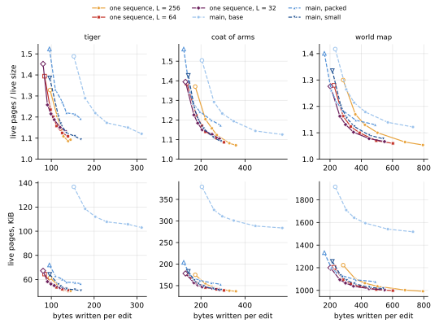
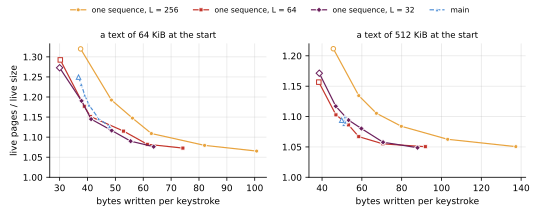

## Executive summary

**On the drawings and texts of [Cleaning edited drawings and texts](cleaning-edits.md), under the same edits, the one-sequence branch keeps as few live pages as main's best layout at equal writes, or fewer, and its churn floor reaches further.**
kladde-rs's branch `one-sequence` implements [the proposal](../drafts/one-sequence.md) in all four of its stages, and ran svg-bench and text-bench at the six settings of the churn floor that main ran, with three bounds `L` of its span policy.
With its default bound, `L` = 64 bytes, it keeps 1 to 10 % fewer live pages than main's small layout at equal writes on the tiger, 1 to 2 % fewer on the world map, and as many, within 1 %, on the coat of arms; 2 to 17 % fewer than the packed layout, but for the world map at λ = 1, and 35 to 61 % fewer than the base layout.
On the texts, it keeps 2 to 3 % fewer than main where their curves overlap on the 64 KiB text, and as many on the 512 KiB text, where main's controller had cut its budget to a page.
At λ = 0.1, it keeps 1.06 to 1.11 times the drawings' live size and 1.07 and 1.05 times the texts', where main reached 1.08 to 1.09 in the small layout, 1.13 to 1.19 in the packed one, and 1.13 and 1.09 on the texts.

**The sequence is as compact as main's small layout, and half its base layout.**
The drawings' live size, the sequence's bytes with the schema chain's, is 46, 128 and 942 KiB, within 0.4 % of the small layout's live allocation bytes, 1.3 to 2.4 % below the packed layout's, and 0.50 to 0.70 times the base layout's.
So the ratios of live pages to live size compare one sequence with main's small layout byte for byte, and its live pages compare with main's other layouts on the same drawing without a ratio.

**The journal writes 14 to 27 % less, and splices restate nothing behind them.**
Relative positions shorten a drawing edit's journal bytes from 37 to 51 per edit in main's small layout to 31 to 43, and a keystroke's from 13.2 to 9.6, as [the proposal's arithmetic](../drafts/one-sequence.md#the-journal) expected.
On the texts, the leaves take 6 to 18 bytes of each keystroke's writes where main's took 15 to 30, since a splice states one to three entries rather than every statement behind it.

**The span policy's bound decides much of the writes: a merge costs the bytes it writes again, and the garbage it leaves for the cleaner.**
At `L` = 256, the proposal's sizing and the branch's first default, the cleaner moves 1.6 to 2.1 times the bytes it moves at `L` = 64 on the drawings and texts at λ = 0.25; at `L` = 64, every setting of the churn floor writes 4 to 33 % less, for about as many live pages at equal writes, which made 64 the default.
At `L` = 64, the leaves take 8 to 26 % of the drawings' live pages and 4 to 10 % of the texts', against 2 to 8 % and 2 to 4 % at `L` = 256, since short spans keep more entries and more payloads inline; `L` = 32 traces nearly the same curves as 64.

**Edits stay fast, flushes short, and opening fast.**
At the default bound, kladde's calls take 39,000 to 123,000 edits per second on the drawings, as many as in main's small layout or up to 1.6 times as many, with median flushes of 2.2 to 5.0 ms, against 2.6 to 10.8; on the texts, 691,000 to 837,000 keystrokes per second, 14 to 30 % fewer than main, with flushes of 1.9 to 2.8 ms, against 6.8 to 9.2.
Reopening an edited file takes 0.8 to 7.7 ms, as on main.

**Where it falls short of the proposal:** the span table holds two levels only, a span costs about 90 bytes of memory rather than 32, and the cleaner, the evacuation and the walk are main's, without the refinements the proposal names; [the proposal](../drafts/one-sequence.md#how-to-get-there) records every deviation.

## What was measured

**kladde-rs's branch `one-sequence`, at `b2d0649`, ran the benchmarks of [Cleaning edited drawings and texts](cleaning-edits.md#what-was-measured) unchanged but for what one sequence removes.**
The branch starts from `defrag-shifts` at `b1a7f90`, as [the proposal](../drafts/one-sequence.md#how-to-get-there) asked, and takes eight commits: seven that implement the store, the schema, persist, the derive and the facade, the containers, `text-bench`, and kladde-svg, and one, `b2d0649`, that sets the span policy's defaults to what this page measured.
kladde-svg has one layout, since every list is a `PersistableVec` and every string a `PersistableString`, inline in its parent; `text-bench` splices the store's sequence itself, as it spliced one allocation on main.

**The edits are the same, edit for edit.**
svg-bench ran each drawing for main's number of edits, 31,613, 41,130 and 177,831, with the same seed, the same mix and the same focus, and every run ended with main's canonical SVG, of 59,005, 184,541 and 1,069,891 bytes; text-bench typed main's 100,000 keystrokes, and the texts ended at main's 241,322 and 700,340 bytes.
The store flushed whenever the journal outgrew four pages, `--journal-budget 4`, and at every row, every 1000 edits or keystrokes.

**Each workload ran at six settings of the churn floor, with three bounds of the span policy: 90 runs, eight at a time.**

| span policy | `L`, `Options::span_min` | `Options::rewrite_below` | churn floor λ |
| --- | --- | --- | --- |
| `L` = 256 | 256 | 128 | 1, 0.5, 0.35, 0.25, 0.15, 0.1 |
| `L` = 64, the default | 64 | 64 | as above |
| `L` = 32 | 32 | 32 | as above |

The bound is [choice B](../drafts/one-sequence.md#b-how-short-spans-may-stay)'s: two neighbouring spans whose entries leave the header for a leaf are merged if they are shorter than `L` together.
`rewrite_below` is [choice A](../drafts/one-sequence.md#a-overwrites-split-rewrite-or-shadow)'s threshold: a span of a data page shorter than it is written again where an edit cuts into it, rather than split.
The span policy's other constants kept their defaults: inline spans up to 64 bytes, 16 flushes to count as cold for the rotating walk, which looks at 256 spans per flush, and `μ` = 0.02.
The cleaner is main's churn floor, with its budget controller aiming the file at a fill of 0.8, its free filling, its compaction mode and truncation, over pages of spans.

**main is the churn floor's runs of [Cleaning edited drawings and texts](cleaning-edits.md#what-was-measured)**, on `defrag-shifts` at `7eb2ec4`, in the drawings' base, packed and small layouts and on the texts, from the tables in `data/cleaning-edits/`.

**The measures are main's, with the live size taken from the sequence.**
The *live size* is the sequence's bytes and the schema chain's, the column `alloc_bytes` of the tables; *live pages* are the data pages and the leaves, without the header and the journal, and the branch writes no interior pages of the span table.
Space is averaged over the second half of each run, and writes are what the store wrote during that half, per edit or keystroke: the journal's bytes and every page written, headers included, at 4,096 bytes each.
The tables keep kladde-bench's columns, so that `tools/plot-evaluation.py` reads them: `statements` and `fragments` count the spans, `allocations` is 0, `window_restated` counts every entry stated, `defrag_rewrites` and `defrag_bytes` the span policy's merges and the bytes they wrote again, and `restated_bytes` the bytes of short spans written again where an edit cut into them; columns of the span policy's own follow.

**The runs were built with `--release` by Rust 1.97.1 and ran on the Intel Core i7-1165G7 of [Cleaning edited drawings and texts](cleaning-edits.md#what-was-measured)**, four cores and eight threads, 16 GB of memory, under Linux 7.0 in a development container.
The benchmarks are deterministic but for their times; the times come from two further passes, one run at a time, of the default bound at λ = 1, 0.25 and 0.1.
`data/one-sequence/` keeps every run's table, in a directory named `<policy>-lambda<λ>-<layout>`, with `seq256`, `seq64` and `seq32` for the bounds and `one` and `text` for the layouts, `logs/` beside them the end of each run's output, and `timing/` and `timing2/` the two timing passes' tables and output, from which the rates, the flush times and the reopen times come.

To reproduce a run, build the benchmarks on the branch, and run them as main's were, with the bound's options:

```sh
cargo build --release -p kladde-svg --bin svg-bench -p kladde-bench --bin text-bench
target/release/svg-bench crates/kladde-svg/corpus/drawings/world-map.svg out/ \
    --edits 177831 --journal-budget 4 --churn-floor 0.25 --span-min 64 --rewrite-below 64
target/release/text-bench out/ --size 524288 --journal-budget 4 --churn-floor 0.25 \
    --span-min 64 --rewrite-below 64
```

The figures come from the tables of both pages, each run labelled `<policy>/lambda/<λ>/<layout>`:

```sh
runs=()
for dir in content/evaluation/data/cleaning-edits/main-*-*/ content/evaluation/data/one-sequence/seq*-*-*/; do
    IFS=- read -r p k l <<< "$(basename $dir)"; knob=${k%%[0-9]*}
    runs+=("$p/$knob/${k#$knob}/$l=$dir")
done
tools/plot-evaluation.py --only seq-svg-tradeoff,seq-text-tradeoff \
    --out content/evaluation/figures/one-sequence "${runs[@]}"
```

## The trade-off between space and writes

**With the default bound, one sequence's curve lies on or below main's lowest on every drawing, and on or below main's on the texts, and reaches further down.**
Each curve runs through the six settings of the churn floor, from λ = 1, hollow, to λ = 0.1; main's are dashed, one per layout.
Each drawing takes a column: above, live pages over the live size; below, the live pages in KiB, which compare the layouts on the same drawing, whatever their encodings:



- **Against main's small layout, whose live size one sequence's matches, the default bound keeps 1 to 10 % fewer live pages on the tiger, 1 to 2 % fewer on the world map, and on the coat of arms between 0.7 % fewer and 0.4 % more, at equal writes.**
  On the tiger the gap closes as the churn floor falls: 10 % at λ = 0.5, 1 % at λ = 0.1.
- **Against the packed layout, it keeps 9 to 17 % fewer live pages on the tiger, 3 to 7 % fewer on the coat of arms, and 2 to 4 % fewer on the world map at equal writes**, but at λ = 1 on the world map, where the packed layout, whose writes start lowest, keeps 3 % fewer.
- **Against the base layout, it keeps 35 to 61 % fewer live pages in KiB**, since the base layout's live size is 1.4 to 2 times larger, and 7 to 22 % fewer relative to each layout's own live size.
  On the tiger, the base layout writes more at its least than one sequence does at its most, so the curves do not overlap.
- **At its lowest writes, λ = 1, an edit writes 84, 135 and 225 bytes, against 96, 142 and 215 in the small layout and 96, 121 and 164 in the packed one**, and keeps 1.39, 1.39 and 1.28 times the live size, against 1.39, 1.43 and 1.34 and 1.52, 1.56 and 1.40.
- **The bound matters less than the churn floor**: `L` = 32 and 64 trace nearly one curve; `L` = 256 writes more for the same live pages on the coat of arms and the world map, while on the tiger its curve crosses `L` = 64's; at the lowest λ, it reaches furthest, 1.05 to 1.09 times the live size.

The equal-write comparisons interpolate main's curve between its settings, at every setting of one sequence whose writes lie within it.

On the texts, a panel per text gives the live pages over the live size:



- **On the 64 KiB text, the default bound keeps 2.0 to 2.6 % fewer live pages than main where the curves overlap, between 38 and 48 bytes per keystroke, and writes from 30 bytes per keystroke, where main's least is 37.**
  Below main's curve, it goes on to 1.07 times the live size at 74 bytes per keystroke, where main's λ = 0.1 kept 1.13 at 48.
- **On the 512 KiB text, main's six settings lie within 2 bytes per keystroke of each other, at 1.09 to 1.10 times the live size, and one sequence's curve passes through them**: between λ = 0.5 and 0.35 it keeps 1.10 and 1.09 times the live size at 47 and 53 bytes per keystroke.
  main's controller had cut its budget to one page, since main's file passed the target fill of 0.8 after about 11,000 keystrokes; one sequence's file stays below it, its budget at 223 to 256 pages, so every λ cleans as its own setting says.

## The live size: the encoding

**One sequence's live size is the small layout's, within 0.4 %, and 1.3 to 2.4 % below the packed layout's: what the small layout kept inline is everything here, and what it described with statements and pointers costs nothing.**
The live size is averaged over the second half of the runs; it does not depend on the bound or on λ:

| workload | edited SVG or text, KiB | main, base | main, packed | main, small | one sequence |
| --- | --- | --- | --- | --- | --- |
| tiger | 58 | 92 | 47 | 46 | 46.3 |
| coat of arms | 180 | 252 | 131 | 128 | 127.9 |
| world map | 1,045 | 1,353 | 954 | 943 | 941.6 |
| text, 64 KiB | 236 | 193 | | | 192.8 |
| text, 512 KiB | 684 | 642 | | | 642.0 |

On main, the live size counts the bytes of the allocations, and the statements that describe them come on top, as live bytes in leaves; here the entries that describe the spans come on top in the same way.
[Live pages](#live-pages) gives both.

## Live pages

**At λ = 0.25, one sequence keeps 13.4, 36.4 and 258.8 live pages on the drawings, against 13.1, 37.1 and 264.6 in main's small layout, with more of them leaves: 3.4, 7.1 and 20.9, against 0.5, 2.0 and 10.6.**
Each cell gives the live pages, and in parentheses the leaves among them, at the default bound; the first column gives the live bytes they hold, in data pages and in leaves, which hardly change with λ:

| workload | live bytes, KiB | λ = 1 | λ = 0.25 | λ = 0.1 |
| --- | --- | --- | --- | --- |
| tiger | 35 + 11 | 16.1 (3.6) | 13.4 (3.4) | 12.8 (3.4) |
| coat of arms | 107 + 24 | 44.4 (8.0) | 36.4 (7.1) | 34.7 (7.0) |
| world map | 887 + 74 | 300.9 (25.8) | 258.8 (20.9) | 249.5 (21.2) |
| text, 64 KiB | 177 + 19 | 62.2 (6.8) | 53.7 (5.6) | 51.7 (5.6) |
| text, 512 KiB | 625 + 25 | 185.7 (8.7) | 171.3 (7.1) | 168.6 (7.5) |

Over the live size, the same live pages:

| workload | live size, KiB | λ = 1 | λ = 0.25 | λ = 0.1 |
| --- | --- | --- | --- | --- |
| tiger | 46 | 1.39 | 1.16 | 1.11 |
| coat of arms | 128 | 1.39 | 1.14 | 1.09 |
| world map | 942 | 1.28 | 1.10 | 1.06 |
| text, 64 KiB | 193 | 1.29 | 1.12 | 1.07 |
| text, 512 KiB | 642 | 1.16 | 1.07 | 1.05 |

**The leaves hold more than in main's small layout because they hold content.**
A new run of bytes up to 64 long is an inline span, its bytes in its entry, and a span shorter than the bound may stay; so the leaves carry 11, 24 and 74 KiB of the drawings, where the small layout's statements took 1, 7 and 36, and the data pages correspondingly less: 35, 107 and 887 KiB, against 45, 127 and 937.
The live bytes differ from the live size by −0.8 to +3.0 %: the entries' framing comes on top, and the bytes inline in the header's entries, up to a page of them, are left out, as the header is left out of the live pages; on the tiger, the second outweighs the first.

**The pages fill as main's do under the churn floor: at λ = 0.25, the data pages 89 to 96 % full, the leaves 80 to 89 %.**
Each cell gives the fill of the data pages, of the leaves, and of all live pages, in percent, at the default bound:

| workload | λ = 1 | λ = 0.25 | λ = 0.1 |
| --- | --- | --- | --- |
| tiger | 71 / 73 / 72 | 89 / 80 / 86 | 93 / 83 / 90 |
| coat of arms | 74 / 75 / 74 | 92 / 86 / 91 | 96 / 90 / 95 |
| world map | 81 / 70 / 80 | 93 / 89 / 93 | 97 / 94 / 97 |
| text, 64 KiB | 80 / 71 / 79 | 92 / 85 / 92 | 96 / 87 / 95 |
| text, 512 KiB | 89 / 71 / 88 | 96 / 86 / 95 | 97 / 90 / 97 |

The proposal's [worked example](../drafts/one-sequence.md#a-worked-example) put a large file's live pages at about 1.12 times its sequence with pages 90 % live; the world map, at 93 % live, comes to 1.10, and the 512 KiB text, at 95 %, to 1.07.
The tiger and the coat of arms, with pages 86 and 91 % live, come to 1.16 and 1.14, since their leaves, a quarter and a fifth of their live pages, are only 80 and 86 % full.

## The span policy

**Merging spans costs writes twice: the bytes a merge writes again, and the old bytes it leaves dead in their data pages, which the cleaner then moves survivors to reclaim.**
At λ = 0.25, each row gives the spans the chains reach and their mean length, the leaves' share of the live pages, the spans split per edit, and per edit the bytes the flush wrote again: short spans an edit cut into, spans merged as their entries left the header, spans the rotating walk merged, and survivors the cleaner moved; and the bytes written per edit in all:

| workload | `L` | spans | mean span, bytes | leaves, % of live pages | splits | rewritten | merged at eviction | merged by the walk | evacuated | written |
| --- | --- | --- | --- | --- | --- | --- | --- | --- | --- | --- |
| tiger | 256 | 515 | 92 | 7.8 | 0.23 | 8.4 | 8.8 | 0.4 | 49.9 | 128 |
| tiger | 64 | 671 | 71 | 25.7 | 0.24 | 5.6 | 2.5 | 1.3 | 30.7 | 112 |
| tiger | 32 | 906 | 52 | 25.0 | 0.27 | 3.5 | 1.2 | 1.6 | 26.7 | 107 |
| coat of arms | 256 | 861 | 152 | 5.6 | 0.43 | 12.4 | 23.7 | 6.8 | 139.6 | 272 |
| coat of arms | 64 | 1,294 | 101 | 19.5 | 0.45 | 8.4 | 4.1 | 11.8 | 81.5 | 220 |
| coat of arms | 32 | 1,703 | 77 | 17.0 | 0.50 | 4.8 | 1.9 | 11.7 | 75.6 | 205 |
| world map | 256 | 2,257 | 427 | 2.3 | 0.73 | 30.0 | 47.3 | 36.7 | 258.0 | 503 |
| world map | 64 | 3,660 | 263 | 8.1 | 0.74 | 19.2 | 9.3 | 36.6 | 136.4 | 389 |
| world map | 32 | 5,121 | 188 | 8.4 | 0.79 | 11.3 | 4.7 | 35.2 | 114.5 | 350 |
| text, 64 KiB | 256 | 829 | 238 | 3.7 | 0.04 | 0.7 | 5.5 | 5.1 | 27.9 | 63 |
| text, 64 KiB | 64 | 1,211 | 163 | 10.3 | 0.04 | 0.3 | 0.7 | 6.2 | 17.6 | 53 |
| text, 64 KiB | 32 | 1,428 | 138 | 9.6 | 0.04 | 0.2 | 0.2 | 6.1 | 15.6 | 49 |
| text, 512 KiB | 256 | 1,493 | 440 | 2.3 | 0.04 | 0.3 | 5.6 | 11.5 | 35.9 | 80 |
| text, 512 KiB | 64 | 1,844 | 357 | 4.1 | 0.04 | 0.1 | 0.5 | 12.7 | 16.9 | 58 |
| text, 512 KiB | 32 | 2,099 | 313 | 4.1 | 0.04 | 0.1 | 0.1 | 12.1 | 19.3 | 60 |

- **From `L` = 256 to 64, the merges at eviction write 3.5 to 11 times less, and the cleaner moves 1.6 to 2.1 times less**, since every merge leaves the bytes it copied dead where they lay; the rewrites of short spans fall with `rewrite_below`, and the walk, which merges by temperature and `μ` rather than by the bound, writes about the same.
  So every setting of the churn floor writes 4 to 33 % less at `L` = 64, the least on the tiger at λ = 0.1 and the most on the 512 KiB text at λ = 0.1.
- **The spans stay short**: 71 to 263 bytes on average on the drawings at `L` = 64, and 163 and 357 on the texts, against the proposal's 128 bytes where the sequence is hot and a page where it is cold.
  The rotating walk merges cold runs, 1.3 to 36.6 bytes per edit on the drawings, whatever the bound, and still the mean span stays below a page by far; this page has not traced which spans stay short, or why the walk leaves them.
- **Short spans move content into the leaves, and add little to the live pages**: at `L` = 64, the leaves take 8 to 26 % of the drawings' live pages, where they took 2 to 8 % at `L` = 256, and the live pages at equal writes stay within a few percent.
  A bound of 64 lets spans of up to 64 bytes stay inline, in their entries, which `L` = 256 merged into data pages; the leaves then hold those spans' content as well as the description.
- **A splice states one to three entries, and a flush folds the keystrokes at one place into one span**: on the texts, a flush states 0.5 entries per keystroke at λ = 1 and splits 0.04 spans per keystroke, whatever the bound.

`L` = 32 writes 3 to 10 % less than 64 on the drawings, and between 14 % less and 2 % more on the texts, for about the same live pages at equal writes, with 1.1 to 1.4 times the spans; the default stays at 64, since the bound's guarantee, a mean span in the leaves of at least `L / 2`, weakens as `L` falls, and nothing measured here asks for it.

## Files

**Free pages make up as much of the files as on main: during the edits, the tiger's file holds 25 to 34 free pages beside 13 to 16 live ones, the coat of arms' 31 to 53 beside 35 to 44, and the world map's 75 to 106 beside 250 to 301.**
Each cell gives the file's pages during the edits, averaged over the second half, and in parentheses the free ones among them, at the default bound:

| workload | λ = 1 | λ = 0.25 | λ = 0.1 |
| --- | --- | --- | --- |
| tiger | 44 (25) | 47 (31) | 50 (34) |
| coat of arms | 78 (31) | 82 (43) | 90 (53) |
| world map | 395 (91) | 336 (75) | 358 (106) |
| text, 64 KiB | 82 (16) | 86 (30) | 92 (37) |
| text, 512 KiB | 218 (29) | 215 (41) | 231 (60) |

main's small layout held 45, 44 and 49 pages on the tiger, 78, 79 and 89 on the coat of arms, and 408, 346 and 355 on the world map, at λ = 1, 0.25 and 0.1: the same files, within a few pages, since the cleaner, its truncation and its compaction mode are main's.

**Closed, the files take what main's take**, after the last edit and `close`, in KiB:

| workload | edited SVG or text | λ = 1 | λ = 0.25 | λ = 0.1 | main, small, at λ = 1, 0.25, 0.1 |
| --- | --- | --- | --- | --- | --- |
| tiger | 58 | 152 | 156 | 176 | 136, 164, 168 |
| coat of arms | 180 | 288 | 260 | 264 | 292, 276, 324 |
| world map | 1,045 | 1,208 | 1,176 | 1,300 | 1,280, 1,120, 1,196 |
| text, 64 KiB | 236 | 376 | 416 | 400 | 384, 360, 400 |
| text, 512 KiB | 684 | 916 | 876 | 988 | 848, 868, 876 |

As on main, the closed sizes depend on where the last live page happens to lie when the edits end, and vary by up to 16 % between neighbouring settings.

## Writes

**The journal and the headers write 13 to 21 % less than in main's small layout, and the leaves more on the drawings and less on the texts.**
Each cell gives the bytes per edit, or per keystroke on the texts, over the second half of the run, at the default bound; the first columns give the journal and the headers, which do not depend on λ, and main's beside them:

| workload | journal + headers | main, small | λ = 1 | λ = 0.25 | λ = 0.1 |
| --- | --- | --- | --- | --- | --- |
| tiger | 31.3 + 9.5 | 36.6 + 11.3 | 84 | 112 | 139 |
| coat of arms | 37.0 + 12.1 | 44.7 + 12.7 | 135 | 220 | 304 |
| world map | 42.9 + 13.7 | 51.0 + 14.4 | 225 | 389 | 602 |
| text, 64 KiB | 9.6 + 4.1 | 13.2 + 4.1 | 30 | 53 | 74 |
| text, 512 KiB | 9.5 + 4.1 | 13.2 + 4.1 | 38 | 58 | 92 |

Each cell splits the rest into data pages and leaves, with main's small layout in the same cells of [the cleaning page](cleaning-edits.md#writes) beside it:

| workload | λ = 1 | λ = 0.25 | λ = 0.1 | main, small, at λ = 1, 0.25, 0.1 |
| --- | --- | --- | --- | --- |
| tiger | 26 + 18 | 46 + 25 | 68 + 30 | 41 + 7, 79 + 8, 114 + 8 |
| coat of arms | 56 + 31 | 119 + 52 | 182 + 73 | 63 + 21, 129 + 27, 208 + 26 |
| world map | 106 + 62 | 214 + 119 | 363 + 183 | 95 + 54, 196 + 95, 336 + 139 |
| text, 64 KiB | 11 + 6 | 28 + 12 | 45 + 16 | 4.6 + 14.9, 8.0 + 15.2, 15.3 + 15.3 |
| text, 512 KiB | 19 + 6 | 33 + 12 | 60 + 18 | 4.8 + 27.8, 4.7 + 29.5, 4.8 + 29.5 |

- **A drawing's edit appends 31 to 43 bytes to the journal, against 37 to 51**, and a keystroke 9.6, against 13.2: a record names its position relative to where the record before left off, with its kind in the same varint, where main's records named an allocation and an offset in it.
- **On the drawings, the leaves take 29 to 41 % of what goes to data pages and leaves, against 7 to 36 % in the small layout**: a flush states 1.2 to 3.4 entries per edit at λ = 1 and 1.5 to 8.9 at λ = 0.1, of which the cleaner's restatements of survivors are the growing part, and the leaves hold inline content that the small layout kept in data pages.
- **On the texts, the leaves take 6 to 18 bytes per keystroke, against main's 15 to 30, which restated the statements behind every splice**; the data pages take more, since the cleaner, whose budget main's controller had cut on the 512 KiB text, cleans at every λ here.

**Every setting writes far less than saving the file would.**
Saving the canonical SVG every 100 edits would write 590, 1,845 and 10,699 bytes per edit, and saving the text every 1000 keystrokes 241 and 700 bytes per keystroke; at λ = 0.25, one sequence writes 112, 220 and 389 bytes per edit, and 53 and 58 per keystroke.

## Times

**Edits are as fast as in main's small layout or faster, flushes mostly shorter, and opening takes as long; keystrokes are 14 to 30 % slower than on main, and their flushes a fifth to two fifths as long.**
Each cell gives the edits per second in kladde's calls, in thousands, or on the texts the keystrokes per second, counting the flushes that a full journal starts within an edit; the median time of the flushes at the rows, in milliseconds; and the median time to reopen the closed file, in milliseconds; each the mean of the two timing passes, at the default bound, and main's small layout and main on the texts, from [the cleaning page](cleaning-edits.md#times):

| workload | λ = 1 | λ = 0.25 | λ = 0.1 | main, small or on the texts, at λ = 1, 0.25, 0.1 |
| --- | --- | --- | --- | --- |
| tiger | 115 / 3.0 / 0.96 | 123 / 3.0 / 0.91 | 115 / 3.1 / 0.89 | 111 / 2.6 / 0.8, 101 / 3.6 / 0.8, 99 / 3.9 / 0.8 |
| coat of arms | 84 / 2.2 / 2.3 | 81 / 2.7 / 1.8 | 75 / 3.4 / 1.9 | 74 / 4.2 / 1.8, 67 / 5.0 / 1.7, 64 / 5.1 / 1.7 |
| world map | 48 / 3.6 / 7.3 | 44 / 4.2 / 7.3 | 39 / 5.0 / 7.7 | 37 / 6.1 / 8.0, 29 / 7.8 / 7.9, 24 / 10.8 / 7.6 |
| text, 64 KiB | 735 / 2.4 / 0.84 | 782 / 2.6 / 0.75 | 837 / 2.8 / 0.76 | 982 / 6.9 / 0.7, 1,016 / 6.8 / 0.7, 968 / 7.2 / 0.7 |
| text, 512 KiB | 804 / 1.9 / 1.8 | 691 / 2.5 / 1.7 | 770 / 2.5 / 1.5 | 958 / 9.2 / 1.4, 993 / 8.9 / 1.4, 966 / 9.0 / 1.5 |

- **On the world map, edits run 1.3 to 1.6 times as fast as in the small layout, and flushes take 0.46 to 0.59 times as long**, the gap growing as the churn floor falls; on the tiger and the coat of arms, edits are 4 to 22 % faster, and flushes 17 to 48 % shorter, but at λ = 1 on the tiger, where they take 15 % longer.
  This page has not timed the parts of an edit or a flush apart.
- **On the texts, a keystroke takes 1.2 to 1.4 µs in the store, against 1.0 on main**, and the flushes at the rows take 1.9 to 2.8 ms, against 6.8 to 9.2, since a thousand keystrokes' splices state a few spans rather than every statement behind them.
  This page has not traced where a keystroke's extra time goes.
- **Reopening takes 0.9 ms on the tiger, 1.8 to 2.3 on the coat of arms, 7.3 to 7.7 on the world map, and 0.8 and 1.5 to 1.8 on the texts**, as in main's small layout within half a millisecond: it reads the span table, walks the chain, and decodes the sequence into the drawing.

**The benchmarks' processes peak at 10.3 MB of resident memory on every workload but the world map, which takes 15.6 MB**, at λ = 0.25.
The store's span table and rope take about 90 bytes per span, 0.3 MB for the world map's 3,660 spans; the rest is the drawing in memory, the store's other tables, and the process itself, which this page has not taken apart, nor measured on main.

**Identical runs differed by more than on the cleaning page.**
The two timing passes differed in the edit rate by 8 % at the median and 32 % at most, in the median flush by 5 % and 26 %, and in the reopen times by 16 % and 33 %, the largest on the 512 KiB text's rates and on the coat of arms' reopens, which take about two milliseconds.
The reopen times are medians of 21 opens each.

## The sweep in numbers

**Every setting's steady state: the live pages over the live size, and the bytes written per edit or keystroke.**
These are the points of [the trade-off figures](#the-trade-off-between-space-and-writes); main's are in [the cleaning page's sweep](cleaning-edits.md#the-sweep-in-numbers).

| drawings | tiger | coat of arms | world map |
| --- | --- | --- | --- |
| `L` = 64, λ = 1 | 1.39, 84 | 1.39, 135 | 1.28, 225 |
| `L` = 64, λ = 0.5 | 1.24, 98 | 1.22, 179 | 1.16, 284 |
| `L` = 64, λ = 0.35 | 1.20, 105 | 1.17, 204 | 1.12, 332 |
| `L` = 64, λ = 0.25 | 1.16, 112 | 1.14, 220 | 1.10, 389 |
| `L` = 64, λ = 0.15 | 1.12, 125 | 1.11, 270 | 1.07, 496 |
| `L` = 64, λ = 0.1 | 1.11, 139 | 1.09, 304 | 1.06, 602 |
| `L` = 32, λ = 1 | 1.45, 81 | 1.39, 129 | 1.28, 203 |
| `L` = 32, λ = 0.5 | 1.26, 91 | 1.23, 168 | 1.16, 263 |
| `L` = 32, λ = 0.35 | 1.22, 99 | 1.18, 185 | 1.13, 299 |
| `L` = 32, λ = 0.25 | 1.19, 107 | 1.15, 205 | 1.10, 350 |
| `L` = 32, λ = 0.15 | 1.15, 120 | 1.13, 250 | 1.08, 450 |
| `L` = 32, λ = 0.1 | 1.13, 134 | 1.10, 284 | 1.07, 548 |
| `L` = 256, λ = 1 | 1.33, 97 | 1.37, 174 | 1.30, 284 |
| `L` = 256, λ = 0.5 | 1.21, 113 | 1.20, 220 | 1.17, 362 |
| `L` = 256, λ = 0.35 | 1.16, 121 | 1.16, 249 | 1.13, 423 |
| `L` = 256, λ = 0.25 | 1.11, 128 | 1.12, 272 | 1.10, 503 |
| `L` = 256, λ = 0.15 | 1.09, 139 | 1.08, 329 | 1.06, 680 |
| `L` = 256, λ = 0.1 | 1.09, 145 | 1.07, 359 | 1.05, 794 |

| texts | 64 KiB | 512 KiB |
| --- | --- | --- |
| `L` = 64, λ = 1 | 1.29, 30.2 | 1.16, 38.4 |
| `L` = 64, λ = 0.5 | 1.18, 38.8 | 1.10, 47.0 |
| `L` = 64, λ = 0.35 | 1.15, 41.0 | 1.09, 53.3 |
| `L` = 64, λ = 0.25 | 1.12, 52.9 | 1.07, 58.4 |
| `L` = 64, λ = 0.15 | 1.08, 61.4 | 1.06, 70.6 |
| `L` = 64, λ = 0.1 | 1.07, 74.2 | 1.05, 91.9 |
| `L` = 32, λ = 1 | 1.27, 30.0 | 1.17, 38.6 |
| `L` = 32, λ = 0.5 | 1.19, 37.9 | 1.12, 46.9 |
| `L` = 32, λ = 0.35 | 1.14, 41.3 | 1.09, 53.3 |
| `L` = 32, λ = 0.25 | 1.12, 48.7 | 1.08, 59.8 |
| `L` = 32, λ = 0.15 | 1.09, 55.5 | 1.06, 70.7 |
| `L` = 32, λ = 0.1 | 1.08, 63.7 | 1.05, 87.9 |
| `L` = 256, λ = 1 | 1.32, 37.5 | 1.21, 45.7 |
| `L` = 256, λ = 0.5 | 1.19, 48.6 | 1.13, 58.4 |
| `L` = 256, λ = 0.35 | 1.15, 56.1 | 1.11, 67.3 |
| `L` = 256, λ = 0.25 | 1.11, 62.9 | 1.08, 79.8 |
| `L` = 256, λ = 0.15 | 1.08, 82.0 | 1.06, 103.1 |
| `L` = 256, λ = 0.1 | 1.07, 100.7 | 1.05, 137.3 |
