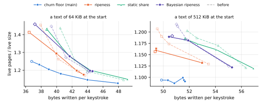

## Executive summary

**With main's free filling, the three ripeness branches write 2 to 3 % less at the same target fill on the drawings and keep about as many live pages, which closes a third to two thirds of their gap to main's churn floor there, and none of it on the texts.**
At equal writes, the ripeness branches keep, at the median, 2.5 % more live pages than the churn floor in the drawings' base and packed layouts, where they kept 3.7 % more without it, and 1.1 % more in the small layout, where they kept 3.0 % more; on the texts, 8.8 % more, where they kept 8.2 %.
[Cleaning edited drawings and texts](cleaning-edits.md) named the free cleaning the ripeness branches give up as the likely source of their extra writes for the same space; it accounts for a third of the gap in the base and packed layouts, two thirds in the small one, and none on the texts.

**Free filling takes about one victim per flush on the drawings, as on main, where the draft's took one in seven flushes or fewer, and the branches open fewer pages for cleaning.**
At τ = 0.9, free filling takes 0.80 to 1.37 victims per flush on the drawings, where the draft's took 0.01 to 0.15 and main's takes 1.0 to 1.3 at λ = 1, and 0.47 to 0.73 per flush on the texts.
The branches evacuate a median 3 % more data pages whole than without it, 9 to 25 % of them free where 0 to 3 % were, and open 2 to 20 % fewer pages for cleaning, 7 % fewer at the median.

**At the same setting, the drawings' writes fall by a median 3.3 % in the base and packed layouts and 2.7 % in the small one, in 98 of 108 runs, while the live pages stay within 2.5 %; on the texts, writes fall by 0.4 % at the median, and both move in either direction, the most at τ = 0.75.**
Along each branch's curve, the drawings keep a median 1.2 % fewer live pages at equal writes in the base and packed layouts, and 1.1 % fewer in the small one, the most at τ = 0.75, up to 5.7 % fewer, and about 0.3 % fewer at τ = 0.9 and 0.95.

**Single-rate ripeness gains most, and lies below the churn floor at 8 of its settings in the small layout, by up to 2.4 %; the churn floor still lies lowest nearly everywhere else, and reaches further.**
At equal writes, single-rate ripeness keeps a median 1.9 % more live pages than the churn floor in the drawings' base and packed layouts, where it kept 3.6 % more, 0.5 % fewer in the small layout, where it kept 2.3 % more, and 3.3 % more on the texts, where it kept 7.0 % more.
The static share and the Bayesian posterior move less, and on the texts by less than a point, in either direction.
The fullest any branch fills the pages moves by 0.02 times the live size at most: at λ = 0.1, the churn floor keeps 1.08 to 1.19 times the drawings' live size, and the best setting of any branch 1.10 to 1.25.

**Otherwise little changes**: the ripeness branches' pages fill as before, 80 to 88 % on the tiger and 84 to 90 % on the coat of arms at τ = 0.9, and their leaves as before, 78 to 86 % in the drawings' base and packed layouts.

## What changed

**Free filling on the ripeness branches is main's.**
The room left in a page the flush writes anyway takes, in compaction mode, the tail first, then whole data victims that fit, the sparsest first, then description defragmentation's candidates beyond its reserved share, then as many of one victim's statements as fit, whether ripe or not.
Without it, the branches gave that room to ripe victims whose survivors take at most θ, 5 %, of a page, and then to the cursor, the least-filled data page of the previous flush, a whole statement at a time, as the ripeness draft did then; both are gone, and [the draft](../drafts/ripeness.md#the-flushs-own-pages-take-what-costs-nothing) takes main's free filling too.

**The price of space holds after a flush whose only cleaning was free filling.**
The controller holds the price where moving it could change nothing: it does not lower it after a flush that cleaned nothing.
Free filling takes its victims whatever the price, in nearly every flush, so counted as cleaning, it would let the price fall in every flush while the pages are fuller than the target; its victims do not count.

| branch | without main's free filling | with it |
| --- | --- | --- |
| `ripeness-svg` | `d6c444d` | `3a4209a` |
| `ripeness2-svg` | `37a3a22` | `59467ed` |
| `bayesian-ripeness-svg` | `d11b834` | `1055cb3` |

**The commits without main's free filling are not those [Cleaning edited drawings and texts](cleaning-edits.md#what-was-measured) measured.**
Each branch has a commit since that fixes what its consolidator state records: the estimates the state's own rewrite changes, after its record is written, were never recorded, and came back at a reopen as losses in the gap.
That changes only bytes the consolidator state writes, and nothing on the texts, but on the drawings it moves single runs by up to 3.1 % in live pages and 7.3 % in writes, where the ranking amplifies a small difference in what a flush writes into a different choice of victims.
So this page compares against its own runs of those commits, which [the earlier page's](cleaning-edits.md#the-sweep-in-numbers) tables come within those bounds of, and the spread of single runs is part of every change below: a change in one run smaller than a few percent says little, while a change of one sign in most runs does.

## What was measured

**Everything ran as on [the earlier page](cleaning-edits.md#what-was-measured)**: the same drawings, layouts, edits, texts, keystrokes and settings, the three ripeness branches at τ = 0.75, 0.85, 0.9 and 0.95, on the same host, with `text-bench` from kladde-rs `7c5cdd6` added to every commit, without its `--churn-floor` option.
The churn floor's numbers are the earlier page's, from its data in `data/cleaning-edits/`; main's free filling is the churn floor's own, so its runs would not change.
This page ran 264 runs, eight at a time, 132 of each commit, and no timing passes, so it reports no times.
`data/ripeness-free-filling/` keeps every run with main's free filling, and its `before/` those without, each with its table and, under `logs/`, the end of its output.

To reproduce a run, build as on the earlier page, on the commit with main's free filling:

```sh
git cherry-pick --no-commit 7c5cdd6   # text-bench; drop its --churn-floor option
cargo build --release -p kladde-svg --bin svg-bench --features packed
target/release/svg-bench crates/kladde-svg/corpus/drawings/world-map.svg \
    out/ --edits 177831 --journal-budget 4 --target-fill 0.9
cargo build --release -p kladde-bench --bin text-bench
target/release/text-bench out/ --size 524288 --journal-budget 4 --target-fill 0.9
```

The figures come from the tables here, those without main's free filling labelled `before/…`, and the churn floor's from the earlier page's:

```sh
D=content/evaluation/data; F=content/evaluation/figures/ripeness-free-filling
runs=()
for dir in $D/ripeness-free-filling/*-*-*/ $D/ripeness-free-filling/before/*-*-*/ \
        $D/cleaning-edits/main-*-*/; do
    IFS=- read -r p k l <<< "$(basename $dir)"; knob=${k%%[0-9]*}
    case $dir in */before/*) before=before/ ;; *) before= ;; esac
    runs+=("$before$p/$knob/${k#$knob}/$l=$dir")
done
tools/plot-evaluation.py --only svg-tradeoff,text-tradeoff --out $F "${runs[@]}"
```

The tables give the churn floor at λ = 0.25 for reference, and each ripeness branch at τ = 0.9, the earlier page's regime, with its value without main's free filling in brackets.

## Free filling

**Free filling takes 69 to 895 victims per run on the drawings at τ = 0.9, where the draft's took 1 to 98, and as many as main's at λ = 1 to within 30 %; at that target, the branches open fewer pages for cleaning in every run.**
Each cell gives, over a whole run, the data victims that free filling took and the data pages opened only to take victims:

| workload | layout or size | churn floor, λ = 0.25 | ripeness | static share | Bayesian |
| --- | --- | --- | --- | --- | --- |
| tiger | base | 66 / 545 | 96 / 290 [3 / 357] | 107 / 511 [5 / 555] | 104 / 374 [10 / 381] |
| tiger | packed | 56 / 301 | 77 / 170 [8 / 196] | 69 / 311 [1 / 336] | 77 / 176 [1 / 221] |
| tiger | small | 66 / 413 | 76 / 216 [8 / 241] | 72 / 398 [7 / 418] | 70 / 228 [5 / 241] |
| coat of arms | base | 131 / 1,045 | 155 / 788 [19 / 838] | 165 / 1,096 [19 / 1,184] | 160 / 914 [18 / 979] |
| coat of arms | packed | 90 / 604 | 118 / 396 [11 / 457] | 108 / 661 [16 / 672] | 121 / 451 [13 / 511] |
| coat of arms | small | 98 / 883 | 116 / 493 [11 / 536] | 105 / 846 [8 / 945] | 112 / 513 [6 / 580] |
| world map | base | 673 / 4,729 | 773 / 4,423 [75 / 4,494] | 863 / 4,421 [88 / 4,635] | 816 / 4,455 [86 / 4,656] |
| world map | packed | 573 / 3,130 | 670 / 2,876 [61 / 3,121] | 890 / 3,000 [93 / 3,324] | 780 / 2,867 [69 / 3,205] |
| world map | small | 571 / 5,996 | 790 / 4,327 [80 / 4,420] | 895 / 4,640 [98 / 4,877] | 849 / 4,211 [84 / 4,368] |
| text | 64 KiB | 50 / 69 | 47 / 93 [8 / 117] | 48 / 132 [8 / 148] | 52 / 118 [4 / 133] |
| text | 512 KiB | 57 / 101 | 63 / 126 [6 / 137] | 67 / 171 [9 / 178] | 73 / 142 [6 / 146] |

- **The branches evacuate about as many data pages whole as before, and more of them free.**
  At τ = 0.9, they evacuate between 3 % fewer and 11 % more on the drawings than without main's free filling, 3 % more at the median, and 9 to 25 % of them by free filling, where 0 to 3 % were; on the texts, 7 to 33 % more, 24 to 33 % of them free.
- **So they open fewer pages for cleaning**: 2 to 20 % fewer on the drawings at τ = 0.9, 7 % at the median, and 3 to 21 % on the texts.
  Over every setting, as many as 38 % fewer on the drawings and 68 % on the 64 KiB text, both at τ = 0.75.
- **Neither count sees what the cursor cleaned without main's free filling**: it took the room that small ripe victims left, a whole statement at a time, and freed its page only once the page was empty, which counts as no victim taken.

## The trade-off between space and writes

**Main's free filling moves each branch's curve down and to the left on the drawings, the most at τ = 0.75 and by a fraction of a percent at τ = 0.9 and 0.95, and closes part of the gap to the churn floor; on the texts, it moves the curves by about as much in either direction.**
Each panel shows each policy's settings, from the one that cleans least, hollow, to the one that cleans most, and dashed and pale each ripeness branch's curve without main's free filling; each drawing takes a row, whose panels share their range of live pages:


- **At equal writes, each branch keeps between 5.7 % fewer and 0.1 % more live pages than without main's free filling, 1.2 % fewer at the median in the base and packed layouts and 1.1 % fewer in the small one, at 42 of 44 and 22 of 22 settings whose writes the other curve spans.**
  At τ = 0.75, 2.4 and 2.9 % fewer at the median; at τ = 0.9 and 0.95, 0.3 % fewer.
- **Against the churn floor's curve, the branches keep between 0.1 % fewer and 12 % more live pages at equal writes in the base and packed layouts, where they kept between 0.2 and 15 % more, and between 2.4 % fewer and 6.5 % more in the small layout, where they kept between 0.6 % fewer and 8.3 % more.**
  At the median, 2.5 % more where they kept 3.7 % more, and 1.1 % more where they kept 3.0 %.
  13 of their 107 settings in range lie below the churn floor's curve, where 3 did: 10 of single-rate ripeness's, one of the static share's and two of the Bayesian posterior's, all but two in the small layout, and by 2.4 % at the most, single-rate ripeness at τ = 0.95 on the tiger; the two in the world map's base and packed layouts lie below by 0.1 % or less.
- **Single-rate ripeness gains most.**
  At the median, it keeps 1.9 % more live pages than the churn floor at equal writes in the base and packed layouts, where it kept 3.6 % more, and 0.5 % fewer in the small layout, where it kept 2.3 % more; the static share 3.4 and 2.1 % more, where it kept 5.3 and 2.9 %, and the Bayesian posterior 2.9 and 1.8 % more, where it kept 3.6 and 4.2 %.
- **The furthest each branch reaches stays where it was**, within 0.02 times the live size.



- **On the texts, the gap to the churn floor stays where it was**: at equal writes, the branches keep between 2.1 and 18 % more live pages than the churn floor, where they kept between 1.9 and 22 % more, 8.8 % at the median, where they kept 8.2 %.
- **On the 512 KiB text, single-rate ripeness at τ = 0.75 to 0.9 keeps 1.16 times the live size, where it kept 1.17 to 1.21**, for about as many writes, 49.4 to 49.5 bytes per keystroke; at τ = 0.95, it keeps 1.13 times, as before.
  The static share and the Bayesian posterior keep 1 to 2 % fewer live pages at τ = 0.75 and 0.85, and within 1 % of as many at τ = 0.9 and 0.95.
- **On the 64 KiB text, the branches at τ = 0.75 write 4 to 5 % less**, single-rate ripeness for 3 % fewer live pages and the other two for about as many; at the other targets, live pages and writes change by 2.5 % at most, in either direction.

## The regime

**For the space each branch kept at τ = 0.9 without main's free filling, it writes between 9 % less and 2 % more with it, and on the drawings 0 to 9 % less.**
Each cell gives the live pages over the live size each branch reached at τ = 0.9 without main's free filling, the bytes written per edit or keystroke then, and the bytes it writes for that space with main's free filling, interpolated along its curve:

| workload | layout or size | ripeness, τ = 0.9 | static share, τ = 0.9 | Bayesian, τ = 0.9 |
| --- | --- | --- | --- | --- |
| tiger | base | 1.29: 192 → 182 (−5 %) | 1.23: 236 → 218 (−8 %) | 1.28: 200 → 197 (−1 %) |
| tiger | packed | 1.33: 119 → 114 (−4 %) | 1.26: 141 → 139 (−1 %) | 1.30: 121 → — |
| tiger | small | 1.23: 118 → 110 (−6 %) | 1.14: 147 → 146 (0 %) | 1.28: 118 → 107 (−9 %) |
| coat of arms | base | 1.24: 307 → — | 1.21: 366 → 344 (−6 %) | 1.21: 342 → — |
| coat of arms | packed | 1.32: 178 → 165 (−7 %) | 1.26: 209 → 204 (−2 %) | 1.29: 191 → 184 (−4 %) |
| coat of arms | small | 1.26: 180 → 171 (−5 %) | 1.17: 231 → 221 (−4 %) | 1.26: 182 → 179 (−2 %) |
| world map | base | 1.21: 399 → 398 (0 %) | 1.21: 431 → 427 (−1 %) | 1.21: 421 → 415 (−1 %) |
| world map | packed | 1.22: 261 → 256 (−2 %) | 1.22: 279 → 273 (−2 %) | 1.22: 274 → 264 (−4 %) |
| world map | small | 1.16: 300 → 296 (−1 %) | 1.16: 315 → 311 (−1 %) | 1.16: 311 → 306 (−1 %) |
| text | 64 KiB | 1.19: 42.8 → 42.8 (0 %) | 1.19: 44.0 → 44.9 (+2 %) | 1.19: 44.3 → — |
| text | 512 KiB | 1.17: 50.4 → ≤ 49.4 (−2 %) | 1.17: 54.2 → 53.1 (−2 %) | 1.18: 51.8 → 51.8 (0 %) |

A dash means that no setting with main's free filling reaches that space; the nearest misses it by at most 1.3 %.
On the 512 KiB text, single-rate ripeness with main's free filling keeps less space even at τ = 0.75, its setting that writes least.

## Live pages and fill

**At τ = 0.9, each branch keeps between 2 % fewer and 1 % more live pages than without main's free filling, and fills its pages as before.**
Each cell gives the live pages, the leaves among them in parentheses, and in brackets the change from the branch without main's free filling; the first column gives the live bytes they hold, in data pages and in leaves:

| workload | layout or size | live bytes, KiB | churn floor, λ = 0.25 | ripeness | static share | Bayesian |
| --- | --- | --- | --- | --- | --- | --- |
| tiger | base | 72 + 26 | 26.9 (7.1) | 29.8 (8.1) [0 %] | 28.2 (8.1) [0 %] | 29.1 (7.8) [−1 %] |
| tiger | packed | 38 + 14 | 14.4 (4.0) | 15.6 (4.2) [−1 %] | 14.9 (4.4) [0 %] | 15.6 (4.3) [+1 %] |
| tiger | small | 46 + 1 | 13.1 (0.5) | 14.1 (0.4) [−2 %] | 13.2 (0.5) [0 %] | 14.6 (0.5) [−2 %] |
| coat of arms | base | 205 + 67 | 75.2 (18.8) | 78.4 (20.4) [0 %] | 75.9 (20.1) [−1 %] | 77.0 (19.8) [+1 %] |
| coat of arms | packed | 108 + 38 | 40.6 (10.8) | 43.0 (11.7) [0 %] | 41.0 (11.4) [−1 %] | 42.0 (11.1) [0 %] |
| coat of arms | small | 128 + 7 | 37.1 (2.0) | 40.1 (2.5) [0 %] | 37.5 (2.6) [0 %] | 40.3 (2.7) [0 %] |
| world map | base | 1,117 + 343 | 398.6 (96.6) | 407.2 (104.2) [0 %] | 408.8 (104.6) [0 %] | 408.4 (105.3) [0 %] |
| world map | packed | 838 + 202 | 282.2 (57.0) | 290.1 (63.1) [0 %] | 291.1 (63.5) [0 %] | 291.1 (62.8) [0 %] |
| world map | small | 939 + 38 | 264.6 (10.6) | 272.6 (14.6) [0 %] | 273.7 (16.8) [0 %] | 272.9 (13.5) [0 %] |
| text | 64 KiB | 192 + 13 | 56.9 (3.8) | 57.7 (3.8) [0 %] | 57.7 (4.3) [0 %] | 57.6 (3.8) [0 %] |
| text | 512 KiB | 641 + 27 | 176.5 (7.6) | 186.3 (10.8) [−1 %] | 186.5 (11.4) [−1 %] | 189.8 (10.2) [0 %] |

Over the live size, with the value without main's free filling in brackets:

| workload | layout or size | churn floor, λ = 0.25 | ripeness | static share | Bayesian |
| --- | --- | --- | --- | --- | --- |
| tiger | base | 1.17 | 1.30 [1.29] | 1.23 [1.23] | 1.27 [1.28] |
| tiger | packed | 1.22 | 1.32 [1.33] | 1.26 [1.26] | 1.32 [1.30] |
| tiger | small | 1.12 | 1.21 [1.23] | 1.14 [1.14] | 1.26 [1.28] |
| coat of arms | base | 1.19 | 1.24 [1.24] | 1.20 [1.21] | 1.22 [1.21] |
| coat of arms | packed | 1.24 | 1.32 [1.32] | 1.25 [1.26] | 1.29 [1.29] |
| coat of arms | small | 1.16 | 1.25 [1.26] | 1.17 [1.17] | 1.26 [1.26] |
| world map | base | 1.18 | 1.20 [1.21] | 1.21 [1.21] | 1.21 [1.21] |
| world map | packed | 1.18 | 1.22 [1.22] | 1.22 [1.22] | 1.22 [1.22] |
| world map | small | 1.12 | 1.16 [1.16] | 1.16 [1.16] | 1.16 [1.16] |
| text | 64 KiB | 1.18 | 1.20 [1.19] | 1.20 [1.19] | 1.20 [1.19] |
| text | 512 KiB | 1.10 | 1.16 [1.17] | 1.16 [1.17] | 1.18 [1.18] |

Each cell gives the fill of the data pages, of the leaves, and of all live pages, in percent, with the values without main's free filling in brackets:

| workload | layout or size | churn floor, λ = 0.25 | ripeness | static share | Bayesian |
| --- | --- | --- | --- | --- | --- |
| tiger | base | 91 / 90 / 91 | 83 / 79 / 82 [83 / 81 / 83] | 90 / 80 / 87 [90 / 79 / 87] | 85 / 83 / 85 [85 / 80 / 84] |
| tiger | packed | 89 / 88 / 89 | 83 / 81 / 82 [82 / 80 / 81] | 90 / 78 / 87 [90 / 79 / 87] | 84 / 80 / 83 [84 / 83 / 83] |
| tiger | small | 91 / 33 / 89 | 84 / 29 / 82 [83 / 28 / 81] | 90 / 30 / 88 [90 / 29 / 88] | 81 / 29 / 80 [80 / 30 / 79] |
| coat of arms | base | 90 / 89 / 90 | 88 / 82 / 87 [89 / 82 / 87] | 92 / 83 / 90 [92 / 83 / 90] | 90 / 85 / 89 [91 / 85 / 89] |
| coat of arms | packed | 90 / 89 / 90 | 86 / 82 / 85 [86 / 82 / 85] | 92 / 83 / 90 [92 / 82 / 89] | 88 / 86 / 87 [88 / 86 / 87] |
| coat of arms | small | 91 / 81 / 90 | 85 / 66 / 84 [85 / 64 / 84] | 92 / 66 / 90 [92 / 64 / 90] | 85 / 63 / 84 [85 / 61 / 83] |
| world map | base | 92 / 89 / 92 | 93 / 83 / 90 [93 / 83 / 90] | 92 / 83 / 90 [92 / 83 / 90] | 93 / 82 / 90 [93 / 82 / 90] |
| world map | packed | 93 / 89 / 92 | 93 / 80 / 90 [93 / 81 / 90] | 93 / 80 / 90 [93 / 81 / 90] | 92 / 81 / 90 [92 / 81 / 90] |
| world map | small | 93 / 91 / 92 | 91 / 65 / 90 [91 / 67 / 90] | 92 / 58 / 90 [92 / 59 / 90] | 91 / 70 / 90 [91 / 70 / 90] |
| text | 64 KiB | 91 / 87 / 90 | 89 / 83 / 89 [90 / 81 / 90] | 90 / 75 / 89 [91 / 74 / 89] | 90 / 84 / 89 [90 / 84 / 90] |
| text | 512 KiB | 95 / 93 / 95 | 92 / 63 / 90 [90 / 65 / 89] | 92 / 61 / 90 [91 / 61 / 89] | 90 / 67 / 88 [90 / 65 / 88] |

- **On the tiger and the coat of arms, the branches still stop short of their target**, their live pages 80 to 88 % and 84 to 90 % full at τ = 0.9, as without main's free filling; on the world map they reach it, at 90 %, as before.
- **The leaves fill as before**: 78 to 86 % in the drawings' base and packed layouts, against 79 to 86 %, and the branches rewrite about as many of them.

## Files

**The files hold between 7 % fewer and 4 % more pages than without main's free filling, and close between 20 % smaller and 15 % larger, by about as much as runs that keep as many live pages differ.**
Each cell gives the file's pages during the edits, and in parentheses the free ones among them, with the values without main's free filling in brackets:

| workload | layout or size | churn floor, λ = 0.25 | ripeness | static share | Bayesian |
| --- | --- | --- | --- | --- | --- |
| tiger | base | 69 (39) | 67 (35) [65 (32)] | 69 (38) [71 (40)] | 67 (34) [66 (34)] |
| tiger | packed | 46 (29) | 48 (29) [46 (28)] | 48 (30) [51 (33)] | 48 (29) [48 (30)] |
| tiger | small | 44 (28) | 43 (26) [45 (27)] | 47 (31) [47 (31)] | 44 (26) [47 (29)] |
| coat of arms | base | 125 (47) | 124 (43) [123 (41)] | 126 (47) [128 (48)] | 124 (44) [122 (43)] |
| coat of arms | packed | 83 (39) | 80 (34) [82 (36)] | 85 (41) [84 (40)] | 83 (38) [84 (39)] |
| coat of arms | small | 79 (39) | 75 (32) [78 (34)] | 81 (41) [82 (41)] | 77 (34) [80 (37)] |
| world map | base | 510 (109) | 477 (67) [477 (66)] | 483 (72) [483 (70)] | 481 (69) [500 (88)] |
| world map | packed | 369 (83) | 358 (65) [357 (64)] | 376 (82) [373 (79)] | 354 (60) [358 (64)] |
| world map | small | 346 (78) | 347 (71) [343 (68)] | 347 (70) [351 (74)] | 339 (63) [347 (70)] |
| text | 64 KiB | 79 (20) | 82 (22) [81 (21)] | 82 (22) [83 (23)] | 82 (22) [82 (22)] |
| text | 512 KiB | 203 (24) | 211 (23) [214 (23)] | 215 (26) [216 (26)] | 216 (24) [217 (25)] |

Each cell gives the closed file in KiB, with the value without main's free filling in brackets:

| workload | layout or size | churn floor, λ = 0.25 | ripeness | static share | Bayesian |
| --- | --- | --- | --- | --- | --- |
| tiger | base | 228 | 216 [220] | 264 [252] | 232 [236] |
| tiger | packed | 164 | 144 [164] | 164 [148] | 140 [176] |
| tiger | small | 164 | 152 [144] | 152 [156] | 140 [128] |
| coat of arms | base | 472 | 476 [496] | 500 [504] | 464 [476] |
| coat of arms | packed | 312 | 292 [320] | 320 [308] | 280 [276] |
| coat of arms | small | 276 | 260 [280] | 312 [272] | 284 [248] |
| world map | base | 1,912 | 1,788 [1,756] | 1,796 [1,780] | 1,744 [1,956] |
| world map | packed | 1,356 | 1,224 [1,200] | 1,208 [1,364] | 1,188 [1,304] |
| world map | small | 1,120 | 1,156 [1,176] | 1,180 [1,200] | 1,120 [1,168] |
| text | 64 KiB | 360 | 364 [380] | 356 [404] | 360 [380] |
| text | 512 KiB | 868 | 940 [944] | 928 [924] | 956 [932] |

As on the earlier page, a closed size depends on where the last live page lies when the edits end.

## Writes

**At τ = 0.9, each branch writes between 5 % less and 1 % more than without main's free filling, nearly all of the difference in data pages.**
Each cell gives the bytes written per edit, or per keystroke on the texts, with the change from the branch without main's free filling in brackets; the journal and the headers write what they wrote before, as on [the earlier page](cleaning-edits.md#writes):

| workload | layout or size | churn floor, λ = 0.25 | ripeness | static share | Bayesian |
| --- | --- | --- | --- | --- | --- |
| tiger | base | 230 | 185 [−4 %] | 228 [−4 %] | 203 [+1 %] |
| tiger | packed | 136 | 116 [−3 %] | 139 [−2 %] | 117 [−3 %] |
| tiger | small | 135 | 113 [−4 %] | 146 [0 %] | 115 [−3 %] |
| coat of arms | base | 349 | 304 [−1 %] | 349 [−5 %] | 338 [−1 %] |
| coat of arms | packed | 195 | 168 [−5 %] | 211 [+1 %] | 184 [−3 %] |
| coat of arms | small | 213 | 175 [−3 %] | 223 [−4 %] | 179 [−2 %] |
| world map | base | 426 | 400 [0 %] | 429 [−1 %] | 417 [−1 %] |
| world map | packed | 280 | 256 [−2 %] | 272 [−3 %] | 263 [−4 %] |
| world map | small | 356 | 297 [−1 %] | 313 [−1 %] | 308 [−1 %] |
| text | 64 KiB | 40.5 | 42.6 [−1 %] | 44.4 [+1 %] | 44.3 [0 %] |
| text | 512 KiB | 51.5 | 49.5 [−2 %] | 54.0 [0 %] | 51.9 [0 %] |

Each cell splits the rest into data pages and leaves, with the split without main's free filling in brackets:

| workload | layout or size | churn floor, λ = 0.25 | ripeness | static share | Bayesian |
| --- | --- | --- | --- | --- | --- |
| tiger | base | 111 + 51 | 79 + 39 [86 + 39] | 117 + 44 [123 + 46] | 92 + 44 [93 + 40] |
| tiger | packed | 60 + 27 | 46 + 22 [47 + 23] | 67 + 23 [69 + 23] | 46 + 23 [49 + 23] |
| tiger | small | 79 + 8 | 59 + 7 [62 + 7] | 91 + 7 [91 + 8] | 59 + 8 [62 + 8] |
| coat of arms | base | 171 + 95 | 150 + 72 [153 + 72] | 192 + 75 [203 + 80] | 172 + 83 [177 + 83] |
| coat of arms | packed | 91 + 48 | 74 + 38 [82 + 40] | 112 + 43 [110 + 43] | 82 + 46 [88 + 47] |
| coat of arms | small | 129 + 27 | 95 + 23 [97 + 25] | 141 + 25 [149 + 25] | 97 + 24 [101 + 24] |
| world map | base | 176 + 169 | 190 + 130 [188 + 131] | 208 + 140 [209 + 142] | 203 + 133 [205 + 135] |
| world map | packed | 120 + 97 | 123 + 70 [128 + 69] | 136 + 72 [142 + 73] | 127 + 72 [136 + 75] |
| world map | small | 196 + 95 | 175 + 57 [177 + 57] | 192 + 55 [193 + 56] | 179 + 64 [179 + 67] |
| text | 64 KiB | 8.0 + 15.2 | 10.8 + 14.5 [11.0 + 14.6] | 12.3 + 14.8 [12.6 + 14.1] | 12.4 + 14.7 [12.3 + 14.7] |
| text | 512 KiB | 4.7 + 29.5 | 5.2 + 27.0 [5.7 + 27.4] | 9.4 + 27.3 [9.7 + 27.1] | 7.8 + 26.8 [7.4 + 27.1] |

On the drawings, the data pages take up to 11 bytes less per edit, and the leaves between 6 bytes less and 4 more.

## The sweep in numbers

**Every setting's steady state: the live pages over the live size, and the bytes written per edit or keystroke, with the values without main's free filling in brackets.**
These are the points of [the trade-off figures](#the-trade-off-between-space-and-writes); the churn floor's are on [the earlier page](cleaning-edits.md#the-sweep-in-numbers).

| base | tiger | coat of arms | world map |
| --- | --- | --- | --- |
| ripeness, τ = 0.75 | 1.44, 168 [1.44, 167] | 1.44, 228 [1.44, 236] | 1.44, 262 [1.45, 274] |
| ripeness, τ = 0.85 | 1.29, 182 [1.29, 192] | 1.27, 282 [1.27, 288] | 1.27, 330 [1.28, 333] |
| ripeness, τ = 0.9 | 1.30, 185 [1.29, 192] | 1.24, 304 [1.24, 307] | 1.20, 400 [1.21, 399] |
| ripeness, τ = 0.95 | 1.31, 182 [1.29, 197] | 1.25, 302 [1.25, 307] | 1.17, 473 [1.17, 477] |
| static share, τ = 0.75 | 1.44, 169 [1.44, 175] | 1.45, 243 [1.45, 248] | 1.45, 289 [1.46, 303] |
| static share, τ = 0.85 | 1.26, 205 [1.27, 219] | 1.28, 297 [1.27, 314] | 1.28, 362 [1.28, 370] |
| static share, τ = 0.9 | 1.23, 228 [1.23, 236] | 1.20, 349 [1.21, 366] | 1.21, 429 [1.21, 431] |
| static share, τ = 0.95 | 1.22, 226 [1.23, 238] | 1.20, 354 [1.21, 364] | 1.16, 550 [1.16, 551] |
| Bayesian, τ = 0.75 | 1.43, 162 [1.43, 172] | 1.44, 236 [1.45, 245] | 1.45, 277 [1.45, 286] |
| Bayesian, τ = 0.85 | 1.29, 195 [1.27, 204] | 1.27, 292 [1.26, 297] | 1.28, 344 [1.28, 350] |
| Bayesian, τ = 0.9 | 1.27, 203 [1.28, 200] | 1.22, 338 [1.21, 342] | 1.21, 417 [1.21, 421] |
| Bayesian, τ = 0.95 | 1.28, 194 [1.29, 200] | 1.22, 328 [1.22, 337] | 1.15, 548 [1.16, 546] |

| packed | tiger | coat of arms | world map |
| --- | --- | --- | --- |
| ripeness, τ = 0.75 | 1.46, 100 [1.46, 107] | 1.50, 134 [1.49, 143] | 1.46, 178 [1.46, 187] |
| ripeness, τ = 0.85 | 1.33, 116 [1.34, 121] | 1.31, 167 [1.32, 173] | 1.29, 218 [1.29, 225] |
| ripeness, τ = 0.9 | 1.32, 116 [1.33, 119] | 1.32, 168 [1.32, 178] | 1.22, 256 [1.22, 261] |
| ripeness, τ = 0.95 | 1.34, 112 [1.33, 119] | 1.32, 165 [1.31, 174] | 1.17, 322 [1.17, 328] |
| static share, τ = 0.75 | 1.46, 102 [1.47, 111] | 1.48, 147 [1.50, 148] | 1.47, 189 [1.47, 203] |
| static share, τ = 0.85 | 1.30, 132 [1.29, 143] | 1.32, 179 [1.32, 184] | 1.29, 230 [1.30, 243] |
| static share, τ = 0.9 | 1.26, 139 [1.26, 141] | 1.25, 211 [1.26, 209] | 1.22, 272 [1.22, 279] |
| static share, τ = 0.95 | 1.25, 142 [1.25, 142] | 1.26, 207 [1.26, 210] | 1.16, 359 [1.16, 366] |
| Bayesian, τ = 0.75 | 1.48, 102 [1.46, 106] | 1.50, 142 [1.50, 148] | 1.47, 186 [1.47, 197] |
| Bayesian, τ = 0.85 | 1.33, 116 [1.31, 122] | 1.32, 171 [1.31, 180] | 1.29, 225 [1.29, 231] |
| Bayesian, τ = 0.9 | 1.32, 117 [1.30, 121] | 1.29, 184 [1.29, 191] | 1.22, 263 [1.22, 274] |
| Bayesian, τ = 0.95 | 1.34, 117 [1.31, 122] | 1.28, 194 [1.28, 198] | 1.16, 360 [1.16, 370] |

| small | tiger | coat of arms | world map |
| --- | --- | --- | --- |
| ripeness, τ = 0.75 | 1.32, 102 [1.31, 110] | 1.39, 148 [1.40, 153] | 1.39, 213 [1.39, 218] |
| ripeness, τ = 0.85 | 1.21, 117 [1.22, 116] | 1.25, 172 [1.27, 179] | 1.22, 253 [1.23, 256] |
| ripeness, τ = 0.9 | 1.21, 113 [1.23, 118] | 1.25, 175 [1.26, 180] | 1.16, 297 [1.16, 300] |
| ripeness, τ = 0.95 | 1.21, 112 [1.22, 117] | 1.26, 176 [1.26, 179] | 1.13, 338 [1.13, 334] |
| static share, τ = 0.75 | 1.29, 107 [1.30, 115] | 1.41, 152 [1.41, 163] | 1.40, 224 [1.40, 233] |
| static share, τ = 0.85 | 1.17, 129 [1.17, 133] | 1.23, 187 [1.24, 202] | 1.23, 264 [1.23, 271] |
| static share, τ = 0.9 | 1.14, 146 [1.14, 147] | 1.17, 223 [1.17, 231] | 1.16, 313 [1.16, 315] |
| static share, τ = 0.95 | 1.13, 148 [1.15, 145] | 1.17, 228 [1.17, 231] | 1.10, 412 [1.11, 412] |
| Bayesian, τ = 0.75 | 1.33, 104 [1.34, 109] | 1.40, 154 [1.41, 160] | 1.39, 225 [1.40, 234] |
| Bayesian, τ = 0.85 | 1.26, 111 [1.28, 120] | 1.26, 179 [1.26, 182] | 1.23, 267 [1.23, 273] |
| Bayesian, τ = 0.9 | 1.26, 115 [1.28, 118] | 1.26, 179 [1.26, 182] | 1.16, 308 [1.16, 311] |
| Bayesian, τ = 0.95 | 1.23, 111 [1.24, 118] | 1.26, 178 [1.27, 183] | 1.12, 369 [1.12, 369] |

| text | 64 KiB | 512 KiB |
| --- | --- | --- |
| ripeness, τ = 0.75 | 1.41, 36.4 [1.45, 37.9] | 1.16, 49.4 [1.21, 49.5] |
| ripeness, τ = 0.85 | 1.29, 40.0 [1.26, 40.2] | 1.16, 49.5 [1.19, 49.9] |
| ripeness, τ = 0.9 | 1.20, 42.6 [1.19, 42.8] | 1.16, 49.5 [1.17, 50.4] |
| ripeness, τ = 0.95 | 1.18, 43.5 [1.17, 43.7] | 1.13, 53.0 [1.13, 53.5] |
| static share, τ = 0.75 | 1.43, 38.7 [1.44, 40.5] | 1.18, 51.7 [1.20, 51.8] |
| static share, τ = 0.85 | 1.28, 41.7 [1.26, 42.3] | 1.17, 52.7 [1.19, 52.6] |
| static share, τ = 0.9 | 1.20, 44.4 [1.19, 44.0] | 1.16, 54.0 [1.17, 54.2] |
| static share, τ = 0.95 | 1.15, 49.1 [1.15, 48.7] | 1.12, 56.9 [1.12, 56.3] |
| Bayesian, τ = 0.75 | 1.46, 37.2 [1.45, 39.3] | 1.19, 50.7 [1.22, 51.0] |
| Bayesian, τ = 0.85 | 1.28, 41.7 [1.27, 41.2] | 1.19, 50.4 [1.21, 51.1] |
| Bayesian, τ = 0.9 | 1.20, 44.3 [1.19, 44.3] | 1.18, 51.9 [1.18, 51.8] |
| Bayesian, τ = 0.95 | 1.19, 44.6 [1.19, 44.0] | 1.12, 55.3 [1.12, 55.0] |
