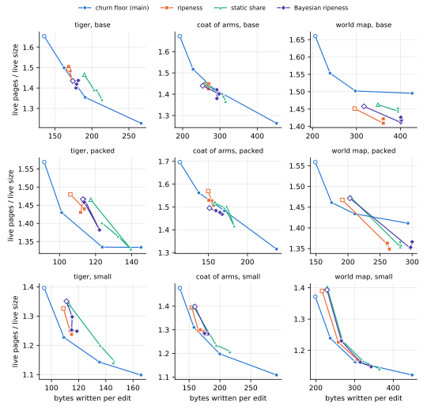

## Executive summary

**Cleaning hard, kladde keeps an edited drawing's live pages at 1.10 to 1.51 times its live size, and 71 to 94 % full; at main's default settings they take 1.37 to 1.70 times the live size, and are 64 to 76 % full.**
Four cleaning policies ran on kladde-svg's three drawings, in three layouts, under a drawing editor's edits that keep to one part of the drawing at a time.
Each ran at the setting that fills its pages most: main's churn floor at λ = 0.1, and cleaning by ripeness, with a static share, and by Bayesian ripeness, each at a target fill of 0.9.
Their data pages come out 82 to 97 % full.

**The leaves hold the fill back.**
In the base and packed layouts, the address table's statements are 20 to 28 % of the live bytes, and the leaves that hold them stay 40 to 72 % full under every policy and setting, so that they make up 29 to 43 % of the live pages.
Leaves as full as the data pages would save 4 to 25 % of the live pages.
The small layout keeps short content inline, which leaves the statements 1 to 5 % of the live bytes and the leaves 4 to 9 % of the live pages.

**Free pages make up much of the smaller files, and cleaning harder adds to them.**
During the edits, the tiger's files hold 24 to 37 free pages beside 13 to 38 live ones, and the coat of arms' 26 to 52 beside 36 to 105.
Closed, the tiger's files take 2.3 to 4.2 times its edited SVG, the coat of arms' 1.4 to 3.1 times, and the world map's 1.15 to 2.3 times.
From λ = 1 to λ = 0.1, the files gain 6 to 24 free pages while they lose 3 to 59 live ones, and the closed files come out between 11 % smaller and 24 % larger.

**Filling the pages costs 1.2 to 2.4 times the writes of main's default, which is still a fraction of saving the SVG.**
At the settings above, an edit writes 112 to 452 bytes, against 91 to 206 at main's default.
Saving the canonical SVG every 100 edits would write 590 bytes per edit on the tiger, 1,845 on the coat of arms, and 10,699 on the world map.
The journal and the headers take 48 to 83 bytes per edit under every policy; cleaning decides the rest.

**No policy wins everywhere.**
On the world map, cleaning by ripeness leaves the fewest live pages in the base and packed layouts, 5 and 4 % fewer than the churn floor at λ = 0.1, with 16 and 10 % fewer writes, and the static share and the Bayesian posterior match its space within 2 % but write 3 to 13 % more.
On the tiger and the coat of arms, the ripeness branches stop short of their target: their data pages stay 80 to 91 % full at every target from 0.85 up, while the churn floor at λ = 0.1 fills them 93 to 97 % full and leaves 2 to 12 % fewer live pages than the best of them, the static share, at 1.1 to 1.4 times its writes.
At equal writes, the churn floor keeps up to 11 % fewer live pages than the ripeness branches on the tiger, the two lie within 2.5 % of each other on the coat of arms in its base and packed layouts, and the ripeness branches keep 2 to 6 % fewer on the world map in its base layout.

**Edits stay fast and flushes short: cleaning hard, kladde's calls take 21,000 to 116,000 edits per second, against 38,000 to 147,000 at main's default, and the median flush 3.1 to 10.4 ms, against 2.1 to 5.5.**
Cleaning hard costs 6 to 51 % of the edit rate, the least under single-rate ripeness; on the world map, the static share's and the Bayesian posterior's flushes take 1.3 to 2.0 times as long as single-rate ripeness's.
Reopening an edited file takes 0.6 to 29 ms.

## What was measured

**kladde-svg's `svg-bench` edits an SVG drawing stored in kladde as a drawing editor would, recording a row in [kladde-bench's](consolidation.md#what-was-measured) format every 1000 edits.**
Its mix: 30 % drags, which set a shape's translation; 20 % node moves, 8 % node insertions and 7 % node deletions in a path's data; 15 % recolours; 8 % duplications and 7 % deletions of a shape; and 5 % restacks, which move a shape among its siblings.
Nine edits in ten go to a window of a tenth of what they pick from, the shapes, the paths, or the elements without children, at the same place in each, and the window jumps elsewhere every 3000 edits, so that the edits keep to one part of the drawing at a time, as a person's do.
This is `svg-bench`'s default since kladde-rs `e88fd47`.

**The drawings are the Ghostscript tiger, the coat of arms of Spain, and a blank world map**, each edited as many times as it took an earlier, uniform mix to store eight times the drawing's live size in the base layout:

| drawing | edits | canonical SVG, before → after the edits | live size during the edits: base / packed / small |
| --- | --- | --- | --- |
| tiger | 31,613 | 66,850 → 59,005 bytes | 92 / 47 / 46 KiB |
| coat of arms | 41,130 | 163,768 → 184,541 bytes | 252 / 131 / 128 KiB |
| world map | 177,831 | 1,005,908 → 1,069,891 bytes | 1,353 / 954 / 943 KiB |

Every run makes the same edits, whatever the branch, layout, or setting.
The *live size* is the bytes of the drawing's allocations, and the *canonical SVG* what kladde-svg writes, without whitespace between tags and with path data in the grammar's shortcuts; the edits leave the coat of arms and the world map larger, and the tiger smaller.

**The layouts are cargo features of kladde-svg that choose the model's containers**: *base* stores every list as a vector of fixed slots, *packed* packs the lists of enums, children, transforms, attributes and path data, and *small* also keeps short lists and strings inline in their parent.
The small layout keeps most of a drawing's content in a few large allocations, so that its address table is small.

**The store flushes whenever the journal outgrows four pages**, `Options::journal_budget_pages = 4`, and at every row, every 230 to 372 edits on average; otherwise it runs with its defaults.

**Four branches of kladde-rs ran, each with the [newest size rule](../spec/address-table.md#conflict-resolution-across-epochs):**

| branch | commit | policy | knob, default | settings run |
| --- | --- | --- | --- | --- |
| `defrag-shifts` | `e88fd47` | main's [churn floor](../impl/consolidation.md#the-churn-floor-is-a-parameter-not-an-identity) | churn floor λ, 1 | 1, 0.5, 0.25, 0.1 |
| `ripeness-svg` | `df6188f` | [cleaning by ripeness](../drafts/ripeness.md), one rate per page | target fill τ, 0.75 | 0.75, 0.85, 0.9, 0.95 |
| `ripeness2-svg` | `1f88fb8` | ripeness with a static share per page | target fill τ, 0.75 | as above |
| `bayesian-ripeness-svg` | `d0bd751` | [Bayesian ripeness](../drafts/bayesian-ripeness.md), rule (a), with the empirical prior capped at the events it has seen | target fill τ, 0.75 | as above |

The three ripeness branches are ports, onto `defrag-shifts`, of the branches that [Cleaning by ripeness](ripeness.md), [Ripeness with a static share](ripeness2.md), and [Bayesian ripeness](bayesian-ripeness.md) measured on kladde-bench's workloads.
Main's budget controller aims the file at a target fill of 0.8, measured over all of its pages, free ones included; in every run its budget stayed at the maximum, 256 pages, so that the churn floor alone decided what was cleaned.
The ripeness branches' controller moves the price of space until the data pages and leaves are as full as the target.

**The regime this page dwells on is the one that fills the pages most**: λ = 0.1 for the churn floor, and τ = 0.9 for the ripeness branches, whose results at 0.85, 0.9, and 0.95 hardly differ.
Main's default, λ = 1, is the reference; the [sweep](#the-sweep-in-numbers) has every setting.
The tables name the churn floor by its λ, and the three ripeness branches, each at τ = 0.9, by their estimate: *ripeness*, *static share*, and *Bayesian*.

**Space is averaged over the second half of each run, and writes are what kladde wrote during that half, per edit**, as on the other evaluation pages.
*Live pages* are the data pages and the leaves, the latter with the interior pages of the address table, but without the header and the journal.
*Fill* is the live bytes in a page over the 4,081 bytes it can hold: for a data page the bytes that fragments resolve to, for a leaf its statements' framing and inline payloads.
*Free pages* are pages within the file that hold nothing live; the *closed file* is the file's size after the last edit and `close`, which truncates it after its last live page.
Writes count the journal's bytes and every page written, headers included, at 4,096 bytes each.

**The space and the writes come from 144 runs, eight at a time; the times from a second pass of the five configurations in the tables, one run at a time.**
Both were built with `--release` by Rust 1.99.0 and ran on an Intel Core i7-1165G7, four cores and eight threads, with 16 GB of memory under Linux 7.0, in a development container, on mains power.
The benchmark is deterministic but for its times, and the second pass reproduced the first's tables to the byte.
`data/svg-cleaning/` keeps every run's table, and `logs/` and `timing/` beside them the end of each run's output, with the closed file's size and the times.

To reproduce a run, build `svg-bench` on the branch, with `--features packed` or `--features small` for those layouts, and run it on the drawing with its number of edits:

```sh
cargo build --release -p kladde-svg --bin svg-bench --features packed
# --target-fill 0.9 instead of --churn-floor 0.1 on the ripeness branches
target/release/svg-bench crates/kladde-svg/corpus/drawings/world-map.svg \
    out/ --edits 177831 --journal-budget 4 --churn-floor 0.1
```

The figures come from the tables in `data/`; each run's directory is named `<policy>-<knob><value>-<layout>`, and `tools/plot-evaluation.py` takes it labelled `<policy>/<knob>/<value>/<layout>`:

```sh
D=content/evaluation/data/svg-cleaning; F=content/evaluation/figures/svg-cleaning
runs=()
for dir in $D/*-*-*/; do
    IFS=- read -r p k l <<< "$(basename $dir)"; knob=${k%%[0-9]*}
    runs+=("$p/$knob/${k#$knob}/$l=$dir")
done
tools/plot-evaluation.py --only svg-tradeoff --out $F "${runs[@]}"
tools/plot-evaluation.py --only svg-pages --out $F $(printf '%s\n' "${runs[@]}" |
    grep -E '^(main/lambda/(1|0.1)|[a-z0-9]+/tau/0.9)/')
```

## Live pages

**Cleaning hard takes 9 to 26 % of main's live pages at its default away, most of them data pages.**
Each cell gives the live pages, and in parentheses the leaves among them; the first column gives the live bytes they hold, in data pages and in leaves, which differ by about 1 % between the policies:

| drawing | layout | live bytes, KiB | λ = 1 | λ = 0.1 | ripeness | static share | Bayesian |
| --- | --- | --- | --- | --- | --- | --- | --- |
| tiger | base | 72 + 26 | 38.1 (13.0) | 28.2 (9.3) | 34.6 (12.8) | 32.0 (11.6) | 32.2 (11.1) |
| tiger | packed | 37 + 14 | 18.6 (5.7) | 15.8 (5.8) | 16.9 (5.4) | 16.1 (5.5) | 16.4 (4.9) |
| tiger | small | 45 + 1 | 16.2 (0.8) | 12.8 (0.7) | 14.4 (0.6) | 13.3 (0.6) | 14.6 (0.7) |
| coat of arms | base | 203 + 67 | 105.4 (33.6) | 79.6 (26.2) | 91.3 (33.1) | 86.0 (29.2) | 87.0 (30.3) |
| coat of arms | packed | 107 + 39 | 55.4 (18.2) | 43.0 (14.9) | 49.2 (17.9) | 46.2 (16.3) | 48.2 (17.2) |
| coat of arms | small | 127 + 7 | 47.4 (3.5) | 35.6 (2.6) | 41.5 (3.4) | 38.8 (3.4) | 41.1 (3.8) |
| world map | base | 1,107 + 346 | 560.2 (205.9) | 505.3 (217.2) | 480.1 (185.6) | 489.8 (195.3) | 478.8 (185.8) |
| world map | packed | 833 + 203 | 370.6 (109.5) | 335.3 (119.3) | 320.9 (100.7) | 324.8 (105.0) | 321.8 (103.7) |
| world map | small | 937 + 36 | 322.5 (19.0) | 264.0 (21.2) | 275.6 (21.9) | 274.5 (20.2) | 273.9 (18.9) |

Over the live size, which the first column gives here, the same live pages:

| drawing | layout | live size, KiB | λ = 1 | λ = 0.1 | ripeness | static share | Bayesian |
| --- | --- | --- | --- | --- | --- | --- | --- |
| tiger | base | 92 | 1.66 | 1.23 | 1.51 | 1.39 | 1.40 |
| tiger | packed | 47 | 1.57 | 1.33 | 1.43 | 1.36 | 1.38 |
| tiger | small | 46 | 1.39 | 1.10 | 1.24 | 1.15 | 1.25 |
| coat of arms | base | 252 | 1.67 | 1.26 | 1.45 | 1.37 | 1.38 |
| coat of arms | packed | 131 | 1.70 | 1.32 | 1.51 | 1.42 | 1.48 |
| coat of arms | small | 128 | 1.48 | 1.11 | 1.29 | 1.21 | 1.28 |
| world map | base | 1,353 | 1.66 | 1.49 | 1.42 | 1.45 | 1.42 |
| world map | packed | 954 | 1.55 | 1.41 | 1.35 | 1.36 | 1.35 |
| world map | small | 943 | 1.37 | 1.12 | 1.17 | 1.16 | 1.16 |

The live bytes exceed the live size in the base and packed layouts, since the statements that describe the allocations are live too.

**The leaves fill far less than the data pages, under every policy and setting: 40 to 72 % in the base and packed layouts, where the data pages come out 71 to 97 % full.**
Both the churn floor and the ripeness branches hold a budgeted rewrite of leaves to a data page's fill floor: its victims' restatements must fill 95 % of a leaf, which leaves between two fifths and a half full cannot do, alone or in pairs.
[Sparse leaves](../drafts/consolidation-from-statements.md) traces this on main; the ripeness branches' budget loop applies the same floor.
So in the base and packed layouts, the leaves are 29 to 43 % of the live pages, the most on the world map in its base layout at λ = 0.1, which fills its data pages most and has 5 % more leaves than at λ = 1.
Only on the tiger and the coat of arms in their base layouts, and on the coat of arms in its packed one, does λ = 0.1 fill the leaves fuller, to 64 to 70 % from 50 to 53 %.

Each cell gives the fill of the data pages, of the leaves, and of all live pages, in percent:

| drawing | layout | λ = 1 | λ = 0.1 | ripeness | static share | Bayesian |
| --- | --- | --- | --- | --- | --- | --- |
| tiger | base | 72 / 50 / 64 | 95 / 70 / 87 | 83 / 51 / 71 | 89 / 56 / 77 | 86 / 58 / 76 |
| tiger | packed | 72 / 62 / 69 | 93 / 61 / 81 | 82 / 64 / 76 | 89 / 64 / 81 | 82 / 72 / 79 |
| tiger | small | 74 / 17 / 71 | 95 / 23 / 91 | 83 / 28 / 80 | 90 / 27 / 88 | 83 / 21 / 80 |
| coat of arms | base | 71 / 50 / 64 | 96 / 64 / 85 | 88 / 51 / 75 | 91 / 57 / 79 | 91 / 56 / 79 |
| coat of arms | packed | 72 / 53 / 66 | 96 / 65 / 85 | 86 / 54 / 74 | 91 / 59 / 80 | 88 / 56 / 77 |
| coat of arms | small | 72 / 50 / 71 | 97 / 68 / 94 | 84 / 49 / 81 | 91 / 51 / 87 | 86 / 47 / 82 |
| world map | base | 78 / 42 / 65 | 97 / 40 / 72 | 95 / 48 / 77 | 95 / 46 / 75 | 95 / 48 / 77 |
| world map | packed | 80 / 47 / 70 | 97 / 43 / 78 | 96 / 51 / 82 | 96 / 49 / 81 | 97 / 50 / 82 |
| world map | small | 77 / 48 / 76 | 97 / 51 / 93 | 93 / 47 / 89 | 93 / 51 / 90 | 93 / 54 / 90 |

In the small layout, the one or two leaves hold a few kilobytes, so that their fill says little; the data pages decide its live pages.

**On the world map, the ripeness branches at τ = 0.9 fill their data pages 93 to 97 % full, as the churn floor at λ = 0.1 does; on the tiger and the coat of arms, they stop at 82 to 91 %.**
Their controller raises the price of space as long as the pages are emptier than the target, but on the smaller drawings no price makes it clean the pages that the churn floor at λ = 0.1 cleans, and the targets 0.85, 0.9, and 0.95 end within a few points of each other.
The static share comes closest, 89 to 91 %.
This page does not trace why.
Of the three, the single-rate ripeness writes least, and on the world map it fills the pages as full as the other two.

## The trade-off between space and writes

**Each policy trades writes for space along its own curve, and which curve lies lowest depends on the drawing.**
The curves run through each policy's settings, from the one that cleans least, hollow, to the one that cleans most:



- **On the world map, the ripeness branches lie below the churn floor in the base layout, by 2 to 6 % at equal writes**, and in the packed layout at their fuller targets, by 3 to 5 %; the churn floor's curve flattens from λ = 0.25 on in these layouts, where its fuller data pages are offset by more leaves.
  In the small layout, the curves meet at the fuller targets, within 2.5 %.
- **On the coat of arms, the two lie within 2.5 % of each other** in the base and packed layouts, and the churn floor up to 7 % lower in the small layout.
- **On the tiger, the churn floor lies lowest**, by up to 11 % at equal writes, but for a few points within about 1 %.
- **The churn floor reaches further on the smaller drawings**, where the ripeness branches' curves bunch once their target passes 0.85: on the tiger and the coat of arms, λ = 0.1 keeps 1.10 to 1.33 times the live size in live pages, where the ripeness branches' best settings stop at 1.14 to 1.42.
  On the world map, the ripeness branches reach 1.14 to 1.41, and the churn floor 1.12 to 1.49.

## Files

**Free pages take 14 to 67 % of the files during the edits, and on the tiger in its packed and small layouts more pages than the live ones.**
Each bar is a file averaged over the second half of the edits, in multiples of the live size:


Each cell gives the file's pages during the edits, and in parentheses the free ones among them:

| drawing | layout | λ = 1 | λ = 0.1 | ripeness | static share | Bayesian |
| --- | --- | --- | --- | --- | --- | --- |
| tiger | base | 69 (28) | 68 (37) | 66 (29) | 71 (36) | 65 (30) |
| tiger | packed | 46 (24) | 51 (32) | 48 (28) | 53 (34) | 47 (27) |
| tiger | small | 45 (26) | 48 (32) | 43 (26) | 46 (30) | 45 (27) |
| coat of arms | base | 138 (30) | 134 (52) | 133 (38) | 135 (46) | 133 (43) |
| coat of arms | packed | 84 (26) | 88 (42) | 83 (31) | 86 (36) | 84 (33) |
| coat of arms | small | 77 (26) | 89 (50) | 78 (34) | 80 (39) | 77 (33) |
| world map | base | 661 (98) | 628 (120) | 563 (80) | 593 (100) | 569 (88) |
| world map | packed | 448 (74) | 426 (88) | 409 (85) | 410 (82) | 408 (83) |
| world map | small | 408 (82) | 358 (91) | 349 (71) | 347 (70) | 355 (78) |

The rest of a file, about three pages, is the two header pages and the journal.

**Free pages are returned only in bulk.**
[Truncation](../impl/consolidation.md#truncation) waits until 16 pages at the file's end are free, `Options::truncate_tail`, 64 KiB, more than the tiger's live size in its packed and small layouts, and [compaction mode](../impl/consolidation.md#compaction-mode) starts only once free pages below the tail exceed a quarter of the file, `Options::hole_share`.
Cleaning harder frees more pages per flush: at λ = 0.1, the files hold 6 to 24 free pages more than at λ = 1, and compaction mode ran in 2 to 35 flushes where it ran in 1 to 8.
This page has not measured how much of the free space either threshold accounts for.

**Closed, the files take 1.15 to 4.2 times their edited SVG, and which policy closes smallest changes from drawing to drawing.**
`close` truncates the file after its last live page, so what it keeps is the free pages below it:

| drawing | layout | edited SVG, KiB | λ = 1 | λ = 0.1 | ripeness | static share | Bayesian |
| --- | --- | --- | --- | --- | --- | --- | --- |
| tiger | base | 58 | 236 | 240 | 244 | 216 | 236 |
| tiger | packed | 58 | 144 | 168 | 164 | 176 | 152 |
| tiger | small | 58 | 132 | 164 | 144 | 172 | 140 |
| coat of arms | base | 180 | 556 | 520 | 544 | 492 | 524 |
| coat of arms | packed | 180 | 336 | 300 | 260 | 340 | 324 |
| coat of arms | small | 180 | 296 | 300 | 292 | 328 | 300 |
| world map | base | 1,045 | 2,452 | 2,192 | 2,052 | 2,092 | 2,184 |
| world map | packed | 1,045 | 1,448 | 1,524 | 1,380 | 1,408 | 1,436 |
| world map | small | 1,045 | 1,284 | 1,200 | 1,252 | 1,200 | 1,268 |

The closed sizes vary by up to a third between policies that keep nearly as many live pages, since they depend on where the last live page happens to lie when the edits end.

## Writes

**Filling the pages costs writes: at λ = 0.1, the churn floor writes 1.6 to 2.4 times as much per edit as at λ = 1, and the ripeness branches at τ = 0.9 1.2 to 2.0 times.**
The journal and the headers write the same under every policy; the rest is data pages and leaves, the flush's own and those cleaning rewrites:

| drawing | layout | journal + headers | λ = 1 | λ = 0.1 | ripeness | static share | Bayesian |
| --- | --- | --- | --- | --- | --- | --- | --- |
| tiger | base | 52 + 15 | 136 | 266 | 169 | 206 | 179 |
| tiger | packed | 37 + 11 | 91 | 145 | 112 | 132 | 122 |
| tiger | small | 37 + 11 | 95 | 166 | 115 | 146 | 115 |
| coat of arms | base | 65 + 18 | 192 | 452 | 270 | 315 | 292 |
| coat of arms | packed | 44 + 12 | 113 | 237 | 157 | 183 | 165 |
| coat of arms | small | 45 + 13 | 135 | 292 | 173 | 217 | 176 |
| world map | base | 63 + 17 | 206 | 427 | 359 | 394 | 402 |
| world map | packed | 49 + 14 | 149 | 294 | 265 | 281 | 298 |
| world map | small | 51 + 14 | 199 | 449 | 306 | 322 | 315 |

All values are bytes per edit, over the second half of the edits.

**Every policy writes far less than saving the SVG would.**
Saving the canonical SVG every 100 edits would write 590 bytes per edit on the tiger, 1,845 on the coat of arms, and 10,699 on the world map, and every 1000 edits 59, 185, and 1,070.
Cleaning hard, kladde writes 112 to 266 bytes per edit on the tiger, 157 to 452 on the coat of arms, and 265 to 449 on the world map.

## Times

**Edits stay fast and flushes short under every policy, but cleaning hard costs up to half of the edit rate, and the Bayesian posterior doubles the flush time on the world map.**
Each cell gives the edits per second in kladde's calls, in thousands, which counts the flushes that a full journal starts within an edit; the median time of the flushes at the rows, in milliseconds; and the median time to reopen the closed file, in milliseconds:

| drawing | layout | λ = 1 | λ = 0.1 | ripeness | static share | Bayesian |
| --- | --- | --- | --- | --- | --- | --- |
| tiger | base | 115 / 2.1 / 1.3 | 67 / 4.5 / 1.4 | 81 / 3.1 / 1.6 | 73 / 3.9 / 1.6 | 73 / 4.0 / 1.5 |
| tiger | packed | 147 / 2.3 / 1.1 | 109 / 3.9 / 1.6 | 116 / 3.4 / 1.3 | 102 / 3.9 / 1.6 | 91 / 3.9 / 1.7 |
| tiger | small | 139 / 2.1 / 0.6 | 96 / 3.9 / 0.9 | 105 / 3.6 / 0.8 | 95 / 4.0 / 0.9 | 100 / 3.4 / 0.9 |
| coat of arms | base | 82 / 2.3 / 2.9 | 47 / 4.1 / 3.3 | 63 / 3.1 / 3.9 | 48 / 4.2 / 4.2 | 49 / 4.7 / 4.0 |
| coat of arms | packed | 111 / 3.1 / 3.1 | 68 / 4.5 / 3.3 | 85 / 3.7 / 3.4 | 68 / 5.3 / 4.1 | 67 / 5.5 / 3.9 |
| coat of arms | small | 91 / 3.3 / 1.5 | 64 / 5.6 / 1.9 | 72 / 4.3 / 1.9 | 64 / 5.2 / 2.0 | 67 / 4.8 / 1.9 |
| world map | base | 42 / 3.9 / 29.2 | 31 / 5.6 / 24.2 | 33 / 5.2 / 22.9 | 24 / 8.3 / 25.9 | 21 / 10.4 / 24.4 |
| world map | packed | 47 / 3.9 / 20.0 | 38 / 5.1 / 25.9 | 42 / 4.9 / 20.0 | 32 / 6.7 / 21.9 | 27 / 9.2 / 19.6 |
| world map | small | 38 / 5.5 / 9.2 | 31 / 7.2 / 9.7 | 35 / 6.4 / 8.5 | 28 / 8.4 / 9.3 | 27 / 9.7 / 9.9 |

- **Against main's default, the churn floor at λ = 0.1 edits 17 to 43 % slower, single-rate ripeness 6 to 29 %, the static share 26 to 43 %, and the Bayesian posterior 27 to 51 %.**
  The edit rate falls with the writes, since cleaning works inside the flushes that edits start.
- **The flushes at the rows take 2.1 to 5.5 ms at the median under main's default, and 3.1 to 10.4 ms cleaning hard.**
  On the world map, single-rate ripeness flushes as fast as the churn floor at λ = 0.1, and the static share and the Bayesian posterior take 1.3 to 2.0 times as long as single-rate ripeness, more than their 3 to 13 % more writes explain; on kladde-bench too, [their ranking cost more](bayesian-ripeness.md).
- **Reopening the edited file takes 0.6 to 1.7 ms on the tiger, 1.5 to 4.2 ms on the coat of arms, and 8.5 to 29 ms on the world map**; the layout matters more than the policy, since the small layout's address table is small.

The times come from single runs, one at a time, so that they carry the noise of one run; the reopen times are medians of 21 opens.

## The sweep in numbers

**Every setting's steady state: the live pages over the live size, and the bytes written per edit.**
These are the points of [the trade-off figure](#the-trade-off-between-space-and-writes).

| base | tiger | coat of arms | world map |
| --- | --- | --- | --- |
| churn floor, λ = 1 | 1.66, 136 | 1.67, 192 | 1.66, 206 |
| churn floor, λ = 0.5 | 1.50, 162 | 1.52, 228 | 1.55, 240 |
| churn floor, λ = 0.25 | 1.35, 191 | 1.42, 284 | 1.50, 298 |
| churn floor, λ = 0.1 | 1.23, 266 | 1.26, 452 | 1.49, 427 |
| ripeness, τ = 0.75 | 1.49, 169 | 1.45, 261 | 1.45, 296 |
| ripeness, τ = 0.85 | 1.44, 173 | 1.43, 269 | 1.41, 361 |
| ripeness, τ = 0.9 | 1.51, 169 | 1.45, 270 | 1.42, 359 |
| ripeness, τ = 0.95 | 1.48, 171 | 1.43, 269 | 1.42, 361 |
| static share, τ = 0.75 | 1.47, 190 | 1.45, 260 | 1.46, 349 |
| static share, τ = 0.85 | 1.39, 203 | 1.39, 311 | 1.44, 395 |
| static share, τ = 0.9 | 1.39, 206 | 1.37, 315 | 1.45, 394 |
| static share, τ = 0.95 | 1.34, 214 | 1.39, 309 | 1.45, 394 |
| Bayesian, τ = 0.75 | 1.44, 174 | 1.44, 254 | 1.46, 317 |
| Bayesian, τ = 0.85 | 1.44, 182 | 1.40, 298 | 1.41, 401 |
| Bayesian, τ = 0.9 | 1.40, 179 | 1.38, 292 | 1.42, 402 |
| Bayesian, τ = 0.95 | 1.42, 179 | 1.42, 292 | 1.42, 401 |

| packed | tiger | coat of arms | world map |
| --- | --- | --- | --- |
| churn floor, λ = 1 | 1.57, 91 | 1.70, 113 | 1.55, 149 |
| churn floor, λ = 0.5 | 1.42, 101 | 1.56, 138 | 1.46, 175 |
| churn floor, λ = 0.25 | 1.33, 124 | 1.48, 171 | 1.43, 211 |
| churn floor, λ = 0.1 | 1.33, 145 | 1.32, 237 | 1.41, 294 |
| ripeness, τ = 0.75 | 1.48, 106 | 1.57, 150 | 1.47, 191 |
| ripeness, τ = 0.85 | 1.44, 114 | 1.53, 154 | 1.36, 261 |
| ripeness, τ = 0.9 | 1.43, 112 | 1.51, 157 | 1.35, 265 |
| ripeness, τ = 0.95 | 1.46, 113 | 1.53, 151 | 1.36, 261 |
| static share, τ = 0.75 | 1.47, 117 | 1.52, 158 | 1.47, 204 |
| static share, τ = 0.85 | 1.33, 140 | 1.50, 171 | 1.35, 282 |
| static share, τ = 0.9 | 1.36, 132 | 1.42, 183 | 1.36, 281 |
| static share, τ = 0.95 | 1.40, 123 | 1.50, 173 | 1.35, 283 |
| Bayesian, τ = 0.75 | 1.47, 113 | 1.49, 151 | 1.47, 203 |
| Bayesian, τ = 0.85 | 1.47, 114 | 1.47, 168 | 1.35, 297 |
| Bayesian, τ = 0.9 | 1.38, 122 | 1.48, 165 | 1.35, 298 |
| Bayesian, τ = 0.95 | 1.46, 114 | 1.48, 160 | 1.36, 300 |

| small | tiger | coat of arms | world map |
| --- | --- | --- | --- |
| churn floor, λ = 1 | 1.39, 95 | 1.48, 135 | 1.37, 199 |
| churn floor, λ = 0.5 | 1.23, 109 | 1.31, 158 | 1.24, 237 |
| churn floor, λ = 0.25 | 1.14, 135 | 1.20, 200 | 1.16, 302 |
| churn floor, λ = 0.1 | 1.10, 166 | 1.11, 292 | 1.12, 449 |
| ripeness, τ = 0.75 | 1.32, 109 | 1.39, 155 | 1.39, 216 |
| ripeness, τ = 0.85 | 1.25, 114 | 1.30, 165 | 1.23, 258 |
| ripeness, τ = 0.9 | 1.24, 115 | 1.29, 173 | 1.17, 306 |
| ripeness, τ = 0.95 | 1.24, 115 | 1.30, 168 | 1.17, 312 |
| static share, τ = 0.75 | 1.34, 113 | 1.40, 157 | 1.40, 230 |
| static share, τ = 0.85 | 1.20, 136 | 1.23, 194 | 1.23, 269 |
| static share, τ = 0.9 | 1.15, 146 | 1.21, 217 | 1.16, 322 |
| static share, τ = 0.95 | 1.14, 145 | 1.21, 216 | 1.14, 364 |
| Bayesian, τ = 0.75 | 1.35, 111 | 1.40, 159 | 1.39, 229 |
| Bayesian, τ = 0.85 | 1.30, 115 | 1.28, 181 | 1.23, 266 |
| Bayesian, τ = 0.9 | 1.25, 115 | 1.28, 176 | 1.16, 315 |
| Bayesian, τ = 0.95 | 1.25, 119 | 1.28, 175 | 1.15, 343 |
