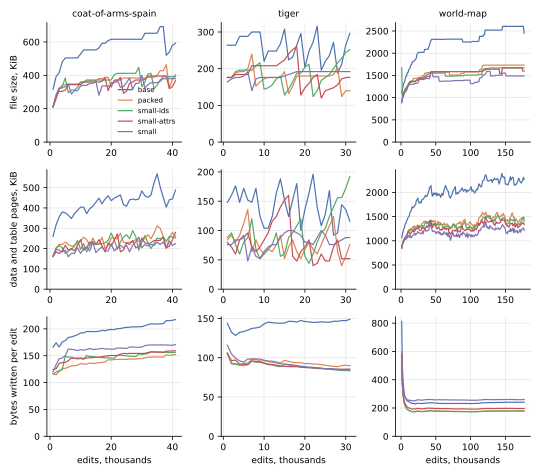
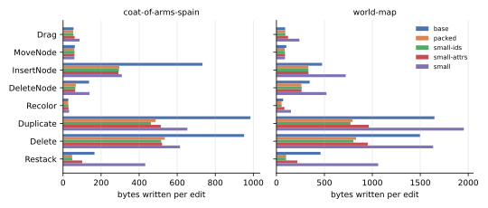

**Packing kladde-svg's lists of enums makes its drawings 18 to 38 % smaller on file, and a drawing editor's edits write 25 to 40 % fewer bytes.**
Small values then take most allocations and nearly every address-table page out of a stored file, and a third of the memory.
Under edits they cost writes again where they put large content inline, since a splice in a long list shifts more: on the world map, the small layout writes 44 % more per edit than packed lists, on the coat of arms 13 % more, and on the tiger 7 % less.

The benchmarks first ran as they were, on the branch of kladde-rs that implements [packed places](../spec/schema/type-descriptors.md#places).
The drawings and the 1,803 files of the corpus hold the same bytes as on main, but for 216 bytes less schema each.
Edits write half to a third of what they write on main: the journal, which on the branch records a stored value as one record, is half as large, and the branch states what a splice shifts where it lies, where main writes it again.

The four layouts after that add to each other, one step at a time:

- **Packed lists of enums.**
  With children, transforms, attributes and path data packed, the drawings' live bytes fall by 41 % on the tiger and the coat of arms, and by 18 % on the world map.
  The world map's path data is 92 % cubic Béziers, the largest variant, which packs to the 26 bytes of its slot.
  An open drawing takes 3 to 8 % more memory, since a packed vector keeps where its elements start, four bytes for each element after the first, and takes 8 bytes more in its value.
- **Small ids.**
  Small strings for element ids take one allocation and one statement per id out of the file, and 3 to 12 % of the memory, and change the writes by 8 % at most.
- **Small attribute lists and strings.**
  These take out half the allocations that remain, settle the files 4 to 8 KiB smaller, and take 21 to 26 % less memory than the slotted layout.
  The edits write 4 % less than with packed lists on the tiger, and 5 % and 9 % more on the coat of arms and the world map.
- **Small child lists, transforms and path data.**
  These leave 99 to 630 allocations per drawing, next to no table pages in a stored file, and a third less memory than the slotted layout.
  On the world map, the edits write 260 bytes each, against 180 with packed lists, and the edited file reopens in 8 ms, against 19.

**Splices in the small layout's long lists shift 464 bytes per edit on the world map; the flush states 441 of them where they lie, and writes 23 again, to merge the fragments that would otherwise cost more to describe at this and the splices to come.**
Merging keeps the statements in check: the world map's grow 2.7-fold over the run in the small layout, to 6,178, where without merging they grew to 14,066, and its table pages take 79 bytes per edit, against 265.

**At the sizes kladde is meant to serve, the files keep far more than their content.**
Stored afresh and settled, a packed drawing takes 0.85 to 1.1 times its canonical SVG; edited and closed, 1.3 to 6.6 times, since closing returns only the free pages at the file's end, and the address table, often less than half full during the edits, keeps statements of every edit spread over its pages.
Reopening the edited world map takes 1.6 to 3.7 times as long as opening it fresh.
Nearly every file of the corpus, a few kilobytes of drawing, settles at four pages, 16 KiB, in every layout.

## What was measured

**kladde-svg, a crate of kladde-rs, stores SVG drawings in a model of `#[derive(Persistable)]` types, and edits them as a drawing editor would.**
An `Element` holds five things:

- its tag, with the tag's core geometry, in an enum `ElementKind`;
- its transform list;
- its other attributes, as a list of an enum `Attr`, which has a variant for each typed attribute and one, `Other`, that keeps an attribute verbatim;
- its inline style declarations, as a second list of `Attr`;
- its children, as a list of an enum `Node`.

A path's data is a list of an enum `PathSegment`, whose variants take from 2 bytes, a `ClosePath`, to 26, a cubic Bézier, with coordinates as `f32`s.
Anything the model does not type it keeps as a string, so every SVG fits, and its canonical form survives the trip through kladde byte for byte.

**Three drawings from Wikimedia Commons, and resvg's test suite at v0.48.1, are the workloads**, pinned by the crate's `corpus/fetch.sh`:

| drawing | canonical SVG bytes | elements to edit | paths | path segments | of them cubic | live bytes, slotted |
| --- | --- | --- | --- | --- | --- | --- |
| the Ghostscript tiger | 66,850 | 481 | 240 | 2,510 | 52 % | 102,775 |
| the coat of arms of Spain, from Inkscape | 163,768 | 606 | 494 | 5,612 | 53 % | 202,815 |
| a blank world map | 1,005,908 | 2,528 | 2,213 | 29,666 | 92 % | 971,531 |

The canonical SVG is what kladde-svg writes: no whitespace between tags outside text, single spaces between attributes, and path data in the grammar's two shortcuts, a command letter left out where the previous segment implies it and no separator before a minus sign.
It is smaller than every original, by 3 % for the tiger, which its authors had written compactly, and by 9 to 17 % for the two drawings that Inkscape and others had indented; so it, rather than the originals, is what the kladde files compare with.

The test suite contributes 1,800 files of a few kilobytes that cover SVG's features; a 1,801st, not UTF-8, is skipped.

**`svg-roundtrip` stores every file, closes it, reopens it, and checks that it writes the same canonical SVG.**
All 1,803 round trips were exact in every layout.
It records the live bytes, allocations and statements, and the file's size *settled*, once two more sessions have opened and closed it, since a new file holds free pages that only the following flushes return.

**`svg-bench` edits a drawing with a seeded mix of what a drawing editor does**, recording a row in [kladde-bench's](consolidation.md#what-was-measured) format every 1000 edits:

| share | edit | what it does to the model |
| --- | --- | --- |
| 30 % | drag a shape | set the translation that leads its transform list, or insert one; nine drags in ten go to a tenth of the shapes |
| 20 % | move a path node | set two coordinates of a segment |
| 8 % / 7 % | insert / delete a path node | insert or remove a segment |
| 15 % | recolor | set a fill's colour, in the attributes or the style, or add a fill attribute where there is none |
| 8 % / 7 % | duplicate / delete a shape | insert a deep copy right above it, or remove and free it |
| 5 % | restack | move a shape elsewhere among its siblings with the child list's `move_element`, which takes its bytes from where they lie |

The mix gives text edits 5 % of their own, which these drawings, having no text, turn into recolors.
Each run makes a fixed number of edits, the same edits in every layout: 31,613 on the tiger, 41,130 on the coat of arms, and 177,831 on the world map, which is where the edits of the slotted layout have stored eight times its live size.
The tables end at the last full thousand.
After the last edit, the file is closed, and its size recorded, and the time to reopen it, as the median of 21 opens.

**The store flushes whenever the journal outgrows four pages**, `Options::journal_budget_pages = 4`, and at every row: every 243 to 477 edits, depending on the drawing and the layout.
The default budget, 256 pages, would let the journal grow to a megabyte between flushes, more than any of these drawings.

`--only` runs of 20,000 edits of one kind each measured what each kind costs, on the coat of arms and the world map.
A run of duplications alone keeps the drawing within a fifth of its size by deleting every other time, and so does a run of deletions, so those two kinds measure the same half-and-half mix.

**The layouts are type aliases in the model, which cargo features select:**

| layout | feature | what it changes |
| --- | --- | --- |
| slotted | none | every list is a `PersistableVec`, whose elements take fixed slots, and every string a `PersistableString` |
| packed | `packed` | children, transforms, attributes and path data are `PackedPersistableVec`s, and everything inside their elements is packed: element kinds, lengths, pointers |
| small ids | `small-ids` | as packed, and an element's `id` is a `SmallPersistableString`, inline in its attribute while short |
| small attributes | `small-attrs` | as small ids, and attribute lists are `SmallPersistableVec`s and every string a `SmallPersistableString`; the document is a packed root |
| small | `small` | as small attributes, and transforms, path data, points and child lists are `SmallPersistableVec`s too |

Lists of points and of lengths, whose elements all have one size, stay slotted until the last step, where they become small.
[Containers](../rust/containers.md) describes each container.

**The flush states the bytes an allocation shifts within itself where they lie, but for runs of fragments it merges.**
A splice, or a move within one allocation, leaves the bytes behind it where they lie, and the flush states each fragment they lie in at its new offset, as [the flush's design](../impl/flush.md#per-record-rules) has it; that counts as *restated* in what follows.
Runs of fragments whose statements would cost more than their bytes, at this and at the shifts that the allocation's history predicts, it [writes again as one chunk](../impl/flush.md#shifted-bytes-restated-or-merged) instead, with the history decayed by `Options::shift_decay = 0.75` per flush; that counts as *merged*.
Bytes copied within an allocation, and bytes from another allocation, are written again too, which these edits hardly do.
Both counts are columns of the tables.

The runs measured kladde-rs's `variable-size` branch at `2b109e7`, and main at `113cfc3` for the baseline, with its default journal budget set to four pages.
Both were built with `--release` by Rust 1.99.0, with default options otherwise, on an Intel Core i7-1165G7 with 16 GB of memory under Linux 7.0, in a development container.
Memory is the heap that opening a drawing allocates, counted by a global allocator in a separate program.
The times to open are medians of 21 opens; other times come from single runs and are noisy.

## The baseline: the benchmarks as they were

**The branch stores every drawing's content in the same allocations and bytes as main, apart from a schema 216 bytes smaller.**
That holds for all 1,803 files: every file's live bytes are exactly 216 fewer, and its allocations the same.
Seven files, the three drawings among them, state the same allocations in 1 to 246 fewer statements.

| live bytes | main | branch, slotted |
| --- | --- | --- |
| tiger | 102,991 | 102,775 |
| coat of arms | 203,031 | 202,815 |
| world map | 971,747 | 971,531 |
| corpus, 1,803 files | 6,662,168 | 6,272,720 |

**The closed files differ by a few pages, in both directions, a matter of where pages fall rather than of what they hold.**
The drawings' data and table pages agree to within two pages.
Settled, the tiger takes 116 KiB against main's 128, the coat of arms 216 against 228, and the world map 1,020 against 1,012.
In the corpus, 1,525 files settle at the same size and 273 settle one page larger, at 16 KiB, where 1,473 others settle on both branches.
On main, those 273 had a larger creation journal, which pushed them to 20 KiB when first closed, with a free page that let the next sessions bring them down to 12 KiB.

**The edits write 50 to 65 % less: a journal half as large, and 65 to 82 % fewer data pages.**
The branch writes a stored value as one record, where main wrote one per scalar, so the journal shrinks by 42 to 50 % and fills its budget less often.
And the slotted layout splices too, inserting and deleting path nodes, duplicating, deleting and restacking shapes, whose shifted tails main writes again and the branch states where they lie, or merges.

| bytes written per edit | main | slotted | journal: main | slotted | data pages: main | slotted |
| --- | --- | --- | --- | --- | --- | --- |
| tiger | 297 | 149 | 76 | 44 | 150 | 51 |
| coat of arms | 460 | 217 | 110 | 59 | 255 | 88 |
| world map | 698 | 241 | 128 | 64 | 469 | 85 |

## The layouts at a glance

**On file, packing makes the drawings smaller, and small values then trade allocations and table pages for data pages.**

| | slotted | packed | small ids | small attributes | small |
| --- | --- | --- | --- | --- | --- |
| **tiger** live bytes | 102,775 | 60,988 | 60,509 | 59,988 | 59,746 |
| allocations | 1,453 | 1,453 | 971 | 485 | 99 |
| data + table pages | 20 + 7 | 13 + 3 | 13 + 3 | 14 + 1 | 15 + 0 |
| settled file, KiB | 116 | 72 | 72 | 68 | 68 |
| **coat of arms** live bytes | 202,815 | 119,350 | 118,744 | 117,951 | 117,806 |
| allocations | 2,007 | 2,007 | 1,398 | 638 | 239 |
| data + table pages | 44 + 8 | 26 + 6 | 26 + 5 | 28 + 2 | 30 + 0 |
| settled file, KiB | 216 | 136 | 132 | 128 | 128 |
| **world map** live bytes | 971,531 | 800,986 | 798,461 | 795,189 | 793,689 |
| allocations | 8,542 | 8,542 | 6,014 | 2,775 | 630 |
| data + table pages | 218 + 34 | 169 + 37 | 169 + 35 | 177 + 23 | 196 + 1 |
| settled file, KiB | 1,020 | 836 | 828 | 820 | 800 |

Each drawing's statements number its allocations plus 2 to 81.
Settled, a packed drawing takes 1.1 times its canonical SVG for the tiger, and 0.85 times for the coat of arms and the world map.

**Under the edits, packing cuts the writes by a quarter to two fifths; the small layouts keep that saving on the tiger, give back a third of it on the coat of arms, and more than all of it on the world map.**

| bytes written per edit | slotted | packed | small ids | small attributes | small |
| --- | --- | --- | --- | --- | --- |
| tiger | 149 | 90 | 83 | 86 | 84 |
| coat of arms | 217 | 152 | 156 | 159 | 171 |
| world map | 241 | 180 | 178 | 197 | 260 |
| **of which data pages** | | | | | |
| tiger | 51 | 25 | 23 | 29 | 34 |
| coat of arms | 88 | 59 | 64 | 71 | 85 |
| world map | 85 | 68 | 68 | 81 | 114 |
| **of which table pages** | | | | | |
| tiger | 41 | 23 | 20 | 17 | 10 |
| coat of arms | 54 | 39 | 40 | 36 | 30 |
| world map | 76 | 46 | 46 | 52 | 79 |
| **of which journal** | | | | | |
| tiger | 44 | 32 | 31 | 31 | 32 |
| coat of arms | 59 | 42 | 41 | 40 | 43 |
| world map | 64 | 51 | 50 | 50 | 53 |

The rest is headers, 8 to 17 bytes per edit, a page per flush.

**The live pages shrink at nearly every step, but the files much less: every file keeps two to five flushes' worth of written pages free**, those the last commit dropped, which stay fallback until the next commit, and the reusable ones that the next flush will fill.
That pool takes 11 to 57 % of the file, the more the smaller the drawing, and closing returns only the part of it that lies at the file's end.

| over the second half of each run, KiB | slotted | packed | small ids | small attributes | small |
| --- | --- | --- | --- | --- | --- |
| tiger: data and table pages | 136 | 74 | 112 | 65 | 87 |
| free pages | 99 | 84 | 68 | 100 | 92 |
| file | 246 | 168 | 190 | 174 | 191 |
| coat of arms: data and table pages | 459 | 253 | 242 | 230 | 217 |
| free pages | 150 | 124 | 138 | 125 | 132 |
| file | 621 | 389 | 392 | 367 | 360 |
| world map: data and table pages | 2,193 | 1,456 | 1,394 | 1,332 | 1,212 |
| free pages | 262 | 217 | 209 | 283 | 242 |
| file | 2,466 | 1,685 | 1,615 | 1,627 | 1,466 |



**The data pages stay 71 to 85 % full, but the address table swings between 6 and 98 %, and mostly stays below half**, while the statements grow with the edits: the slotted world map ends with 31,433 statements, on 228 table pages, for the 10,296 it had after its first thousand edits.

**Closed after the edits, a file takes 1.6 to 8.9 times its live size**, and 1.3 to 6.6 times the canonical SVG of the edited drawing:

| closed after the edits, KiB | slotted | packed | small ids | small attributes | small | canonical SVG |
| --- | --- | --- | --- | --- | --- | --- |
| tiger | 236 | 152 | 264 | 140 | 180 | 40 |
| coat of arms | 580 | 396 | 364 | 368 | 356 | 207 |
| world map | 2,448 | 1,692 | 1,648 | 1,600 | 1,472 | 1,163 |

Flushes took 2.8 to 5.0 ms at the median, but for the small world map's 7.0 ms.

## Packed lists of enums

**Packing saves what the slots padded, so it saves most where variants differ most.**
A path segment's slot takes 26 bytes, the size of a cubic Bézier, while a line takes 10 and a close 2.
On the tiger, the path data packs to 75 % of its slotted size, on the coat of arms to 68 %, and on the world map, 92 % of whose segments are cubic, to 95 %.
The child lists save more: a `Node`'s slot takes 38 bytes, where a packed node, an element whose lists are pointers, takes 9 or 10, as the bytes a restack stores show.
Attributes shrink in the same way: an attribute's slot takes 17 bytes, a fill colour packed 6.

| live bytes saved by packing | slotted | packed | saved |
| --- | --- | --- | --- |
| tiger | 102,775 | 60,988 | 41 % |
| coat of arms | 202,815 | 119,350 | 41 % |
| world map | 971,531 | 800,986 | 18 % |

The world map's coordinates are what remains, four bytes each, which only a narrower number would shrink, as [floats as decimals](../drafts/decimal-floats.md) measures.

**Every kind of edit writes less with packed lists.**
A packed value is smaller, so its records are: the journal shrinks by 20 to 29 % in the mix.
A restack stores 9.5 bytes instead of 38, and an inserted path node about 10 instead of 26.
A splice shifts fewer bytes, since a packed list is shorter, and so has fewer fragments to restate: inserting a path node on the world map restates 161 bytes per edit, against 195 in the slotted layout, and a restack 25, against 237.
And smaller records fill the journal's budget more slowly, so the packed layouts flush a sixth to a quarter less often.



On the world map, a drag that adds the first translation to a shape's transform list creates the list's allocation.
The shape's pointer grows from the one byte of a null pointer to the two of an id, and the shape's encoding grows with it, a splice in its parent's child list that restates 15 bytes per drag; a slotted pointer slot takes the id in place, and yet the slotted layout's drags write 91 bytes against 76.

## Small ids

**Small ids take one allocation and one statement per id out of the file, and with them 3 to 12 % of the memory; the bytes and the writes stay nearly as they were.**
An id in a packed place is a varint pointer, one or two bytes, to an allocation of a few bytes.
Small, it is a one-byte tag and the same bytes, inline in its attribute: the tiger loses 482 allocations, the coat of arms 609, and the world map 2,528.
Those allocations were stored [inline in the address table](../impl/flush.md#the-inline-threshold), so up to two table pages go, and the data pages stay.
Writes change by 1 to 8 %, in both directions.

## Small attribute lists and strings

**Small attribute lists halve the remaining allocations again, and shrink the table pages, but put each attribute list inside its element.**
The tiger falls to 485 allocations, the coat of arms to 638, the world map to 2,775.
Table pages fall by 2 to 12 and data pages grow by 1 to 8, since content that the table held inline now lies in its element's list, and the settled files take 4 to 8 KiB less.

An element now changes size whenever its attribute list does, and splices its parent's child list.
The world map colours its shapes through CSS classes, so its first recolor of a shape adds a fill attribute: recolors restate 17 bytes per edit, and merge 7, against nothing with packed lists alone; in the mix, 125 bytes are restated per edit, against 59.
So the edits write 9 % more than with packed lists on the world map, and 5 % more on the coat of arms; on the tiger, 4 % less.

## Small child lists, transforms and path data

**With every list small, a drawing is a few hundred allocations, the address table nearly empty, and its memory a third smaller than slotted; but whole subtrees lie inside their parents' child lists.**
The tiger keeps 99 allocations, the coat of arms 239, the world map 630: the root's child list, the child lists of groups, and path data too long to stay inline.

A list that changes size now shifts its siblings' whole content.
On the world map, whose root holds 234 children and whose largest group 286, splices shift 464 bytes per edit in the mix, against 65 with packed lists:

| world map, bytes per edit | slotted | packed | small attributes | small |
| --- | --- | --- | --- | --- |
| written, the mix | 241 | 180 | 197 | 260 |
| of which table pages | 76 | 46 | 52 | 79 |
| of which data pages | 85 | 68 | 81 | 114 |
| restated, the mix | 190 | 59 | 125 | 441 |
| merged, the mix | 5 | 6 | 10 | 23 |
| restated: drag | 0 | 15 | 32 | 133 |
| restated: recolor | 0 | 0 | 17 | 80 |
| restated: restack | 237 | 25 | 79 | 686 |
| restated: insert a path node | 195 | 161 | 161 | 396 |
| restated: delete a path node | 160 | 145 | 145 | 295 |

A drag that inserts a translation grows a transform list inline, and with it the shape; a restack moves a whole shape's content, 72 bytes on average instead of 9.5, and everything between its two places; a path node inserted into inline path data grows the path element.
Each splices a child list, and the flush restates the list's tail, or merges the short fragments in it.
On the coat of arms, the mix restates 86 bytes per edit and merges 13, against 20 and 4 with packed lists, and on the tiger, 19 and 7 against 9 and 3.

**Merging trades a few data bytes for many statements.**
Writing 23 bytes per edit again on the world map keeps the description of the lists that splices shift from fragmenting: in the small layout, the drawing ends the run with 6,178 statements on 23 table pages, where restating every fragment left 14,066 on 75, and its table pages take 79 bytes per edit, where they took 265.
The data pages pay for it, 114 bytes per edit against 68 with packed lists: the merged bytes, and consolidating the pages they leave half dead, 45 bytes of evacuation per edit against 23.
What remains of the small layout's extra cost on the world map is that: each splice shifts seven times what it shifts with packed lists, and every shifted fragment is a statement, or a byte written again.

## The corpus: drawings of a few kilobytes

**The corpus's files are dominated by the schema, which every layout carries: an empty drawing takes 1,930 to 1,968 bytes, nearly all of it schema.**
Beyond that, packing shrinks the content by 40 %, and small values save allocations but not bytes: in a file this small a pointer takes one byte, as a tag does, and the content takes the same bytes inline as in an allocation of its own.

| corpus, 1,803 files | slotted | packed | small ids | small attributes | small |
| --- | --- | --- | --- | --- | --- |
| live bytes | 6,272,720 | 5,162,539 | 5,164,297 | 5,096,806 | 5,130,927 |
| beyond an empty drawing each | 2,724,416 | 1,625,053 | 1,621,402 | 1,617,016 | 1,616,880 |
| allocations | 59,061 | 59,061 | 47,077 | 14,787 | 6,470 |
| statements | 60,962 | 60,947 | 48,963 | 16,679 | 8,390 |
| settled files, MB | 30.78 | 30.56 | 30.55 | 30.55 | 30.53 |

The small layout's schema is 19 bytes larger than the small-attribute layout's, which outweighs what its small lists save in most of these files.
Of the 1,800 files of the test suite, 1,775 hold their content in one page in the slotted layout and 1,777 in every other.

**1,769 to 1,799 of them, depending on the layout, settle at 16 KiB, four pages, for a median of 2.2 to 2.7 KB of live bytes**: the two header slots, a journal page, and one data page; the rest settle at 12 KiB, but for two larger ones.
Documents of a few kilobytes are what kladde is meant to serve as well as larger ones, so the three pages a file takes besides its content are a cost to reduce, not a floor to accept.

## Memory and opening

**Packed lists cost a little memory and small values save much of it, a third once every list is small.**

| heap after opening, KiB | slotted | packed | small ids | small attributes | small |
| --- | --- | --- | --- | --- | --- |
| tiger | 424 | 438 | 413 | 335 | 266 |
| coat of arms | 712 | 758 | 626 | 528 | 475 |
| world map | 3,061 | 3,315 | 2,684 | 2,287 | 1,954 |

A packed vector keeps where each element after the first starts, a `u32` each, in a `ThinVec` beside its content's pointer and end, 16 bytes in the value; it takes 40 bytes in memory, a slotted one 32.
So an `Element`, with four lists and a fifth in a path's kind, grows from 168 bytes in memory to 200, whether its lists hold anything or not.
Each allocation the small layouts remove saves 50 to 230 bytes, by the differences between the layouts.
The history of shifts that merging keeps per allocation takes 8 bytes in the allocation map: 4 % of the slotted world map's heap, measured against the commit before, and far less in the small layouts, which have few allocations.

| opening the stored drawing, median of 21, ms | slotted | packed | small ids | small attributes | small |
| --- | --- | --- | --- | --- | --- |
| tiger | 1.1 | 1.6 | 1.3 | 1.2 | 1.1 |
| coat of arms | 1.7 | 2.4 | 2.0 | 1.8 | 1.7 |
| world map | 6.8 | 8.3 | 7.2 | 5.9 | 5.2 |

Opening follows memory: packed lists decode their elements one by one and build their offsets, and fewer allocations mean fewer statements to load.
Opening the world map takes less than parsing its SVG into the model in every layout, 5.2 to 8.3 ms against 8.4 to 9.6; on the smaller drawings, the two are within a millisecond of each other.

**Reopening a drawing closed after the edits takes up to four times as long as opening it fresh, the longer the more its address table has grown.**

| reopening after the edits, median of 21, ms | slotted | packed | small ids | small attributes | small |
| --- | --- | --- | --- | --- | --- |
| tiger | 1.3 | 1.8 | 3.0 | 0.9 | 1.2 |
| coat of arms | 3.8 | 4.0 | 3.5 | 2.9 | 2.3 |
| world map | 25.1 | 19.4 | 16.7 | 13.6 | 8.2 |

An open reads every table page and every statement, and the edits leave both far more numerous than a fresh store: the slotted world map closes with 228 table pages and 31,433 statements, the small one with 23 and 6,178.
The edited tiger is slowest to reopen in the small-id layout, whose address table ends at 41 pages, against 5 to 13 in the others.
Reopening the edited world map takes 3.7 times as long as opening the drawing fresh in the slotted layout, and 1.6 times in the small one.

## What to change

- **Keep small values to ids and strings, and to attribute lists where memory counts for more than writes**; keep child lists and path data in packed vectors.
  Packed vectors for every list of enums whose variants differ in size pay on all three drawings, in space and in writes, for 3 to 8 % more memory, which small ids win back.
  Small child lists pay in memory and in reopening, but on the world map they shift seven times the bytes per splice, which merging makes cheaper but not cheap.
- **Consolidate the address table harder at these sizes.**
  It runs below half full for most of the edits, and its pages are what makes an edited file slow to reopen; one edited tiger closed with 41 table pages for 2,265 statements.
- **Return the free pages when a file closes**, not only those at its end: a closed file keeps the two to five flushes' worth of pages that were free when it closed.
- **Reconsider the default journal budget, 256 pages**, which lets a megabyte of journal build up between flushes, more than these drawings take; at four pages, a flush comes every 243 to 477 edits.
- **Shrink what a file takes besides its content**: two header slots and a journal page, three of the four pages a small drawing's file takes.

## Reproducing

The corpus comes from `crates/kladde-svg/corpus/fetch.sh` in kladde-rs, and each layout is one build of kladde-svg's two programs, from `2b109e7` on the `variable-size` branch:

```sh
C=crates/kladde-svg/corpus
B="--journal-budget 4"
for layout in base packed small-ids small-attrs small; do
    features=$([ $layout = base ] || echo "--features $layout")
    cargo build --release -p kladde-svg $features
    ./target/release/svg-roundtrip $B --csv rt-$layout.csv $C/drawings $C/resvg
    ./target/release/svg-bench $C/drawings/tiger.svg mix-$layout --edits 31613 $B
    ./target/release/svg-bench $C/drawings/coat-of-arms-spain.svg mix-$layout --edits 41130 $B
    ./target/release/svg-bench $C/drawings/world-map.svg mix-$layout --edits 177831 $B
    for kind in Drag MoveNode InsertNode DeleteNode Recolor Duplicate Delete Restack; do
        for d in coat-of-arms-spain world-map; do
            ./target/release/svg-bench $C/drawings/$d.svg only-$layout-$kind --edits 20000 --only $kind $B
        done
    done
done
```

Main's runs, at `113cfc3` with `journal_budget_pages: 4` as the default in `kladde-store/src/options.rs`, are `svg-roundtrip` on the same paths and `svg-bench` on each drawing without `--edits`.
The decay of 0.75 came from runs of the slotted, packed and small layouts on the three drawings with `--shift-decay` 0, 0.5, 0.75, 0.875 and 0.95, of which 0.5 and 0.75 wrote least over all nine, and 0.75 reopened faster.

The tables are kept gzipped under `content/evaluation/data/variable-size/`:

- the mix in `<layout>/`, with `base` for the slotted layout, and main's in `main/`, each run's summary beside its table in `<drawing>.log`;
- the round trips in `roundtrip/<layout>.csv.gz`;
- the runs of one kind in `kinds/<layout>-<kind>/`, summed up per edit in `kinds/edit-kinds.tsv`;
- memory and the time to open in `memory.txt`, measured with `memory.rs` built against each layout, and an empty drawing's live bytes in `empty.txt`.

The figures are drawn from them:

```sh
D=content/evaluation/data/variable-size
tools/plot-evaluation.py --only svg-layouts --out content/evaluation/figures/variable-size \
    base=$D/base packed=$D/packed small-ids=$D/small-ids small-attrs=$D/small-attrs small=$D/small
tools/plot-evaluation.py --only svg-edit-kinds --out content/evaluation/figures/variable-size kinds=$D/kinds
```
