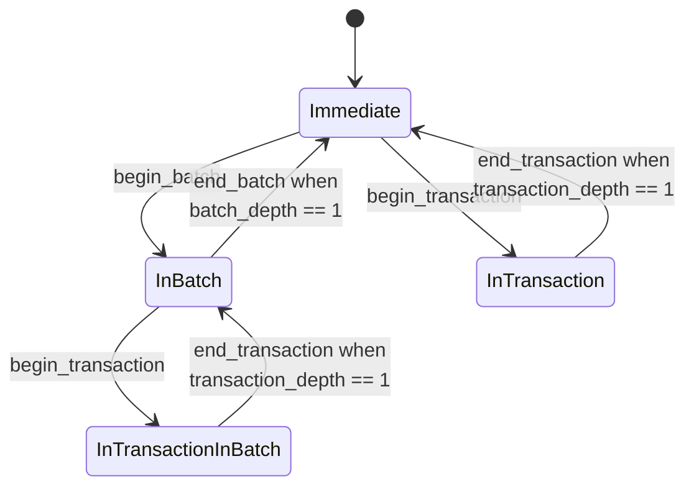

How application operations are grouped into the [transactions](../spec/journal.md#transactions) the journal records, how they wait in memory, and when they are appended to the journal pages and folded.

**Status:** settled apart from the open questions at the end; kladde-rs implements it as described here.

Transactions are normative — they are the unit of atomicity an application builds on.
**Batches are not**: they are an implementation's mechanism for turning a long run of operations into reasonably sized transactions, and an implementation is free to offer something else or nothing at all.
Both exist only to affect how mutations are *persisted*; the accompanying in-memory mutations are always immediate.

**From [the buffer](#one-buffer-and-three-cursors) on, this page is the design of the reference implementation, not one way among several to meet the format.**
kladde-rs keeps exactly one buffer of operations and the cursors into it described below, and appends and flushes by exactly the rules in [Flush triggers](#flush-triggers).
A departure — a second buffer, copying between spans, another trigger — is a deviation: it is recorded in kladde-rs' implementation notes with its reason, and proposed as a change to this page if it is better, rather than taken as a free choice.

## Three mechanisms over one journal

| mechanism | effect on the journal | what it is for | when to use |
| --- | --- | --- | --- |
| **transaction** | wraps a sequence of operations in a single journal transaction, appended atomically when the caller commits | **correctness**: either all or none of the operations are persisted, so a crash can't expose an invalid intermediate state | whenever intermediate state would be invalid |
| **batch** | cuts a long sequence of operations into the largest pieces that fit in what is left of the journal's page budget, respecting nested transactions, and wraps each in a transaction | **optimization**: fewer and fuller journal writes, while keeping the journal within its budget | when many operations happen at once with valid intermediate states — a large import, a paste |
| **bare operation** | recorded as its own transaction | **simplicity**: changes persist immediately | single mutations, prototyping |

**Transactions enforce correctness.**
In complex data types, one semantic operation often produces several journal records — appending to a vector splices the element in and rewrites the count — and interrupting between them leaves a sequence that does not decode.
The same happens in application code, where a transition between two valid states sometimes passes through invalid ones.

**Batches are an optimization, and a necessary one.**
Kladde's promise to persist every mutation immediately carries a small unavoidable per-transaction overhead.
That is usually worth it, but it adds up when an action triggers a large or unbounded burst — and for such bursts, per-operation durability buys little anyway.
It is tempting to wrap the burst in a transaction instead, but **very large transactions perform poorly**, because the whole transaction is held in memory until it ends, and the journal pages, and therefore the file, must then temporarily grow in proportion to the number and size of the operations.
A batch is the middle ground: the backend decides how to divide the sequence, respecting any explicit transaction inside it, so that each piece fills what is left of the journal's budget as far as the transaction boundaries allow.

### Recommendations

- For most application code, reach for a **batch or a bare operation**.
  Batches are cheaper for multiple operations, have no I/O overhead over a bare operation even for one, and cost a handful of instructions and no allocation.
  But remember that **batches delay persistence**: they are only guaranteed committed when ended, so holding one open for a long time defeats the point of immediate persistence.
- Use **transactions** when application logic requires atomicity, and keep them short.
  Needing a very long transaction almost always means either that the application's state transitions pass through too many invalid intermediate states, or that the wrong data type was chosen — a vector where a rope or an ordered tree belongs.
  When atomicity is genuinely required for a large mutation, it can usually be imposed at the application level instead: build the value in memory, outside any handle, then insert it in one operation, which encodes it into one buffer and splices it in.
- For a long sequence where *some parts* need atomicity, use a **batch with a few smaller transactions inside**.
  This is the pattern the design is arranged around.

## Nesting

Transactions and batches nest arbitrarily, so that a container's `push` can open a transaction without caring whether its caller already did.
The backend flattens the nesting, because the journal only deals with a flat sequence of transactions.

| ↓ outer; inner → | transaction in a … | batch in a … |
| --- | --- | --- |
| **… transaction** | only outer transaction survives | only the transaction survives *(shouldn't usually occur)* |
| **… batch** | both survive | only outer batch survives |

- **Transaction in a transaction ⇒ outer.** The inner one is meaningless; its atomicity is already enforced. Expected often in composable code.
- **Transaction in a batch ⇒ both.** The inner transaction enforces atomicity, so no cutting point may lie inside it. Expected often.
- **Batch in a batch ⇒ outer.** The inner one is meaningless; deferral is already in effect. Fine, but not useful.
- **Batch in a transaction ⇒ the transaction.** The inner batch is meaningless, since the transaction already forces the operations to commit as one group.
  A potential code smell: batches are for large or unbounded sequences, transactions should be short, so this combination implies a long chain of state transitions with only invalid intermediate states.

## One buffer and three cursors

**Every operation recorded since the last flush lives in one in-memory buffer `ops`, in the order it was recorded, whether it is already in the journal pages or not.**
Between two flushes, the operations form a single stream: some prefix of it has been appended to the journal pages, the operations on top of that are a batch's ready run, and those on top of that belong to the transaction that is still open.
So everything that happens between two flushes either appends to the buffer or moves a boundary between these spans; **nothing is ever copied from one span to another**.

The flush folds the operations the journal pages hold from this buffer, not from the pages, which only [recovery](../spec/journal.md#recovery) reads back.
Recovery decodes the journal's complete transactions into the buffer, and `open` folds them before it returns (see [opening a file](#flush-triggers)).

**In kladde-rs, the buffer is a `VecDeque` of records, beside a byte arena, also a `VecDeque`, that holds their payloads.**
Positions in both are counted from the start of the session rather than from the buffer's front, so that discarding the folded prefix after a flush moves the front and nothing else: no record moves, and every position held elsewhere — a record's payload, a pending fragment of the flush pointing into the arena — stays valid.
A journal's cuts are positions in it too: a paste names its cut by distance among the cuts of its journal, which the records keep in order, so no cursor moves them.

Three cursors, `front <= committed_cursor <= ready_cursor <= end`, divide the buffer into three spans:

- `committed := ops[front..committed_cursor]` — appended to the journal pages since the last flush: what the next flush folds;
- `ready := ops[committed_cursor..ready_cursor]` — a batch's operations, held back to be appended as one transaction;
- `transaction := ops[ready_cursor..end]` — the operations of the open transaction.

**Each cursor also carries the encoded size of the records before it**, so that the encoded size of any span is a subtraction, and deciding whether a span [fits](#flush-triggers) costs constant time.
The journal's [length prefix](../spec/journal.md#framing) needs a transaction's size before its first byte is written anyway.

**Moving the cursors is all that recording, appending, and flushing do:**

- **Recording an operation** appends it at `end`.
- **Appending a span to the journal pages** encodes it as one transaction, writes it, and moves `committed_cursor` to the span's end.
- **A flush** folds `committed` and moves `front` to `committed_cursor`.
- **Discarding operations** — a transaction that failed halfway and is rolled back, or one the application abandons — moves `end` back to where they began.

The backend's state holds the depths of the open scopes and the cursors that are not implied by them:

```rust
enum TransactionState {
    Immediate,
    InBatch              { batch_depth: NonZero, committed_cursor: Cursor },
    InTransaction        { transaction_depth: NonZero, batch_depth: u32,
                           committed_cursor: Cursor },
    InTransactionInBatch { transaction_depth: NonZero, batch_depth: NonZero,
                           committed_cursor: Cursor, ready_cursor: Cursor },
}
```

`transaction_depth` and `batch_depth` count begins minus ends, with an implied zero in any variant where they are absent.
`front` and `end` belong to the buffer, and the table below gives the cursors each state implies.



**Why four states and not three.**
`InTransaction` carries a `batch_depth` that may be positive, so it overlaps with `InTransactionInBatch` in depth alone.
What distinguishes them is **which scope was opened first**.
`InTransactionInBatch` is *batch outside, transaction inside* — the useful nesting, where ending the transaction returns to `InBatch` and persistence stays deferred.
`InTransaction { batch_depth > 0 }` is *transaction outside, batch inside* — the code-smell nesting, where the batch is subsumed and its depth is tracked only so that its end can be matched.

### Transitions in detail

The `error` cells are all the same mistake: ending one scope while a scope nested inside it is still open — *interleaving* rather than nesting.
An implementation should make that unrepresentable at the API level rather than checking for it.

| | `Immediate` | `InBatch` | `InTransaction` | `InTransactionInBatch` |
| --- | --- | --- | --- | --- |
| **`transaction_depth`** | `0` (implicit) | `0` (implicit) | `> 0` | `> 0` |
| **`batch_depth`** | `0` (implicit) | `> 0` | any | `> 0` |
| **`committed_cursor`** | `end` (implicit) | explicit | explicit | explicit |
| **`ready_cursor`** | `end` (implicit) | `end` (implicit) | `committed_cursor` (implicit) | explicit |
| **`begin_transaction()`** | `InTransaction { t: 1, b: 0 }` | `InTransactionInBatch { t: 1, .. }` | `transaction_depth += 1` | `transaction_depth += 1` |
| **`end_transaction()`** | error | error | `−1`; at `0`: `Immediate` if `batch_depth == 0`, else error | `−1`; at `0`: `InBatch` |
| **`begin_batch()`** | `InBatch { b: 1 }` | `batch_depth += 1` | `batch_depth += 1` | `batch_depth += 1` |
| **`end_batch()`** | error | `−1`; at `0`: `Immediate` | `batch_depth -= 1` | `−1`; at `0`: error |

The implied cursors are invariants at every operation boundary, not just labels: in `Immediate`, everything recorded is in the journal pages, and in `InBatch`, everything not yet appended is the batch's.

## Flush triggers

> **Keep the journal within its page budget.**
> **A transaction that would not fit in what is left of the budget is preceded by a flush, and only a transaction too large for the budget on its own exceeds it, followed by a flush at once.**

**The budget is a number of journal pages, `B`, and a transaction fits if the journal's stream, with the transaction appended, ends within `B` pages.**
Each journal page holds `page_size − 8` bytes of the stream, the rest being [its trailer](../spec/journal.md#pages), and a transaction of `n` record bytes takes `n` plus its length prefix plus its 4-byte `crc`.
The writer takes the next journal page only once the stream continues past the current one, so fitting within `B · (page_size − 8)` stream bytes is fitting within `B` pages.
A transaction that does not fit even into an empty journal is **overlong**.

**Whenever operations close** — a bare operation recorded in `Immediate` or `InBatch`, or the outermost transaction ending, `InTransaction → Immediate` or `InTransactionInBatch → InBatch` — let `X` be the operations that just closed, `ops[ready_cursor..end]`, and apply:

1. **The candidate is `ops[committed_cursor..end]`:** `X` alone outside a batch, where `ready` is empty, and `ready` followed by `X` inside one, to be appended as one transaction.
2. **If the candidate does not fit, the batch is cut before `X`:** append `ready` as one transaction if it is not empty, which it [always fits](#why-ready-always-fits), and flush, unless the journal is empty.
   The candidate is now `X` alone, in an empty journal.
   A paste in `X` that names a cut of the journal just folded becomes a `Splice` of its value's bytes, since that cut has ended ([moving values](values.md#moving-a-value-between-containers)), and `X`'s size is computed again.
3. **Inside a batch, a candidate that fits stays in memory as the new `ready`**, which the batch holds back until its next cut or its end.
4. **Otherwise, the candidate is appended as one transaction, and if that took the journal past its budget, flush again.**
   Only an overlong `X` can do that, since step 2 left it an empty journal.

The other triggers:

- **The outermost batch ends, `InBatch → Immediate`:** append `ready` if it is not empty.
  It fits, so no flush follows.
- **An explicit `flush()`:** append `ready` if it is not empty, then flush — on an empty journal too, since a flush also consolidates.
  An open transaction stays in the buffer, past `committed_cursor`.
- **A flush when the application is idle:** `flush_if_journal_exceeds(fraction)` appends `ready` and flushes if the journal pages then hold at least that fraction of the budget, and does nothing otherwise; the check is a subtraction of two cursors.
  An interactive application calls it from its event loop's idle callback, so that the automatic flush, whose `fsync` blocks the mutating call that triggers it, rarely fires in the middle of a gesture.
  The fraction should stay well above zero: an idle flush ends the journal, and with it the [cuts](values.md#moving-a-value-between-containers) its records made.
- **Opening a file:** kladde-rs folds a non-empty recovered journal before `open` returns, since reads see the flushed state only.
  That also keeps [the journal's rule](../spec/journal.md#the-start-of-a-session) that nothing is appended to a non-empty recovered journal, and no state outlives `open`.

So **an overlong transaction is flushed twice, once before it and once after it**, the first unless the journal was empty; and **a batch is always cut at the last boundary at which its run still fits**, which lies between two closed transactions or operations, never inside a transaction.

### Why `ready` always fits

`ready` only becomes longer in step 3, which checked that it fits after what the journal pages already hold.
Nothing else is appended while a batch holds a ready run, since every closing operation inside the batch either joins `ready` or cuts the batch, and the cut appends `ready` first.
So what the journal pages hold does not change until `ready` itself is appended, and `ready` still fits then.

### Why flush first

**A flush before the append leaves no journal page behind that only the start of an overflowing transaction occupies.**
Appending first and flushing once the journal is over budget would end every journal with such a page, nearly empty; and at the moment of a flush, the journal it folds and the previous one, still [the fallback](../spec/durability.md#the-reuse-rule), are both off limits, so that it would cost two pages at a time.

**It costs nothing.**
The operations of `X` are already in the buffer, and their encoded size is known from the cursors, so deciding before the append is as cheap as deciding after it.
A flush folds only `committed`, so `X` waits in the buffer past `committed_cursor` and is appended to the next journal; only the order of the two steps changes.

**The flush after an overlong transaction keeps a long journal from lingering**: the journal is back within its budget as soon as the operation that exceeded it returns.

**The budget bounds the file, not memory.**
An open transaction is held in memory in full, whatever the budget, because nothing can [fold an unfinished transaction](../spec/journal.md#checkpoint-versus-commit); a huge transaction costs memory in proportion to its size, and journal pages in proportion too once it is appended.

### Consequence for write-phase state

**A flush may run while operations are still in the buffer past `committed_cursor`**: the `X` that step 2 holds back, or, at an explicit `flush()`, an open transaction.
The [write-phase state](write-phase-state.md) — the sequence's length and the journal's cuts — describes them as well, so a flush leaves it as it was, and the flush folds only the records before `committed_cursor`, whose positions refer to the sequence as it stood before the held-back ones.

Discarding operations moves the length and the cuts back to what they were where the discarded operations began.

## Checkpoint versus commit

**Decided: a checkpoint never splits a commit** — see [the journal](../spec/journal.md#checkpoint-versus-commit).

A *checkpoint* is a flush triggered by resource pressure, and a *commit* is a transaction boundary the recovered state may snap to.
The open question was whether a checkpoint could fold part of an unfinished transaction, to bound the memory the transaction holds.
It cannot: the header it committed would describe a state inside the transaction, and undoing that part on recovery would need a mechanism the format does not have.
So every flush folds complete transactions only, and the memory an open transaction holds is bounded only by [keeping transactions short](#recommendations).

What remains is that application authors need never call `flush()`: the operation whose transaction would not fit in the journal's budget flushes automatically.
Two consequences follow:

**Flush needs only shared access to the backend.**
The auto-checkpoint fires from inside a mutating call, which holds no exclusive reference to the whole structure.
This is safe: handles hold positions in the sequence, which a flush does not change, since it rewrites only where the sequence's bytes lie on file.
Note that it is a *reentrant* call, so no write path may hold an interior borrow across a callback.

**The trigger belongs at operation boundaries**, not at append time.
A check on append can fire between two records of one logical mutation.
An operation is the natural atomic unit, being the smallest thing an application author perceives as one change.

## A flush off the caller's thread

**An automatic flush that sealed its journal may hand its `fsync` and its header write to a thread of their own, and the mutating call that triggered it then returns without waiting for the disk.**
Folding a journal and writing a flush's pages take well under a millisecond for files of the sizes kladde is meant for, while the `fsync` takes milliseconds on an SSD and more on a slow disk, which an interactive application feels as a stall in the middle of a gesture.
So the calling thread seals, folds, places and writes the pages as before, and a worker does what remains: the `fsync`, then the header write.
The application goes on appending to the next journal meanwhile, which [the seal](../spec/journal.md#seals) makes reachable from either header, so an application crash before the header is written loses nothing that returned.
Doing it is optional; the format requires only the seal, and a flush that runs entirely on the calling thread writes the same file.

The worker shares nothing with the calling thread but the file, through a second handle to it, and one hand-over:

- **The next flush waits for the worker before it seals**, and so do an explicit flush, before it returns, and closing the store.
  One commit is in flight at a time.
- **The pages the commit before freed become reusable only when the worker reports**, since its `fsync` is what retires the world that held them ([the reuse rule](../spec/durability.md#the-reuse-rule)); until then neither the next journal nor anything else may take them.
- **A flush that cannot seal syncs on the calling thread**: without a seal, transactions appended during the `fsync` would belong to a journal only the unwritten header names.
  A flush seals only where a reusable page can start the next journal, since a page added at the end of the file before the flush's own pages would keep the file from being truncated to them.
- **A failure on the worker poisons the store** when it is reported, at the next flush or read that waits for it, as a failure on the calling thread would at once.

An explicit `flush()` keeps its meaning — everything before it is durable when it returns — by waiting; only the flushes that mutations trigger run their commit off the calling thread.
kladde-rs offers this behind an option, off by default, until the Inkscape demo has shown whether the idle flush of [flush triggers](#flush-triggers) already keeps the stall out of gestures.

## Open questions

- The journal's page budget: whether it is fixed or scales with the file, and whether it should adapt to an application whose transactions routinely exceed it.
