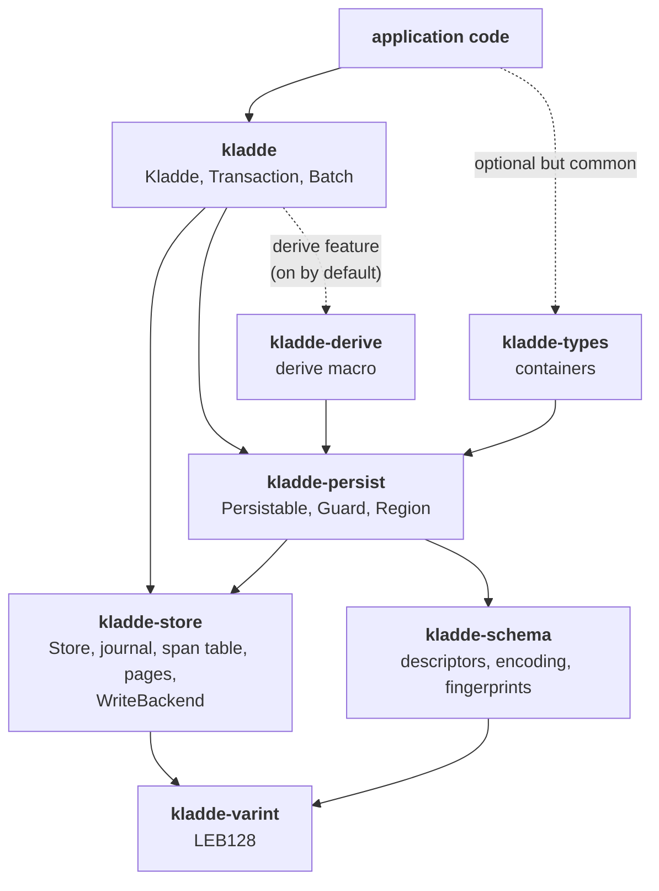

The workspace, what depends on what, and where the language-neutral half ends.

## The crates

| crate | role |
| --- | --- |
| `kladde-store` | the storage layer: the file, pages, the span table, the journal, the flush, and consolidation, behind the `WriteBackend` trait. Type-agnostic; knows nothing about serialization. |
| `kladde-persist` | the serialization layer: `Persistable`, `Bounded`, `Guard`, `Region`, `Encoder` and `Decoder`, the scalars, tuples, `Option`, `Box` and `Fixed`, cuts, and the schema binding. |
| `kladde-schema` | type descriptors, their canonical encoding, fingerprints, and the rules of nesting. Depends on nothing but `kladde-varint`. |
| `kladde-varint` | LEB128 varints and zigzag. |
| `kladde-types` | the built-in containers: vector, map, string, blob. The default collection, not a layer — it uses only the public API any library could. |
| `kladde-derive` | the `#[derive(Persistable)]` macro. Reached through `kladde`'s `derive` feature; applications do not depend on it directly. |
| `kladde` | the application-facing entry point: creating and opening files, the root value, transactions and batches. Re-exports the derive macro and everything a `Persistable` impl names, so an application needs this crate and nothing below it. |

Two more crates sit beside them, used by the measurements and nothing else: `kladde-svg`, an SVG drawing held as a durable value, with `svg-bench` among its binaries, and `kladde-bench`, with `text-bench`; together they drive the [evaluation](../evaluation/tools.md).

The dependency direction is strictly downward, and `kladde-store` deliberately depends on nothing but `kladde-varint` — it is usable on its own as a persistent store of one byte sequence, independently of anything above it.

## The parts

### `kladde-store` — the storage layer

Owns the file.
It implements everything [the implementation notes](../impl/) describe, and adds only what Rust needs: the `Backend` traits the layer above calls, the `Store` that implements them, and a `Storage` trait with two implementations, a real file and a byte vector in memory.
See [The store](store.md) for the Rust-specific half.

### `kladde-persist` — the serialization layer

Where types meet bytes.
`Persistable` and `Bounded`, the `Guard` counterpart, `Region` and the `Node` a container keeps for its children, the `Encoder` and `Decoder`, `Cut`, and the implementations for scalars, tuples, `Option`, `Box` and `Fixed`.
Knows about the store's `WriteBackend`; knows nothing about any particular container or derived type.

### `kladde-schema` — type descriptors

The Rust implementation of the [language-independent schema model](../spec/schema/).
It depends on neither the store nor `Persistable`, deliberately, because it must be portable and testable on its own; the binding between a Rust type and its descriptor lives one layer up, in `kladde-persist`.
See [Schema binding](schema-binding.md).

### `kladde-types` and `kladde-derive` — the type vocabulary

The built-in containers, and the macro that turns user types into backed ones.
Both build on `kladde-persist`, and neither depends on the other.

The macro is re-exported from `kladde`, not from `kladde-types`, so that an application can use the containers without the macro machinery and vice versa — and because generated code is rooted at `::kladde`, which is where the items it names are re-exported from.

### `kladde` — the entry point

`Kladde<T>` pairs a root value with a `Store`, and is what application code holds.
It writes the root's descriptor table and fingerprint into the file at creation, checks the fingerprint at open, and hands out guards, transactions, and batches.

## The seam

For anyone porting kladde, one boundary matters more than the rest.

**Below `kladde-persist`, the design is language-neutral.**
The span table, the journal, the flush, the consolidation policy, the schema model, and the encoding of values all translate more or less directly; they are documented in [Specification](../spec/) and [Implementation](../impl/) rather than here, and so are the regions and the containers' indexes that [Values and their positions](../impl/values.md) describes.

**At and above `kladde-persist`, the design is Rust-specific and should be redone.**

- `Persistable`/`Guard` exists because Rust cannot intercept a field assignment.
- `WriteBackend` takes `&self` because sibling guards share one backend by reborrow, which Rust's borrow checker otherwise forbids.
- `FIXED_SIZE` as an associated constant exists because Rust can compute field offsets at compile time.
  A language without compile-time constant folding will compute them some other way — probably once per type at startup, which is fine, but it changes the shape of the code.
- `Bounded` is a subtrait so that `Fixed<T>` fails to compile for a `T` without a fixed form; another language checks it however its type system allows.

A Python port should keep the storage layer almost verbatim and throw away the guards entirely, intercepting assignments with property hooks.
A C++ one might use proxy objects with `operator=`; a Java one might use bytecode enhancement, which is what db4o did.

## Cross-cutting concerns

**Crash consistency** is a property of the journal and the flush, and of the one rule a container must keep: every edit it makes, such as an element and its count, goes into one transaction ([ordering](../spec/journal.md#ordering)); the guards wrap every mutation in one.

**Schema evolution** touches the load path, the mutation path, and the flush, because a value read in a foreign schema must not then be written in the native one unless the file is upgraded; see [the specification](../spec/schema/evolution.md).
Until it exists, a file whose root fingerprint differs from the application's is refused at open.
